# 鸿鉴工具使用说明

本教程说明静态扫描与人工复核、静态扫描后的 AI 初判与手动深入调查、一键智能审计。流程二接续流程一的静态扫描结果，流程三从新建智能审计开始；结果在任务中心、风险中心和报告中心查看。

本文由正式揭榜提交包的工具使用说明 PDF 整理，保留操作步骤、20 张配图及提交版实测记录。截图和实测对应提交时版本；当前源码的一般操作说明见[面板操作手册](面板操作手册.md)。

## 开始前 准备并载入审计仓库

首次使用或更换项目时，先在系统设置中把待审计源码加入工作台，再创建审计任务。仓库已经显示“可用”且有已解析的 HEAD 时，可直接进入任务创建。

1. 点击左侧“系统设置”→“仓库与源码管理”。
2. 同步公开仓库：在“OpenHarmony 在线仓库目录”搜索仓库，点击“预览代码版本”，核对仓库与 Commit 后点击“下载并开始扫描”。下载完成后，仓库会出现在“已登记仓库与可用状态”列表，并自动生成静态扫描任务。
3. 登记本地仓库：如果源码根目录尚未配置，在“受控本地源码根目录”填写目录别名和服务器绝对路径，点击“验证并添加仓库”；随后点击该目录的“查找仓库”。在发现结果中选择目标仓库，核对路径后点击“登记并校验仓库”。
4. 在“已登记仓库与可用状态”中确认目标仓库显示“可用”，并有已解析的 HEAD。之后在“新建审计”→“仓库审计”中选择该仓库和目标 Commit。

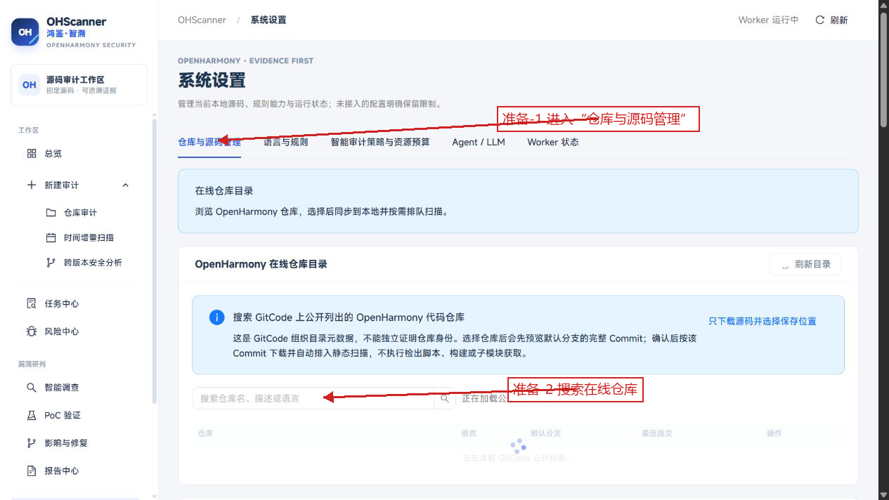

图 A：“仓库与源码管理”提供在线仓库搜索入口；选择仓库后可预览固定版本。

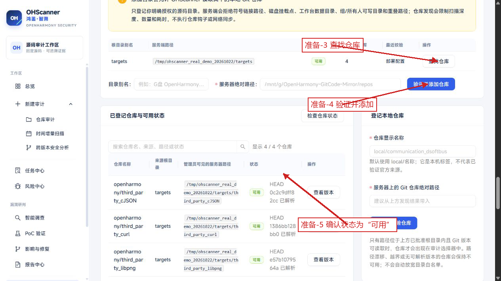

图 B：本地仓库可从已批准源码根目录查找并登记；列表中的“可用”和 HEAD 表示该仓库可供审计选择。

## 三种方式一览

| 方式 | 谁决定调查对象 | 核心操作 | 可查看的结果 |
|---|---|---|---|
| 静态扫描 + 人工复核 | 使用者逐条查看候选并记录复核 | 创建静态审计；查看源码证据；保存复核记录 | 扫描任务、候选证据、人工复核记录、报告 |
| 静态扫描 + AI 初判 + 手动深入调查 | AI 提供初判建议，使用者挑选候选并授权深入调查 | 静态扫描后在候选与复核中初判；按 AI 初判排名勾选，预览并授权深入追查 | 扫描任务、AI 初判操作、深入调查操作及结果 |
| 一键智能审计 | 创建任务时授权，由系统按策略推进 | 创建智能审计并允许深入追查；确认授权范围 | 扫描任务、AI 初判、符合策略条件的深入调查及报告 |

三种流程使用同一仓库和固定 Commit 时，任务中心中的版本标识可用于对照结果。智能审计开始前，应在系统设置中完成模型服务配置。

## 流程一 静态扫描与人工复核

此流程由本地静态检测器生成候选，使用者查看每条候选的规则与源码位置，并保存人工复核记录。

### 1 创建静态审计

1. 点击左侧“新建审计”下的“仓库审计”。
2. 在“本次审计方式”选择“静态审计”。
3. 选择已登记仓库、审计版本及扫描路径。
4. 点击页面下方“开始静态审计”。

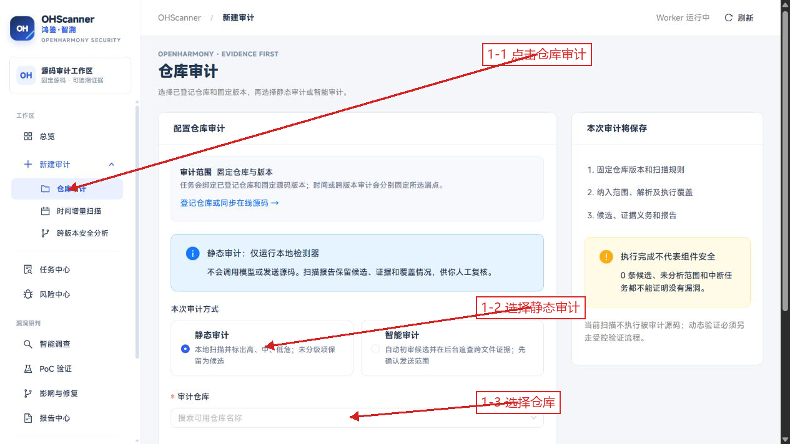

图 1：红色箭头标出审计方式和仓库选择位置。提交后生成固定仓库版本的扫描任务。

### 2 在任务中心打开扫描任务

1. 点击左侧“任务中心”。
2. 在“源码扫描”列表中找到刚创建的任务。
3. 点击该行的“查看任务”。
4. 等待任务状态变为完成，再进入任务详情。

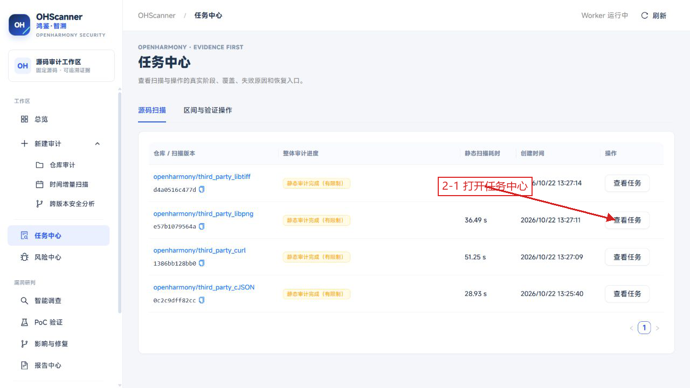

图 2：任务中心列出扫描任务及其状态；打开对应行可进入任务详情。

### 3 核对版本和解析范围

在任务详情中查看任务状态、Commit、Git Tree、纳入路径以及文件和语言解析统计。确认打开的是本次任务后，再查看扫描结果。

图 3：任务详情展示固定版本、任务状态及扫描信息。

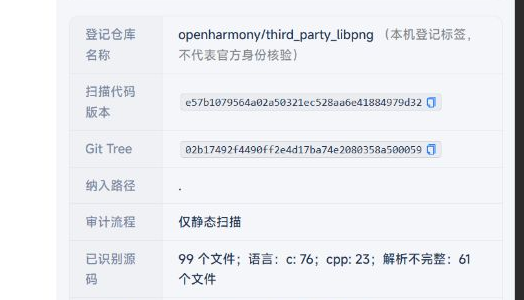

图 4：解析统计用于查看本次任务覆盖的代码文件与语言信息。

### 4 查看候选和源码证据

1. 点击左侧“风险中心”。
2. 使用仓库、风险等级或研判状态筛选候选。
3. 在候选列表选择目标记录，查看规则、Commit、文件路径、代码行和源码片段。

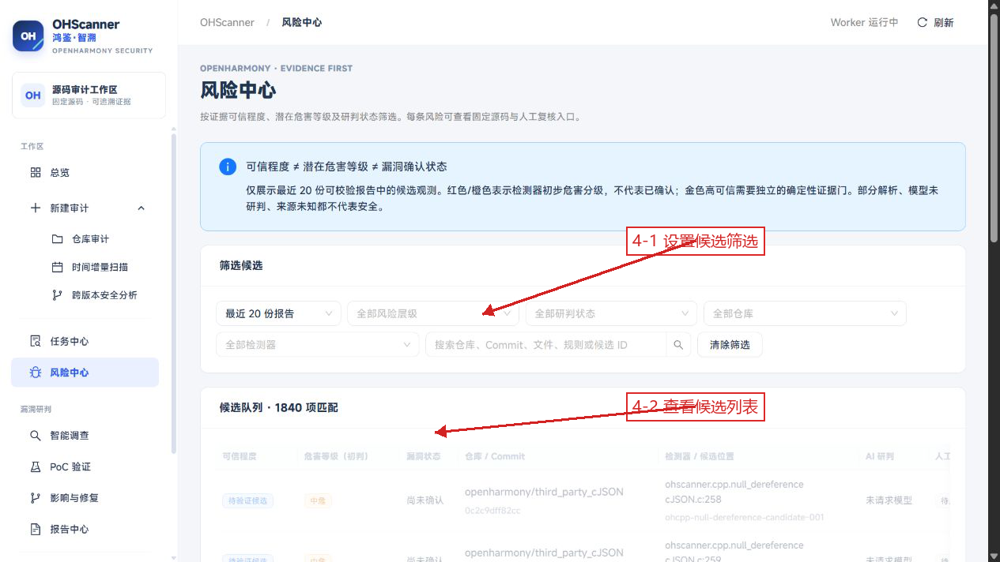

图 5：设置筛选条件后，候选列表显示匹配记录及候选数量。

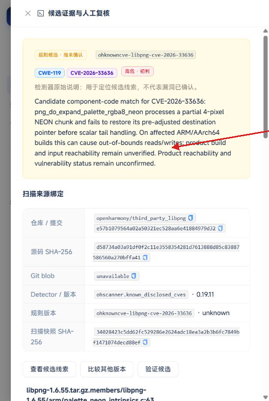

图 6：候选详情提供规则标识、固定版本和源码位置等证据字段。

### 5 保存人工复核

1. 在候选详情找到“添加人工复核”区域。
2. 选择复核状态，填写复核人和复核依据。
3. 点击“保存追加记录”。
4. 返回候选列表，查看该候选更新后的复核状态。

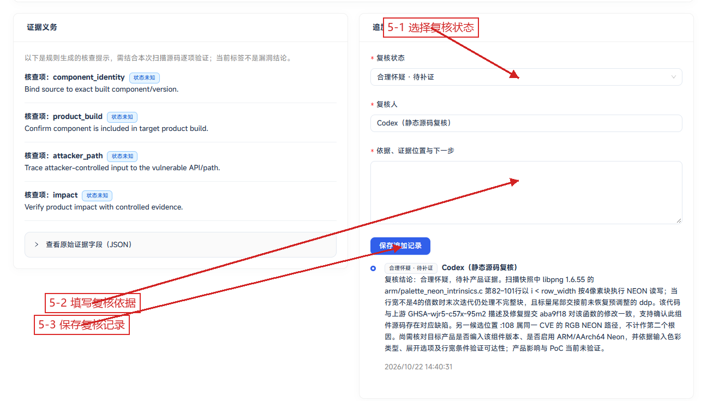

图 7：人工复核表单用于记录判断状态、复核人及依据。

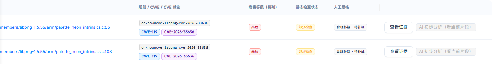

图 8：保存后可在候选列表查看复核状态。

本流程输出：静态扫描任务、候选及源码证据、人工复核记录和扫描报告。报告可在“报告中心”按仓库版本定位。

## 流程二 静态扫描后 AI 初判与手动深入调查

完成流程一的静态扫描后，可直接在已有任务上继续进行 AI 初判。查看初判排名并勾选目标候选后，再预览发送内容、授权深入追查；一键智能审计见流程三。

### 1 在静态扫描任务中打开候选与复核

1. 点击“任务中心”→“源码扫描”，找到流程一完成的静态扫描任务，点击“查看详情”。
2. 核对仓库、固定 Commit 和扫描状态，然后向下滚动到结果页签，点击“候选与复核”。
3. 在候选列表左侧勾选需要初判的条目，将分析方式设为“AI 初步分析（看当前片段）”。

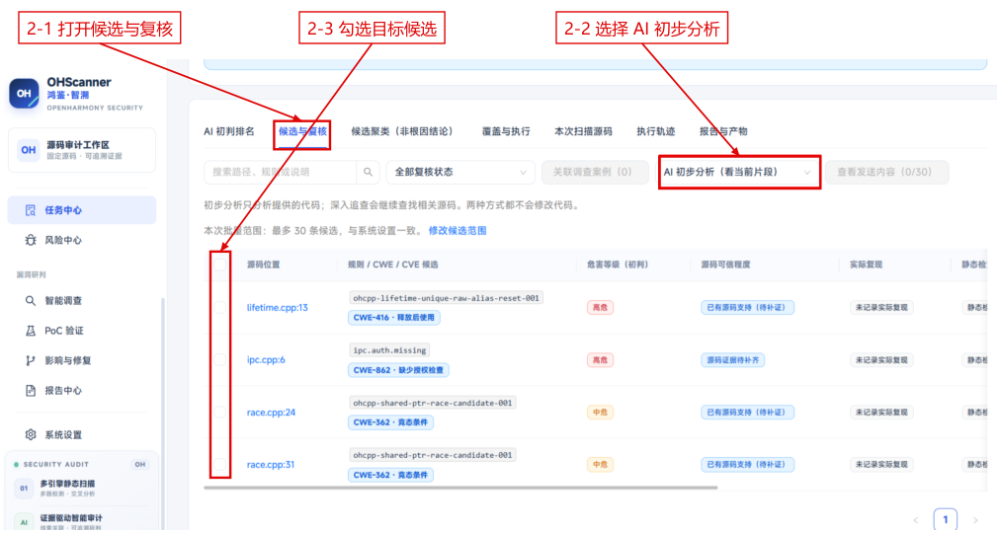

图 9：静态扫描完成后，在任务详情下方进入“候选与复核”，勾选候选并选择 AI 初步分析。

### 2 预览发送内容并授权 AI 初判

勾选候选后，点击“查看发送内容”。在预览中核对本次候选、模型、固定版本和发送的代码片段，再按弹窗提示确认授权。初步分析仅分析提供的当前代码片段；等待初判操作完成后，进入“AI 初判排名”。

### 3 查看 AI 初判排名并勾选候选组

返回同一扫描任务的详情页，向下滚动并点击“AI 初判排名”。查看每组的调查优先级、初判与推荐理由；需要核对具体内容时，点击该组右侧“查看初判”。初判和排序用于选择复核对象，不能直接视为漏洞确认。

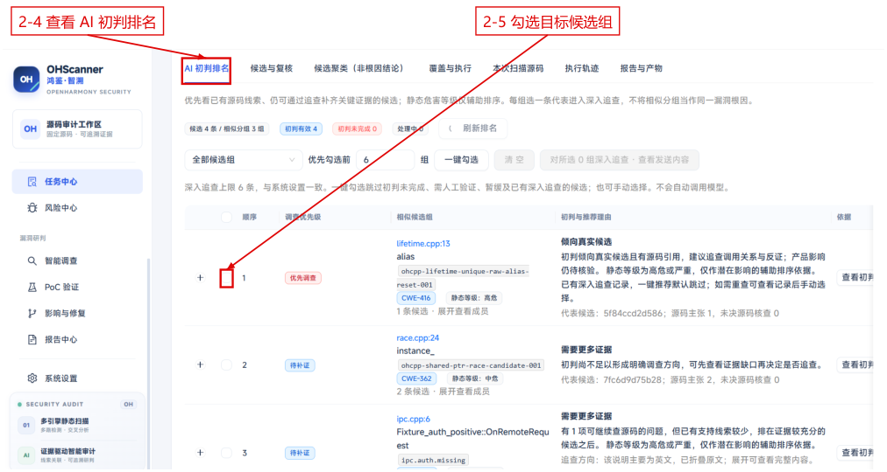

图 10：初判完成后，排名页显示候选组、调查优先级及推荐理由，可逐组查看初判并手动勾选。

可手动勾选候选组，也可设置“优先勾选前”的组数后点击“一键勾选”。一键勾选会跳过初判未完成、需人工验证、暂缓及已有深入追查记录的候选；需要重查时可先查看已有记录，再手动选择。

### 4 预览并授权深入追查

勾选后，点击“对所选 N 组深入追查 · 查看发送内容”（N 为实际选中组数）。在预览中核对候选清单、模型、固定 Commit、初始代码上下文与只读工具范围，按弹窗提示确认后排队。深入追查会继续查找相关源码和证据，形成独立的智能调查操作。

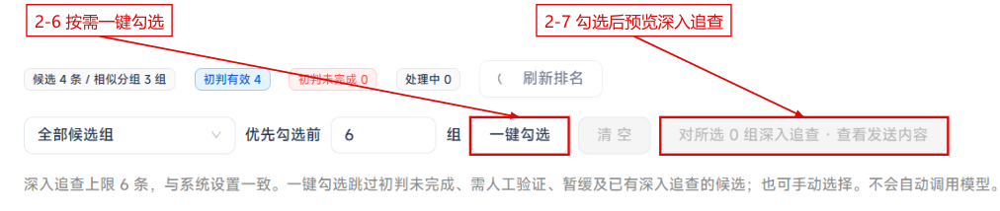

图 11：排名页顶部提供选择与发送内容预览入口。截图为未选中状态；选中候选组后，深入追查按钮才可用。

### 5 在区间与验证操作中查看智能调查

打开“任务中心”→“区间与验证操作”，找到对应的“智能调查”记录。按任务编号、创建时间和状态核对本次操作，点击该条记录右侧“查看”。多条候选形成多条记录时，可逐条打开核对。

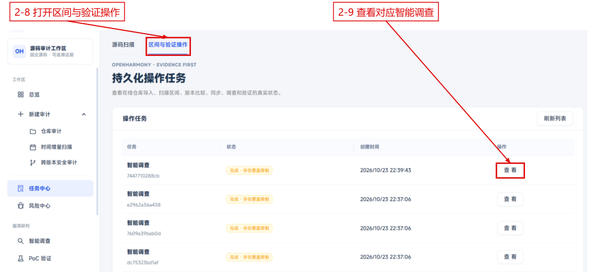

图 12：区间与验证操作列表显示各条智能调查及状态，点击“查看”进入操作详情。

### 6 向下查看 AI 证据追踪研判

在展开的操作详情中继续向下滚动，查看“AI 研判概览”和“智能调查研判报告”，核对模型分诊倾向、待复核候选状态、固定源码位置及固定提交。继续向下查看源码摘录、追踪研判记录、证据缺口和限制与失败详情。

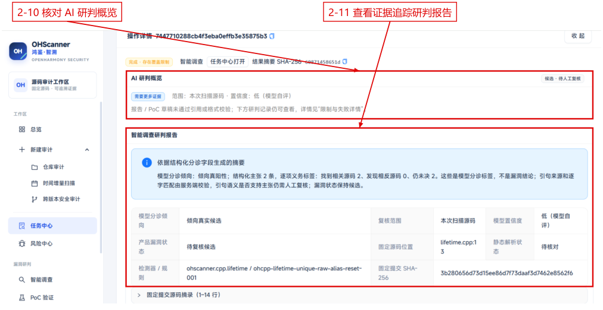

图 13：智能调查详情展示研判概览与报告；向下可继续查看源码、证据追踪记录及限制。图中结果仍为待人工复核候选。

本流程输出：原静态扫描任务、AI 初判及排名、人工选择并授权的智能调查记录，以及对应的源码证据、研判结果和限制。需要归档时，可在“报告中心”按仓库版本查看报告。

## 流程三 一键智能审计

此流程在创建任务时确认审计范围和智能审计授权。系统完成静态扫描与 AI 初判后，按任务策略推进符合条件的深入调查。

### 1 配置智能审计范围

1. 点击“新建审计”→“仓库审计”。
2. 选择“智能审计”。
3. 选择仓库、Commit 和纳入路径。
4. 展开“高级范围与规则设置”，保持“允许深入追查”勾选。
5. 点击“预览授权并开始智能审计”。

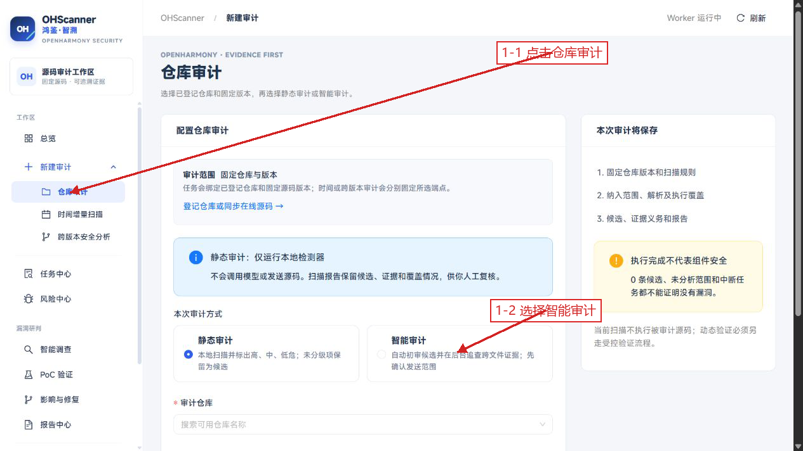

图 14：选择智能审计并配置仓库版本后，继续查看授权预览。

### 2 确认任务授权

在“智能审计：确认模型外发范围”弹窗中查看模型名称、固定来源、候选上限和源码范围。确认后点击“同意范围并开始智能审计”。任务按所选配置运行初判，并对符合策略条件的候选推进深入调查。

### 3 跟踪任务阶段

1. 点击左侧“任务中心”，在“源码扫描”列表打开对应仓库任务。
2. 在任务详情核对任务状态、Commit 和解析覆盖。
3. 查看任务详情中的阶段进度；深入调查操作可在“区间与验证操作”中单独打开。

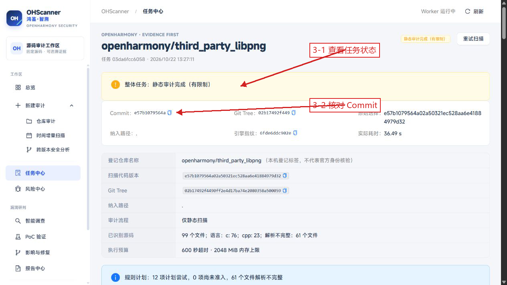

图 15：任务详情用于确认任务对应的仓库版本及运行状态。

图 16：任务详情显示代码文件和解析覆盖统计。

### 4 查看候选 调查结果与报告

1. 在“风险中心”按仓库和 Commit 定位本次候选，打开记录查看源码证据。
2. 在“任务中心”→“区间与验证操作”查看 AI 初判和深入调查记录。
3. 在“报告中心”按仓库版本打开报告或下载所需文件。

图 17：风险中心提供候选筛选和结果列表。

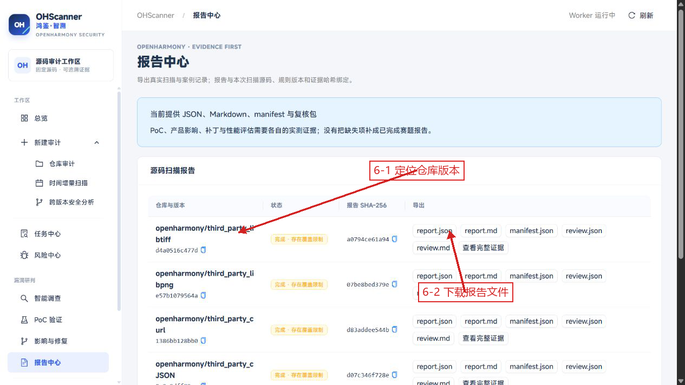

图 18：报告中心提供 JSON、Markdown、清单及复核材料等导出入口。

本流程输出：关联同一审计任务的扫描结果、AI 初判记录、符合策略条件的深入调查结果及报告材料。

## 三种流程的结果入口

| 流程 | 扫描任务 | 候选与源码证据 | AI 操作记录 | 报告 |
|---|---|---|---|---|
| 静态扫描 + 人工复核 | 任务中心 → 源码扫描 | 风险中心 | — | 报告中心 |
| AI 初判 + 手动深入调查 | 任务中心 → 源码扫描 | 任务详情中的候选与复核、AI 初判排名；风险中心 | 任务中心 → 区间与验证操作 | 报告中心 |
| 一键智能审计 | 任务中心 → 源码扫描 | 风险中心 | 任务中心 → 区间与验证操作 | 报告中心 |

## 提交版 libpng 实测结果

以下为原提交说明记录的 **2026-10-23 历史实测**，不是本次 Markdown 转换重新执行的结果。

测试对象为 `openharmony/third_party_libpng`，固定 Commit 为 `e57b1079564a02a50321ec528aa6e41884979d32`，模型为 DeepSeek Flash。

| 流程 | 结果 |
|---|---|
| 静态扫描 + 人工复核 | 任务 `45c38e` 扫描完成（有限制），纳入 99 个源码文件并生成 68 个候选；本轮没有保存人工复核记录。 |
| 本地排序 + 批量 AI 初判 | 任务 `0b56bb` 的排序页列出 68 组，选中 0 组；批量 AI 初判按钮为禁用状态，因此未发送候选源码、未产生 AI 初判结果。 |
| 一键智能审计 | 任务 `be871c` 的 AI 初判完成 1/1，深入追查 0/0（未触发）。单次输出上限为 8,192 tokens，本次输入 4,766、输出 5,143、合计 9,909 tokens。模型建议为 `likely_false_positive`，结果仍保留为候选，确认漏洞数为 0。 |

原说明记录的渐进策略标准配置为：单次输出 8,192 tokens、每任务累计输出 100,000 tokens、累计输入 400,000 tokens、最多 120 次模型请求。本次一键审计的 R1 用量栏显示单次输出上限为 8,192、平台累计上限为“无”。

报告中记录的 3,618 tokens 和 32,586 tokens 分别是历史实验的单次与多次调用实测用量，不是单次输出限额。
