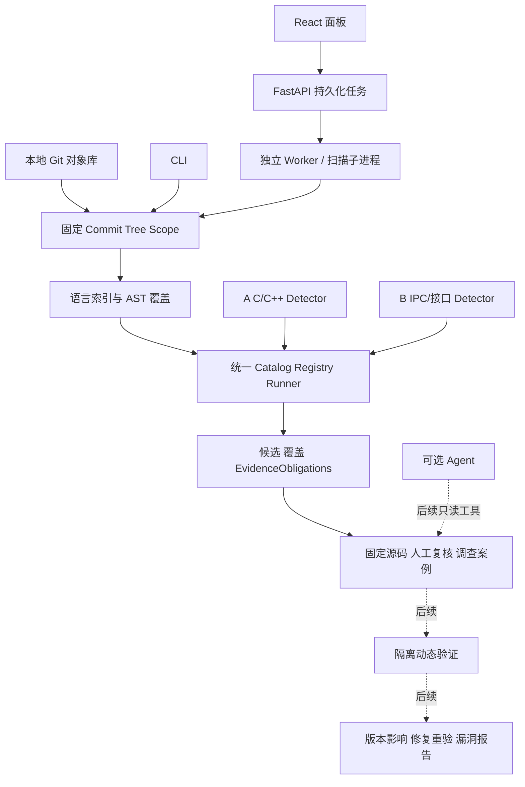

# 架构、模块边界与公共协议

更新：2026-10-13。当前实现与目标分开；源码字段以代码和回归为准。

## 一套内核，多个入口

Web 与 CLI 共用 execution.py；不得各造扫描器。历史工具对照与生产 Detector 分开。
未来 GitSyncService 独立显式联网；扫描仍只读本地固定对象，不隐式 fetch。

## 模块与九层目标

| 层 / 模块 | 代码入口 | 当前与后续边界 |
|---|---|---|
| L0 来源/版本 | git_source.py、workbench/service.py | 本地登记、ref→SHA、对象核验已有；远程同步/Manifest 待做 |
| L1 索引 | indexing.py、frontend.py、parser | Tree-sitter 轻量 AST；不是完整类型/CFG/跨过程证明 |
| L2–L3 检测 | detectors/cpp、interface、runner.py | 已注册窄家族研究 Detector；语义增强由 A/B 做 |
| L4 证据/复核 | execution.py、workbench/service/store | 覆盖侧车、义务、源码绑定、追加复核已有；自动根因归并待评估 |
| L5 验证 | 家族 Harness / 后续验证 Worker | 研究资产存在；统一隔离产品服务未完成 |
| L6 分类 | candidate CWE / 后续 CVE 绑定 | 关联须有来源，不能用名称猜 CVE 或严重度 |
| L7 影响/修复 | 后续版本服务、A 研究 sidecar | 同根因多版本与补丁重验需产品化，文本相同不等于漏洞成立 |
| L8 交付 | JSON/MD、Web 导出、后续完整漏洞报告 | 原始报告与人工审计包已有；竞赛闭环不完整 |

M0–M4 是研发里程碑，不替代上述功能层。当前是 M2 公共工程 + Web 快照/复核已实现，
A/B 继续提升算法，M3 评价/可选 Agent 与 M4 闭环仍需验收。

## 当前实际契约

本工作台公共代码仍为 ToolRunResult/ToolDiagnostic v1 + 覆盖/来源侧车。
主要类型在 src/ohscanner/contracts.py：
- ScanRequest：目标 repository、full commit、snapshot、profile、provenance。
- SourceUnit：规范相对路径、language、text、SHA-256、parse_status。
- ScanContext：排序/去重 SourceUnits 与 shared_facts。
- DetectorFinding：位置、rule/message、候选 CWE、EvidenceObligations；可选 consequence 仍是候选。
- DetectorRun：ID/version/status、analyzed_files/findings/limitations、可选 file_outcomes。
- Detector：ID/version、supported_languages/required_facts、detect(context, units)；精确签名读代码。

Registry 显式批准 factory，浏览器不能提供 Python 模块名或 Shell 命令。
Catalog 当前三个研究检测器：ohscanner.cpp.lifetime、ohscanner.cpp.shared_ptr_race、
ohscanner.interface.ipc。example Detector 不是正式漏洞检测能力。

状态必须分离：
- Web task：queued/running/completed_with_limitations/failed/cancelled/timed_out/interrupted 等。
- Detector execution：completed/blocked/failed。
- 文件覆盖：complete/partial/not_analyzed/failed；parse 状态另记。
- 人工复核与漏洞证据等级：不由 task completed 决定。

经过来源/范围验证的局部候选及义务不会因整体 blocked 而消失。
无 file_outcomes 的 legacy blocked 自报覆盖最多为 partial，不能推成 complete。
来源至少绑定 repository/full commit/tree/snapshot/file/blob/source SHA、
detector ID/version/rule/scope/profile；缺什么就记录缺口。

## v1 → v2：最终迁移方向与当前差距

目标：新结果统一 v2，兼容读取旧 v1，不长期维护两套独立引擎。
B 48bce9e 已有 v2 逐 diagnostic 来源；A 最新 e27f744 通过合并接口线也支持 v1/v2。
这不表示负责人公共版本已经迁移，更不表示两线 runner 语义等价。

负责人单独收口：
1. 冻结 v2 字段与覆盖/义务语义，复用可审查实现而非重造。
2. 保留 v1 读取，缺失来源标 unbound/unknown，不猜测补齐为 verified。
3. 统一内部表示和转换层；逐步让 CLI/Web/报告输出 v2。
4. 回归 malformed payload、证据混用、partial/blocked、旧报告、source hash、
   新旧候选集合和报告展示。迁移不顺手改检测算法。
5. 同时复用 B M1/M2 检测修复时独立提交与对照，方便定位集合变化。

这是当前目标，不是已完成迁移；在迁移验收前公共产品保持既有 v1 行为。

## 证据门与边界

默认 candidate/unassessed；partial/failed/未执行是 unknown，不是 safe 或 miss。
确认/报告需要固定目标、真实入口/攻击者控制或权限边界、可达敏感操作、
必要触发条件及具体 CIA 影响，记录可复核证据和仍未知项。
满足证据门后应升级并交付 PoC、影响/修复/报告，不能永久停留在 candidate。

当前工作台整任务子进程有取消、截止、地址空间/CPU/输出限制，
不是逐 Detector 沙箱，不是执行不可信构建/PoC 的隔离环境。
超时不发布残缺候选包；缺失分析保持 unknown。
数据库中的报告 hash、报告内 Markdown hash 与固定 blob 清单防意外混用，
不保证主机/数据库被完全控制后的完整性。

## 扩展原则

新源码同步、区间/版本、Agent、验证模块复用同一任务/证据服务。
文件级 AST 缓存可用 blob+parser+配置；跨文件语义要绑定依赖/宏/编译配置。
2000 文件/32MiB 总源码/1MiB blob 是当前限制，不直接移除来冒充全系统覆盖。
扩容先 batch Git、分片/聚合与覆盖不变性实验，再测 wall/RSS。
