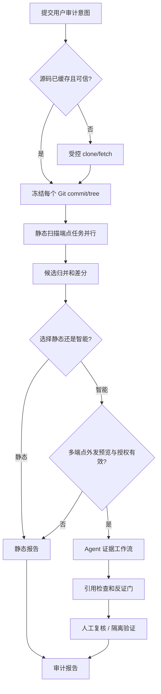

# OHScanner 工程实施 RFC — 三审计模式统一 DAG、Agent 深度追查与证据裁决

> 2026-10-20。目标架构；当前 PR 的代码只交付 P0，不能将下述 P1～P6 写为已上线。

## A. 刚核对的主线证据

- `src/workbench/api.py`：单仓 `/audit-plans`、`/scans` 已有 `audit_mode/auto_triage/max_triage_candidates/max_r2_candidates/max_cost_usd`、源外发预览指纹、任务级不可变授权。
- `src/workbench/smart_audit.py`：已有候选风险分层、授权后有界 R1 与条件 R2；目前后端选择最多 5 条，R2 最多 2 步，基于证据义务与严重度排序。R0 人工静态复核与模型输出相互独立。
- `src/workbench/operations_api.py` + `operations.py`：时间区间/跨分支/矩阵会创建多个静态端点扫描；请求模型仅有 `audit_mode`，**没有与任务级自动授权对应的多端点 consent/operation DAG**。
- `src/workbench/agent.py`：OpenAI Responses-compatible Provider、固定提交代码摘录和有界工具查找、脱敏和引用约束；模型不能写 Git 或修改人工确认结果。
- `web/src/features/audits/{RepositoryAudit,OperationForms}.tsx`：仓库表单已有自动研判勾选；时间、版本表单文字明确需要扫描后再按候选授权，未自动。
- `web/src/features/workbench/WorkspaceViews.tsx`：风险中心列表、筛选、报告已存在；本 PR 对风险展示进行增量改造。
- `src/workbench/operations.py:execute`：Git 显式同步只下载固定来源对象，不自动扫描；源准备→审计任务联动缺失。

## B. 目标数据合同

```json
{
  "audit_id": "uuid",
  "audit_kind": "snapshot | time_range | branch_compare | version_matrix",
  "analysis_mode": "static | intelligent",
  "source_plan": {
    "repo_id": "immutable logical repository identity",
    "source_manifest_sha256": "sha256",
    "git_objects": [{"commit": "40/64-hex", "tree": "hex", "role": "baseline"}],
    "scope": {"include_paths": ["."], "build_profile_sha256": null}
  },
  "detector_plan": {"approved_detectors": [], "catalog_sha256": "sha256"},
  "agent_plan": {
    "provider_fingerprint": "sha256",
    "policy_version": "version",
    "candidate_budget": 20,
    "deep_research_budget": 6,
    "max_steps_per_candidate": 8,
    "cost_cap_usd": "25.00",
    "consent_sha256": "sha256",
    "consent_status": "not_requested | approved | revoked | expired"
  },
  "stages": [],
  "report_artifacts": []
}
```

此 JSON 是**目标模型，不是当前 API 的真实响应**。持久化应将 `audit_operation`/扫描/Agent 任务、代码源、费用、评审、PoC、报告各自拥有稳定 ID 和不可变 hash；所有外发数据的允许范围需要准确绑定到多个固定 Git 对象。不同端点不可把“一个 repo SHA”套到整个 OpenHarmony 多仓产品版本中。

## C. DAG/状态机



- **快照**：一个 ScanJob；Agent 根据候选预算自动启动。
- **时间区间/跨分支**：baseline/endpoint 各有 ScanJob；比较产生 `candidate_diff`；Agent 优先读取「新增风险、疑似同一根因、补丁附近」候选，能够读取两个已授权快照。
- **版本矩阵**：至少两个 ScanJob；优先展示补丁贯穿各版本的根因状态，禁止用候选消失自动计算受影响版本。
- **异常恢复**：下载或扫描异常时对应阶段失败；仅已完成静态结果可浏览；Agent 配置失效、预算不足或撤权不会丢静态报告。完整取消/重试需要根据原始 commit、计划 fingerprint 和授权快照幂等处理。
- **服务重启**：Worker 从持久状态恢复，禁止自动重发可能成功但响应未知的模型外发请求（避免重复扣费/泄漏）。

## D. 必须新增的后端端点（建议）

| 方法 | 路由 | 语义 |
|---|---|---|
| GET | `/api/v1/repository-catalog` | 分页 OpenHarmony 在线目录；元数据仅来自经校验来源 |
| POST | `/api/v1/repositories/preparations/preview` | 检查磁盘配额/allowlist/已缓存对象、待 clone/fetch |
| POST | `/api/v1/audits/preview` | 三种审计统一计划预览，生成完整端点/agent disclosure manifest |
| POST | `/api/v1/audits` | 原子提交审核过的计划和授权（或静态无授权） |
| GET | `/api/v1/audits/{id}` | 联合下载/静态/差分/Agent/报告状态 |
| GET | `/api/v1/audits/{id}/risks` | 权威风险详情与筛选；严重度/可信度/验证分离 |
| GET | `/api/v1/audits/{id}/agent/trace` | 逐候选 Evidence Graph/工具输入输出 hash、预算 |
| POST | `/api/v1/audits/{id}/review` | 人工追加复核记录，严禁静态/模型覆盖 |
| POST | `/api/v1/audits/{id}/reports` | 把已验证证据渲染为用户版+技术版报告 |

避免破坏旧 `/api/v1/scans`、`/operations/*`；适配层可先将现有操作包成 `AuditOperation` 并保持深链。前端不能只传 `audit_mode=standard_review` 就显示“自动 Agent”；必须服务器生成并保存对应任务级实际授权。

## E. Agent 多步工具治理与创新

### E1. 角色状态机

`candidate-router -> hypothesis-builder -> source-navigator -> counterexample-searcher -> disclosure-checker -> impact-evaluator -> evidence-judge -> report-writer`。每阶段既可用相同模型角色化 prompt，也可配置不同模型，但“强弱模型切换”不能被计为算法创新本身。

**必须设置反证目标**：例如 IPC 权限检查是否发生在上游；危险 `memcpy` 参数是否在 caller 已被约束；libpng/curl 根因是否已被供应商补丁覆盖；假阳性解释如果无法由固定源码反证，只能留下 `unknown`。每次工具结果提供证据 ID、Git blob/SHA、文件/行和 parser 状态。

### E2. 工具权限

只读且命中仓库白名单的 Git blob/AST/符号索引、有限跨文件检索、固定历史 patch diff、固定构建/宏配置。每个工具都有 byte_limit / file_limit / step_limit / wall_limit；模型只能传受控符号/文件相对路径，不能发明任意系统绝对路径、开放网络 URL 或执行 Shell。只允许读取 consent manifest 中明确批准的数据域；范围扩大必须重新审批。Prompt Injection（源代码注释要求模型上传秘钥/改变规则）必须作为负例。

### E3. 分诊决策与写入约束

决定 `candidate_risk_tier` 的代码路径必须是**确定性证据门**。Agent 输出 `hypothesis`、`cited_support`、`cited_counterevidence`、`unknowns`、`severity_recommendation`、`next_steps`；服务校验引用来源是否存在、是否为当前 snapshot/文件/行，再交给证据门。只有人工独立确认 + 必要运行环境证据才能将 **产品** 状态升级为 confirmed；Agent 的 `likely_true_positive` 和官方 CVE 字符串匹配绝不能直接写 `validated_vulnerability=1`。

### E4. N-day/1-day 证据关系

`CVE/disclosure -> affected upstream version -> vendor vendoring/build profile -> vulnerable code hash -> fixed patch diff -> current target code -> root-cause status -> reachability`。允许“与已披露漏洞代码根因高度一致”的**高可信候选**（依靠严格证据门），但产品环境与外部触发可能仍 unknown。显式记录公告日期、补丁日期、被审计 Commit 时间，不混淆 1-day 为单纯扫描到旧版。

### E5. 验证与 PoC

Agent 可以计划：组件级输入、控制输入、Sanitizer、修复后重测和预期观测；执行必须由**预审注册 Harness/容器最小权限服务**在用户授权下完成。状态区分 `not_planned/planned/not_run/ran_blocked/observed_component_mechanism/confirmed_product_impact`。不允许模型凭空编造 PoC 成功、运行输出或影响版本；不允许给 Agent 通用 Shell、远程利用扫描或未经许可的目标访问。

## F. 真实用户版风险报告 Schema（建议）

```json
{
  "candidate_id": "...",
  "identity": {"repository": "openharmony/...", "commit": "...", "source_sha256": "...", "report_sha256": "..."},
  "labels": {
    "confidence": "high_confidence_candidate | further_validation | unknown_source_binding",
    "severity_preliminary": "critical | high | medium | low | info | unknown",
    "vulnerability_state": "candidate",
    "agent_status": "completed | partially_completed | not_requested"
  },
  "technical": {
    "cwe": [],
    "cve_matches": [],
    "entry": null, "source": null, "guards": [], "sink": null,
    "root_cause": null, "related_functions": [], "counterevidence": []
  },
  "analysis": {"evidence_ids": [], "unknowns": [], "suggested_fix": [], "impact_conditions": []},
  "poc": {"status": "not_run", "plan": null, "run_manifest_sha256": null, "observed": null},
  "human_review": {"state": "unassessed", "review_id": null},
  "provenance": {"model_fingerprint": "...", "prompt_version": "...", "tool_policy": "..."}
}
```

这是用于未来新建的结构化聚合对象；不替代已有静态原始 JSON/manifest。Report Writer 只能引用已有确定性字段，任何没有来源支持的影响措辞都应标为待核实。

## G. 队列优先级与预算

初始优先队列按 `可校验来源 → 根因义务数量 → 潜在危害 → 公开补丁线索 → diff 新增` 排序。预算不应一刀切 5 条；推荐管理员控制 `candidate_limit=20`、`deep_limit=6`、`tool_steps=8`、`cost_cap_usd=25`，**这些是下一期目标参数，目前后端硬上限仍为 5，且当前 R2 2 步，修改必须同时核对 token/费用/consent 计算与 Worker 时限**。费用失败对单个 candidate 局部降级；可重放去重键：`audit+report+candidate+provider+tool_policy+consent`。

## H. 顺序实施与自动化验收

### P1 — 源码准备（建议给平台线）

开发 catalog 服务、下载根目录设置、目录 allowlist、Git clone/fetch DAG、镜像重复命名和容量检查。测试：Git SSRF/重定向/submodule 拒绝、目录逃逸、两个仓库同名/不同 Commit 幂等、超时磁盘不足重试。浏览器从「未下载」到「可扫描」完成一次任务。

### P2 — 三审计方式的智能共用编排（平台线最优先）

统一计划预览/授权；时间/分支/矩阵持有各端点 scan_id 的授权 snapshot，自动排队 AI，不要求用户逐条点。要先写高精度 4×2（快照、日期、跨分支、矩阵 × 静态/智能）测试，外加 Provider 未配置、费用不足、撤权、固定 SHA 漂移、解析 partial 等负例。**不允许仅更改前端文案宣布已实现。**

### P3 — Agent 高价值深挖（Agent 线）

跨文件 symbol/caller/guard/related-file 工具和证据图，反证/补丁角色，保留无网络/无写权限。用 A UAF、B IPC 调用者、D 敏感日志和历史 CVE、C Ark Runtime 源语义四组真实样本验证，重点测少误报及真实证据完成率；严禁要求 C blocked 的解析结果自动升级高可信。

### P4 — 高可信证据门与可解释风险（平台+审计）

新增历史披露匹配的独立证据门，保持现有 human R0 gate；不得用 LLM 自评阈值替代。严重度需有来源/CVSS 条件标记；人工状态不可被 Agent 写入。可复核风险详情一屏联通静态源码、AI 路径、反证、人工记录。

### P5 — 报告与安全 PoC（Agent+验证）

结构化 claim→evidence 图导出中文报告；PoC Planner、已注册 Harness 的安全申请和真实观测状态；手动确认使用双层约束。报告导出应有 JSON/MD/HTML 和 manifest hash，PDF 可在最后迭代。跑一个历史 CVE vulnerable/fixed/safe 三对照且不能伪造受影响产品。

### P6 — 实验与交付（全员）

按 CVE 修复家族拆分开发/冻结 holdout；记录每组 root cause precision/recall、静态候选召回、Agent 纠误率、证据引用真伪、人工时间、Token/cost/wall/RSS；R0 静态人工、R1 单轮、R2 单工具、R3 多角色反证工作流同样本对照。数据来源/未覆盖/unknown 单列，不拿训练/调参样本计算独立准确率。

## I. PR 验收必须回报的结果

每次 PR 描述至少包含：`main` 基准 SHA、修改文件、前端 TypeScript/Node test/build、Python tests、Git diff check、隔离数据库真实 API→Worker→页面流程、静态零模型外发验收、授权指纹改变被拒、Agent 失败静态报告保留、已确认产品漏洞数与验证证据。未实测一律填“未运行/未知”，不能写“通过”。

**当前 P0 PR 的验收声明仅限风险分级展示 + 单仓自动追查表单引导 + 回归测试与文档。它不会把时间或跨版本接口变成真正的自动 Agent，也不会写入漏洞已确认。**
