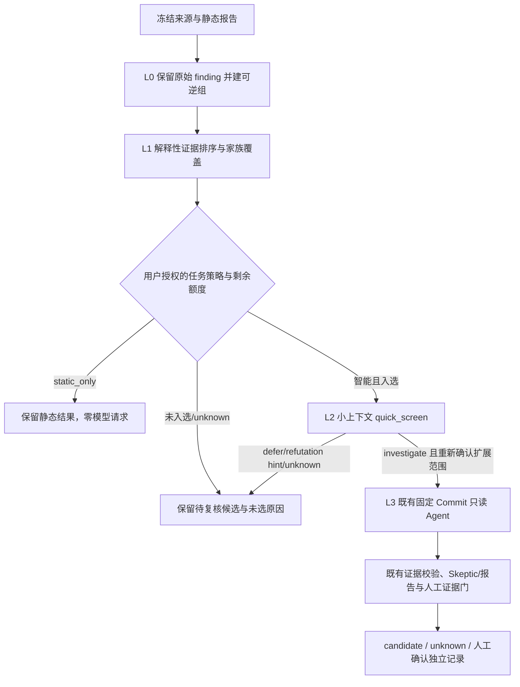

# OHScanner 渐进式智能审计架构与实施状态

## 2026-10-22 最新主线预算策略集成复核

集成树 `feat/progressive-phase5-main-latest-20261022` 基于 `origin/main@361eb142612d2795cef1d4e3f8ed81a64ced8c7f`，Phase 5 增量已提交、尚未推送。逐段整合保留 #62/#63 的主线策略结构与候选范围约束，并叠加 Phase 5 的任务级策略快照、L2/L3 共享用量账本及 Agent 额度继承。原 `feat/progressive-phase5-main-e2e-20261022` dirty worktree 与队友目录未动。

设置页一次配置标准预设或自定义策略；单轮输出、单次审计输入/累计输出、模型请求数、候选范围、工具步数、并发和时长进入服务端 policy revision/hash。Agent 普通单项/批量/配对预览从同一快照派生限额，批量候选上限也使用同一快照；L2 单请求受策略约束，L3 共享父审计账本；授权预览绑定冻结策略，变更只影响新任务。实际隔离浏览器页 `127.0.0.1:18879/#/settings/policy` 可见全部策略值；API 默认标准策略单轮 1200、输入 400000、累计输出 100000、请求 120、时长 1800。隔离实例 Provider 未配置，无模型调用或扫描。

验证结果：`test_progressive_triage` 51/51；Agent/策略/候选范围定向组 41/41；深度批次 5/5；Web Node 137/137，TS 与生产构建通过。另一个后端组合 46/82 通过，其余 36 项的共同阻断是 WSL `git` 命令缺失，测试夹具无法初始化；全仓 Python 结果不能标为通过。当前 Phase 5 仍缺三类浏览器 Worker E2E、独立冻结 holdout/消融、全仓 Python 回归、真实 Provider 应用级 L2/L3；mock 和协议冒烟不等于产品准确率或漏洞确认。`validated_vulnerability=0`。分支已推送，Draft PR #65（https://github.com/unpredictablexss-lang/CyberSecurity-Innovation-Audit/pull/65）为 open/draft，未合并且未标 Ready。


## 2026-10-22 Phase 5 验证续记（当前状态）

重新 fetch 后，`origin/main=361eb142612d2795cef1d4e3f8ed81a64ced8c7f`，参考分支 `work/pr38-44-e2e-followup-20261020=b469f623b34ca5fd752ab72de66e53927b9dcd9c`，仍是 main 的祖先。当前开发分支 `feat/progressive-phase5-main-e2e-20261022` 的 HEAD 是 `a3ae034bc8c1015da9f4a34c458ab344410b6dcf`，相对 main 为 ahead 1 / behind 9；工作树有 33 个已修改或未跟踪路径。修改集中在 Agent/Operation API、L2/L3 账本、前端、测试与状态文档。为保护这些未提交内容，本次只 fetch 和验证，没有 reset、rebase 或合并；main 最近合入的 #62/#63 等变更与本工作树多个文件重叠，集成须在新隔离工作树逐项叠加。

本次使用 WSL Ubuntu 22.04 的 Python 3.10.12 与 `/tmp/ohscanner-phase5-full-linux-venv-20261022` 依赖环境运行：Agent 路由预算继承/候选门槛 2/2、渐进策略与账本 50/50、L3 深度批次 5/5、多模式 Worker E2E 10/10，合计 67 项通过。多模式 Worker 用临时仓库/数据库与 mock Provider，耗时 230.468 秒。Web Node 测试 125/125、TypeScript 检查、生产构建及 `git diff --check` 通过。Windows Python 3.10 缺少 `tree_sitter`，所以后端结果以 WSL 定向测试为准；没有据此宣称全仓 Python 套件全绿。

隔离浏览器打开 `http://127.0.0.1:18877/#/settings/policy` 后，系统设置策略页成功渲染，能读到 v2 策略、单轮输出上限及 L0/L1/L2/L3 接入状态；没有修改策略、创建扫描或调用模型。该服务只列出合成仓库，Agent Provider 未配置。正式服务 8765 未操作。本次浏览器观察只是页面加载证据，不计作三种审计的交互闭环。

Phase 5 仍未完成：仓库快照、时间增量、跨分支/矩阵三类浏览器到 Worker 的完整交互验收；独立冻结并标注的 vulnerable/fixed/safe 集及消融；当前分支全仓 Python 回归；真实 Provider 的应用级 L2/L3 授权流程。已有的一次 MiMo 协议冒烟和 500 条合成候选控制不能替代这些证据。旧 `auto_triage` R1/R2 尚无累计 Token/调用/总时长账本，普通 Agent 批量预算仍逐候选独立，Provider 美元额度仍为 advisory。未推送、未建 PR、未合并；下一步应先在最新 main 的新工作树中语义整合，再完成上述验收与 Draft PR。

## 2026-10-22 最新远端复核与 PR #63 冲突补记

重新 fetch 后，`origin/main` 为 `6aae77d19332cb00ef37af25abb4244bd33a2cff`；参考分支 `work/pr38-44-e2e-followup-20261020` 仍为 `b469f623b34ca5fd752ab72de66e53927b9dcd9c`，是 main 的祖先，落后 85 个提交。当前开发分支 HEAD `a3ae034bc8c1015da9f4a34c458ab344410b6dcf` 与最新 main 分叉：main 前进 6 个提交，开发分支有 1 个独有提交，另有 25 个文件处于未提交状态；本记录不把旧 HEAD 或未提交修改说成最新主线。

远端 PR #62「统一模型单次输出额度，移除 L2 隐藏限制并细化校验失败原因」已合入最新 main。PR #63「统一候选范围：手动深查支持策略中的 6 条，审计入口读取同一设置」仍为 open/Ready，head `b13d4338e5d8184f751a389a3f07ca3fa5427313`，base 为上述 main。其改动与本工作树的 `src/workbench/operations_api.py`、`src/workbench/progressive_triage/policy.py`、`web/src/features/audits/OperationForms.tsx`、`web/src/features/workbench/IntelligentAuditPolicySettings.tsx` 和状态文档有直接重叠；此外 PR 还改 `src/workbench/api.py`、`operations_store.py`、`triage_limits.py`、`RepositoryAudit.tsx`、候选范围组件与 JobDetail。重叠部分必须在最新基线上按语义合并或叠加审查，不能用本工作树整文件覆盖 PR #63。

Issue #39–#42 经 GitHub API 复核均仍 open。Phase 0/1 基础实现已随 PR #57 等进入 main，不需要重复创建另一套策略/归并/排序基础。当前继续工作应从最新 main（必要时基于 PR #63 叠加）整理未提交增量，再验证 Phase 2–5；当前机器 benchmark 仍只有合成组件规模样例，真实 Provider 调用不是应用级 Agent E2E，浏览器仅有直接路由/API 验证，完整三种审计交互及冻结 holdout 仍缺证据。

独立浏览器验收补记：临时服务 `127.0.0.1:18877` 使用 `/tmp/ohscanner-phase5-browser-20261022/data` 和空源码根目录，Playwright 驱动本机 Chrome。真实点击进入系统设置策略 Tab，切换自定义并将单轮输出上限改为 1250；页面保存后通过 GET 复读确认 revision=1、profile=custom、单轮=1250、任务输入/累计输出额度保持在同一策略。随后真实打开仓库、时间增量、跨版本三个新建入口，三页都没有 Token/额度输入项。该环境没有已批准仓库，所以没有创建扫描任务；此验收证明策略页交互及表单不重复配置，不证明三类 audit→Worker 路径。当前表单也未显示“使用系统策略/预计组数”的摘要，PR #63 的 `CandidateScope` 改动正覆盖此入口，合并方式待协调后复测。

## 2026-10-22 完整目标复核、冲突矩阵与当前 Phase 边界

本节是当前状态；后续较早日期的内容是历史检查点，不能覆盖本节。复核时重新 fetch 了 `main` 与 `work/pr38-44-e2e-followup-20261020`：当前 `origin/main=cfc5aec8fc5bbf7dbad0a5a64b0f5dbb6dc13fba`，参考分支仍为 `b469f623b34ca5fd752ab72de66e53927b9dcd9c` 且是 main 的祖先。当前独立分支 `feat/progressive-phase5-main-e2e-20261022` 的本地提交为 `a3ae034bc8c1015da9f4a34c458ab344410b6dcf`，基于该 main，尚未发布。GitHub 读取确认 PR #38、#44、#57、#61 已合并；Issue #39、#40、#41、#42 仍 open。

Phase 0/1 已由 PR #57 及其进入 main 的实现覆盖，不应另造第二份基础模块：当前源码含 `progressive_triage/{policy,grouping,ranking,runtime}.py`，四档策略持久化和 revision、L0 可逆候选映射、L1 确定性证据排序/家族配额，以及 500 条观察保留测试；设置页/API 已接入真实读写。PR #57 的集成继续实现了 L2/L3 和预算账本。当前主线在单快照与多端点之间仍存在能力差异，详见下方边界；不把“Phase 1 已实现”扩展解释成整项任务完成。

| 领域 | 当前代码与已核实证据 | 未完成或冲突处置 |
|---|---|---|
| #40 多端点 DAG | PR #44 已合并并由后续 PR 集成；现有 `operations_api.py`、`operations_store.py`、`OperationForms.tsx` 支持多端点 consent/固定端点/Operation Worker | Issue #40 仍 open；复用现有 DAG 和父任务绑定，不回拷旧分支文件，不覆盖其幂等、重试、静态默认语义 |
| #41 深度 Agent | main 已有固定 SHA、只读工具、Skeptic 和证据校验；渐进深查复用既有工作流 | Issue #41 仍 open。`progressive-triage-impl-20261021` 和 `progressive-triage-latest-20261021` 都存在未提交的 `agent.py` 改动；另一个工作树改了 operations/Worker/UI。对这些路径只读检查，不清理、不覆盖，任何后续重叠改动先停在独立 adapter/test |
| 当前渐进模块 | `policy.py`、`grouping.py`、`ranking.py`、`quick_screen.py`、`ledger.py`、`quick_screen_batch.py`、`deep_agent_batch.py` 与相关 API/Worker 已存在 | 全局 Python 发现、完整浏览器三审计流程、父任务预算恢复/撤权全链路及外部账单对照仍须分别验收 |
| Phase 5 实证 | 当前分支 `a3ae034` 修正 Chat Completions 转发 `parallel_tool_calls=false` 和拒绝非法 tool-call 类型；真实 MiMo 对 3 段合成 C 样例完成一次协议请求（412 tokens） | 该请求不是应用 Agent 端到端，模型标签不是独立真值。浏览器三种审计完整流程、冻结 vulnerable/fixed/safe 基准、性能/成本消融与 `triage_benchmark.json` 尚未交付 |

本分支局部验证：Provider/设置/ProviderConfig 专项 48/48，Web Node 125/125、TypeScript 和生产构建通过；`py_compile` 与 `git diff --check` 通过。已在隔离构建上加载 `/#/settings/policy` 并看到策略控件；该次用直接路由，未单独测鼠标点击、保存和审计闭环。当前 checkout 是 sparse，WSL Git 不能解析其 Windows `.git` 指针；因此本轮没有把不完整 sparse 文件集的全量发现结果冒充全套通过。PR #61 的 CI 曾对 main 运行 2,223 项 Python（19 skipped）并通过，但不是本分支提交的全量复测。

## 2026-10-22 系统设置集中配置渐进审计额度

`/settings/policy` 现显示候选范围、工具步数、并发、审计级模型请求数、累计输入/输出 Token、单轮输出 Token 上限、AI 总时长和费用参考。四档预设一键填充整组参数，自定义仍可逐项调整；保存仅影响后续新任务。L2 单次输出最多 512 tokens 且受此策略上限约束，L3 与普通 Agent 单候选、批量和 R1/R2 对照任务继承配置的上限。普通 Agent 表单不再展示或提交任务级额度；每次仍须预览并授权本次源码发送。页面把运行状态码翻译为中文，并拆短说明区，布局沿用工作台 Ant Design 卡片和响应式栅格。

策略 schema 升为 v2；读取与继续执行旧 v1 冻结策略仍兼容。渐进 L2/L3 账本在每次 Provider 请求前检查模型调用数、累计 Token 预留、并发和自审计开始后的 AI 时长；L2/L3 请求都使用策略中的单轮输出上限，L3 另外执行每组工具步数。普通 Agent 操作也会在预览和创建时读取策略，冻结单任务累计输入/输出、请求、工具步骤、每轮输出和时长上限；改动策略后旧预览需重新生成。Provider 返回的实际用量若超出渐进累计预算，账本停止后续请求并把该结果标成受限/未知。输入 Token 预留按序列化 UTF-8 字节作保守估计，账本再用 Provider 返回的真实 usage 对账；美元金额仍是估算，不能限制外部账单。旧版自动分诊 `auto_triage` R1/R2 的单轮输出上限从任务创建时冻结的系统策略继承，并写入授权摘要及每个 Agent 子任务；这条旧链路仍没有累计 Token、请求数与调查总时长账本，也尚未接入渐进账本，不能把本节解释成全站所有 Agent 路径都已统一限额。批量普通 Agent 的预算按每个候选任务分别应用，当前没有跨候选共享账本。

当前差异尚未提交。验证：渐进策略/账本/授权 API 50/50，L2/L3 批次 9/9；多端点四种操作的授权 Worker 集成单测独立重跑 1/1；Web Node 125/125、TypeScript 与生产构建通过，`git diff --check` 通过。一次包含 82 项的组合运行有一条“端点授权摘要变化”失败，单独重跑该集成测试通过；组合全套未宣称全绿。没有创建或发送真实审计任务，也没有在浏览器点击保存或启动真实任务；候选与漏洞结论边界不变，`validated_vulnerability=0`。

另按现有 500 候选单元测试生成器实跑两次：500 个合成观察归并成 100 组，30 组进入 L1 排序结果，500 个 member 均保留；四个合成家族都入选，计数为 9/8/7/6。两次排序结果 SHA 相同，分别耗时 13.769/12.623 ms（WSL Python 3.10.12）。这是组件规模控制样例，不是 OpenHarmony 数据上的性能、召回或准确率。现有四个历史修复样本仍标记为未重放；机器结果、来源和限制见 [triage_benchmark.json](../research/deliveries/progressive-phase5-chat-completions-20261022/triage_benchmark.json)。

漏洞结论边界：以上都是功能、协议和控制样例证据，不是产品漏洞确认；`validated_vulnerability=0`。费用预算在没有服务商硬限/可证明费率上界的地方仍标 `advisory_only`。

更新：2026-10-22。当前复核基线为 `main@3069f49a29f31c76aa88de0e9d26f81d9c6fe262`；开发分支 `feat/progressive-ai-triage-phase5-20261022` 的上一个已推送节点为 `b82fbfa647789d74792487ded1f4be2f09c6db04`，本记录描述其后的单快照接线增量。旧的 L0-L3 policy、multi-endpoint runtime、L2/L3 operation 与账本已随 PR #56 等集成进入 main。本轮验证和缺口以文档前部更新记录为准；下方原 2026-10-21 能力矩阵保留为历史快照。

## 2026-10-22 主线复核与 Phase 5 验收进度

已补单仓快照的 policy revision/hash 冻结与 audit workflow 绑定；固定扫描报告完成后，`/api/v1/scans/{id}/progressive-triage` 通过同一 L0/L1 运行时归并并排序，任务详情显示分页候选组。静态模式显式标为 `ranked_static_only`，继续保留候选且不发起模型请求。多端点子扫描详情会指向父 Operation 统一计划，避免把端点局部排序误当成共享预算结果。单快照 L2 preview/Worker 复核冻结策略和完整 L0/L1 计划并在 worker 执行前重算摘要；该新路径已有专项回归，但尚未做浏览器操作或真实 Provider 请求。

浏览器路径 `/settings/policy` 曾因 `SettingsView` 的 tab allowlist 漏掉 `policy` 而落回“仓库与源码管理”。当前分支修复为共用 `settingsTab()` 并新增回归用例。隔离服务 `18788` 的策略读取 API 与静态页面 HTTP 状态已核实；Windows 浏览器窗口采集两次超时，真实浏览器点击/保存仍未验证。

截至本记录：单快照 L0/L1、父 Operation 委派、limited 保留 unknown、L2 固定计划复核与策略 hash 专项回归 34/34 通过（Python 3.14，测试依赖安装在 `/tmp/ohscanner-phase5-deps`）；此前四类 operation × 静态/智能八组合 API/Worker 测试 1/1 通过；前端 Node 127/127、TypeScript 与生产构建通过。Python 全量回归运行 2063 项，15 fail、31 errors、10 skipped。输出明确包含 sparse checkout 缺失的 `samples/`、`research/` 数据/脚本和 Windows 挂载目录的 CRLF 字节哈希不一致；全量失败未逐项归因，不据此断言剩余错误均由环境造成。此次专项仅在隔离依赖目录通过，不等于标准 Linux/Python 版本全套回归。

隔离 API 策略读写与持久化重读通过。Windows 浏览器状态采集两次超时，未完成浏览器点击验收。测试期间短暂发现另一个来自 `/home/audit/ohscanner-workbench/main-integration-20261021` 的 `serve --port 8765` 进程；其父进程与本测试无可证实关系，为防止争用已终止该 PID 及其 Worker。当前 8765 无监听，未重启，需由负责人核对运行状态。

没有真实 Provider 调用，也未执行冻结 vulnerable/fixed/safe 对照；`triage_benchmark.json` 和比赛对照结论仍未交付。美元预算保持 advisory，候选状态不因此变化。

## 当前能力矩阵

| 区域 | 已有代码/行为 | 当前边界 |
|---|---|---|
| 单仓快照授权 | `api.py` 冻结策略版本/SHA 并纳入 workflow SHA；扫描完成后提供 L0/L1 计划 API，详情页展示候选组；静态模式不调用模型；L2 preview/Worker 按固定 snapshot 计划和策略重新校验 | 单快照 L2 浏览器路径、真实 Provider 小样本仍未验收；旧 `auto_triage` R1/R2 仍是既有路径 |

2026-10-22 额度入口补记：仓库、时间、版本和普通 Agent 的智能任务表单加入只读策略摘要，提示从系统设置配置、任务创建时冻结；不在任务表单加入 Token 编辑项。旧 `auto_triage` R1/R2 的预览现在绑定 `progressive_triage_policy` 版本与 SHA，R1、R2、修复和报告请求均从该快照读取单轮输出上限（服务端保持既有 3000 tokens 上界）。授权弹窗展示策略修订和实际单轮上限。旧链路累计 Token、请求数和总时长仍未接入，页面已明确区分。验证：Provider/预览/多端授权 46 个 Python 测试通过；前端 125 个测试、TypeScript/构建通过；隔离服务浏览器确认策略页预设与额度展示，未创建扫描任务。任务创建页智能模式下的只读摘要尚未做浏览器交互验收。
| 日期、区间、分支、版本矩阵 | `operations_api.py` 冻结策略快照并把策略 SHA 纳入智能审计 workflow consent；Operation Worker 在端点完成后运行 `progressive_triage.runtime.build_operation_plan`，结果含端点绑定的 L0 manifest、L1 排序和未选原因；风险工作区显示摘要 | 当前只接入这四类父 Operation 的本地归并/排序；快照单任务仍走原路径。L2 仍 `not_scheduled`，新 SQLite 父任务账本及其发送前门尚未接线 |
| 现有 Agent | `agent.py` 固定 Commit、只读受限工具、脱敏、来源绑定、证据引用校验、已有累计预算扩展 | #41 的完整多阶段反证/evidence graph/补丁对照尚未完成；渐进策略不重写该模块 |
| 策略设置 | `progressive_triage/policy.py`：四档和自定义严格校验、私有版本化文件、原子替换、审计历史与 revision 冲突；多端点操作创建时持久化不可变策略快照；智能 consent 绑定策略 SHA | 每次保存只影响新任务；只读排序预算仍不等于真实模型调用额度 |
| L0 归并 | `grouping.py` 生成可逆 manifest 和 SHA；固定来源、提交、报告、文件源码哈希、候选定位满足强条件才做重复归并；root-cause 候选组额外要求确定性源分析字段；多端点 Operation Worker 已调用 | 不使用 CWE/路径/行号/模型文本单独合并；来源哈希或字段不全的观察保持独立；快照单任务尚未接入 |
| L1 排序 | `ranking.py` 对来源绑定、局部安全事实、未决义务、初判危害、版本变化排序；多端点 Operation 使用冻结策略并输出选择理由 | 只列优先组，不触发模型；unknown/partial 保留且不自动入选；快照单任务尚未接入 |
| L2/L3/预算 | L2 `/operations/progressive-quick-screens/{preview,start}` 与批量入口按固定 report/source SHA、冻结策略/L1 选择、Provider、脱敏版本、证据、nonce 和过期时间绑定授权；Worker 执行 no-tools 请求。L3 单组入口与 `/operations/progressive-deep-investigation-batches/{preview,start}` 仅接受完成且建议 `investigate` 的 L2 结果，展示逐组固定 Commit、上下文、只读工具范围和预算，并要求单独勾选授权；批次 Worker 串行复用现有 Agent/Skeptic/报告流程，逐次请求经过父任务 SQLite 账本预留/结算，Provider 重试关闭，未知结果保守占额且不重放 | L2/L3 任务级批次需分别预览和授权，不会自动外发；批次按顺序执行，不提供并发加速。父任务预算和取消门已接到 L2/L3 Worker；完整的撤权联动、Provider 崩溃后的外部账单核对、自动调度及真实 Provider 验收仍未完成。美元限制仍为 `advisory_only` |
| 风险中心设置 UI | `IntelligentAuditPolicySettings.tsx` 可读取/保存策略并显示集成状态 | 设置可见不代表审计使用它；三类创建表单、固定 consent hash、任务详情状态和继续调查尚未接线 |

## 冲突与集成顺序

| 公共区域 | 已核对的并行改动 | 处置 |
|---|---|---|
| `operations.py`、`operations_api.py`、`operations_store.py`、`OperationForms.tsx`、`OperationWorkspace.tsx` | Issue #40 的主要适配由 PR #44 落地；PR #44 已并入 PR #52，且 main 最新 SHA 包含此工作 | 不回拷旧 main 文件；后续仅向现有预览/持久化接口增加策略快照适配和测试，保留现有端点授权、状态与幂等语义 |
| `agent.py`、Agent 操作 Worker 与证据服务 | Issue #41 仍 open；当前 main 含 PR #51/#52 的有限预算、只读工具与 source-bound 行为 | 不改 Agent 主循环来实现新 Agent；通过现有 `agent_investigation` Operation 和授权预览接入，增加 adapter/contract tests；需要触碰核心时单独协调 |
| 风险详情、案例、报告与评测 | Issue #42 仍 open；main 已含多项确认门、报告与来源绑定更新 | 只读复用既有候选、案例/报告协议；不能用快筛、分数或 Agent 自评写入人工确认/`validated_vulnerability` |
| 静态 Detector / Catalog | A/B/C/D 各自维护，当前 main 包含近期集成 | 本功能不修改检测器、规则准入、静态输出或解析边界 |

当前 GitHub 证据：Issue #40、#41、#42 状态均为 open；PR #44 状态 closed/merged，后续合并入 PR #52。远端参考分支 HEAD 经 GitHub branch API 核对为 b469 SHA；本地 SSH host-key 校验失败，通过 HTTPS URL rewrite 完成只读 fetch；未改共享负责人/队友 checkout。

## 目标渐进流程



跨端点任务必须有唯一 parent audit-operation ID；每个端点仍有自己的 repository、Commit/tree、report/source hash 和 egress consent。跨端点只共享额度与调度队列，不把一个版本的证据套用于另一版本。策略选择、端点 manifest、Provider/model/tool/redaction、预算和 consent digest 在提交前冻结；设置修订后只影响新任务。

## 建议的任务级持久合同

```json
{
  "schema_version": 1,
  "audit_operation_id": "stable operation id",
  "audit_kind": "snapshot | date_range | branch_compare | version_matrix",
  "endpoints": [{"scan_id": "...", "repository": "...", "commit": "...", "report_sha256": "..."}],
  "policy_snapshot": {"policy_version": "progressive-triage-v1", "profile": "standard", "limits": {}},
  "policy_sha256": "sha256",
  "provider_fingerprint": "sha256",
  "model": "...",
  "tool_policy_version": "...",
  "consent_sha256": "sha256",
  "state": "active | stopped | completed | partial",
  "stop_reason": null
}
```

多端点 Operation 已持久化策略版本、策略内容与 SHA，并在智能模式把摘要绑定到既有每端点 consent；L0/L1 规划随父 Operation 结果持久化。上面的完整合同仍是目标记录格式。每个快速筛选/深度调用必须在发送前以 SQLite 事务预留 request、Token、并发槽和组配额；同一操作下跨端点共用账本，按 Operation/consent/group 幂等。可观测 Provider usage 用真实值结算；缺失 usage 或外发后进程崩溃则保守按预留额记 unknown 并阻止继续自动外发。`max_cost_usd` 在无法证明 Provider-side hard cap 时仅为价格估计，严格费用模式拒绝创建，不宣传账单硬封顶。

策略文件与预算账本是不同持久对象：策略文件保存管理员/操作者的当前默认，任务记录保存不可变快照。既有 operation 按原授权兼容读取，不迁移/覆盖历史报告。任何 Worker 重试都验证 report SHA、source SHA、Provider/model/tool/redaction 及同一 consent；不得重复外发未知结果。

## 分阶段实施与验收门

| 阶段 | 内容 | 验收证据/边界 |
|---|---|---|
| Phase 0 | 代码/远端/Issues/PR/冲突复核、架构与数据合同 | 本文矩阵、full SHA、PR/Issue 状态及兼容计划 |
| Phase 1 | policy 预设/校验/持久化/API、纯函数 grouping/ranking、设置页、500 候选控制测试 | 基础模块完成；本分支把 L0/L1 接到四类多端点 Operation。策略 revision/hash、每端点 SHA、500 全量保留/预算选择有测试 |
| Phase 2 | L2 独立 operation 与状态/usage 持久化、preview/start 用户授权 | 已接入单扫描及四类多端点审计候选级 API→Worker；多端点使用父任务冻结策略与完成的 L0/L1 选择。mock Provider 覆盖未授权零请求、来源/策略/排序变化拒绝、严格 schema、no-tools、usage 结算、重复执行不重放、错误保留 candidate；真实 Provider 未调用 |
| Phase 3 | 父 Operation 账本与真实调度门 | SQLite 事务预留/结算覆盖 L2/L3 单扫描及多端点父审计；组级幂等、并发/token/call/time 限制；父任务取消传播。L3 只在 L2 `investigate` 后二次预览授权，并复用现有 Agent；真实 Provider 崩溃后的外部账单核对与全链撤权仍未验收；USD 只有 advisory |
| Phase 4 | 三类审计与现有 Agent/Risk UI 接线 | 快照/日期/分支/矩阵 × static/intelligent API→Worker；端点 SHA 独立、每条 selected/unselected/status/reason 可追溯；详情页已连接任务级 L2 批次→单独授权的 L3 批次和逐组结果。浏览器端到端与三类真实界面验收仍待完成 |
| Phase 5 | 全量 QA、浏览器、真实 Provider 小样本与冻结 benchmark | 仓库全套 Python/Web/TypeScript/构建；mock E2E；经授权的真实 Provider；三类浏览器流程；vulnerable/fixed/safe frozen data；未执行项明确 unknown |

交付硬约束：静态模式零模型外发；候选不因分组、未选或失败而删除；分数/模型意见不改变漏洞确认状态；不重写 Agent 主循环或 A/B/C/D Detector；不将 synthetic fixture、mock Provider 或组件 Harness 写成产品准确率/漏洞确认。L2/L3 批次都必须对各自完整清单逐项预览并显式授权，L3 只接受 L2 `investigate`，执行串行且受任务级账本控制。Phase 5 全量 QA、浏览器验收、经授权的真实 Provider 小样本与冻结 benchmark 仍未完成。
