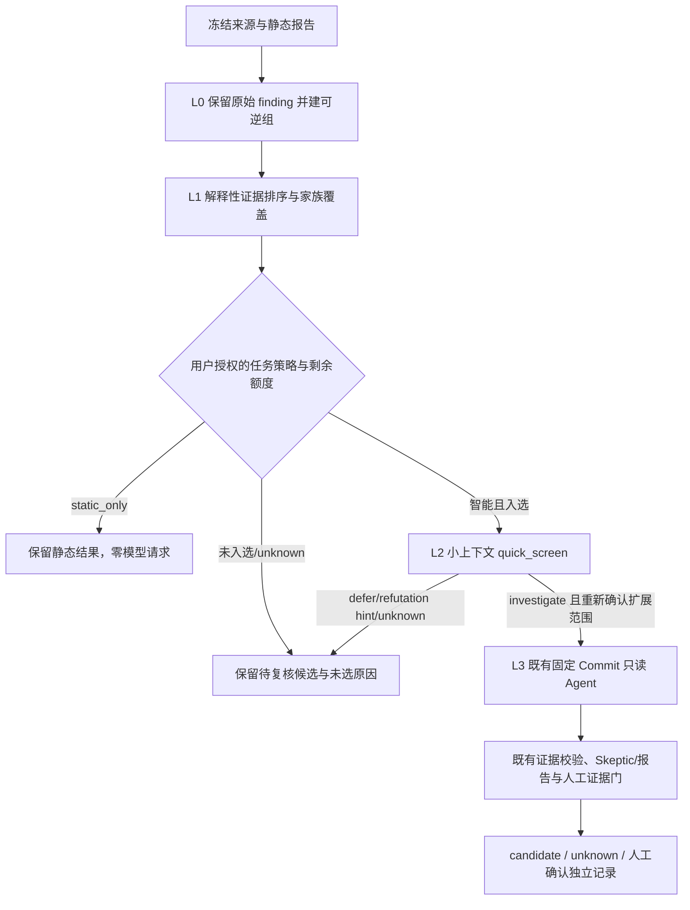

# OHScanner 渐进式智能审计架构与实施状态

更新：2026-10-21。本文记录任务书 Phase 0 架构复核与 Phase 1 基础模块的当前事实；目标项不视为已上线。验收代码基线为 `main@fe9d11c237d0edac9e93144d7d75a84b1df27895`。任务书参考分支 `work/pr38-44-e2e-followup-20261020` 当前为 `b469f623b34ca5fd752ab72de66e53927b9dcd9c`，比较结果为 main 在其上前进 52 个提交、无落后；PR #44 的多端点授权改动已由 PR #52 带入 main。当前开发分支从最新 main 建立。

## 当前能力矩阵

| 区域 | 已有代码/行为 | 当前边界 |
|---|---|---|
| 单仓快照授权 | `api.py` 的计划、扫描和 `auto_triage` 授权字段；已有 R1/R2 路径 | 旧 R1/R2 仍按原流程调度；新 `progressive-triage-v1` 策略没有绑定任务快照 |
| 日期、区间、分支、版本矩阵 | `operations_api.py` 冻结策略快照并把策略 SHA 纳入智能审计 workflow consent；Operation Worker 在端点完成后运行 `progressive_triage.runtime.build_operation_plan`，结果含端点绑定的 L0 manifest、L1 排序和未选原因；风险工作区显示摘要 | 当前只接入这四类父 Operation 的本地归并/排序；快照单任务仍走原路径。L2 仍 `not_scheduled`，新 SQLite 父任务账本及其发送前门尚未接线 |
| 现有 Agent | `agent.py` 固定 Commit、只读受限工具、脱敏、来源绑定、证据引用校验、已有累计预算扩展 | #41 的完整多阶段反证/evidence graph/补丁对照尚未完成；渐进策略不重写该模块 |
| 策略设置 | `progressive_triage/policy.py`：四档和自定义严格校验、私有版本化文件、原子替换、审计历史与 revision 冲突；多端点操作创建时持久化不可变策略快照；智能 consent 绑定策略 SHA | 每次保存只影响新任务；只读排序预算仍不等于真实模型调用额度 |
| L0 归并 | `grouping.py` 生成可逆 manifest 和 SHA；固定来源、提交、报告、文件源码哈希、候选定位满足强条件才做重复归并；root-cause 候选组额外要求确定性源分析字段；多端点 Operation Worker 已调用 | 不使用 CWE/路径/行号/模型文本单独合并；来源哈希或字段不全的观察保持独立；快照单任务尚未接入 |
| L1 排序 | `ranking.py` 对来源绑定、局部安全事实、未决义务、初判危害、版本变化排序；多端点 Operation 使用冻结策略并输出选择理由 | 只列优先组，不触发模型；unknown/partial 保留且不自动入选；快照单任务尚未接入 |
| L2/L3/预算 | 新增 `/operations/progressive-quick-screens/preview` 与 start Operation；服务端从已完成报告重新提取源码、校验 report/source SHA、复用 Agent 脱敏；授权摘要绑定来源、脱敏版本、策略 revision/hash、L1 选择、模型、提示版本、证据正文、nonce 和过期时间。Worker 执行一次 no-tools 请求、持久化真实 usage，SQLite 账本按扫描任务原子预留/结算，失败保守占用额度，重复执行不重放请求 | 当前入口按单扫描任务共享预算；多端点父任务共享、selected 组自动排队、深度 Agent、撤权与费用硬封顶未接通。美元限制仍为 `advisory_only` |
| 风险中心设置 UI | `IntelligentAuditPolicySettings.tsx` 可读取/保存策略并显示集成状态 | 设置可见不代表审计使用它；三类创建表单、固定 consent hash、任务详情状态和继续调查尚未接线 |

## 冲突与集成顺序

| 公共区域 | 已核对的并行改动 | 处置 |
|---|---|---|
| `operations.py`、`operations_api.py`、`operations_store.py`、`OperationForms.tsx`、`OperationWorkspace.tsx` | Issue #40 的主要适配由 PR #44 落地；PR #44 已并入 PR #52，且 main 最新 SHA 包含此工作 | 不回拷旧 main 文件；后续仅向现有预览/持久化接口增加策略快照适配和测试，保留现有端点授权、状态与幂等语义 |
| `agent.py`、Agent 操作 Worker 与证据服务 | Issue #41 仍 open；当前 main 含 PR #51/#52 的有限预算、只读工具与 source-bound 行为 | 不改 Agent 主循环来实现新 Agent；通过现有 `agent_investigation` Operation 和授权预览接入，增加 adapter/contract tests；需要触碰核心时单独协调 |
| 风险详情、案例、报告与评测 | Issue #42 仍 open；main 已含多项确认门、报告与来源绑定更新 | 只读复用既有候选、案例/报告协议；不能用快筛、分数或 Agent 自评写入人工确认/`validated_vulnerability` |
| 静态 Detector / Catalog | A/B/C/D 各自维护，当前 main 包含近期集成 | 本功能不修改检测器、规则准入、静态输出或解析边界 |

当前 GitHub 证据：Issue #40、#41、#42 状态均为 open；PR #44 状态 closed/merged，后续合并入 PR #52。远端参考分支 HEAD 经 GitHub branch API 核对为 b469 SHA；本地 SSH host-key 校验失败，通过 HTTPS URL rewrite 完成只读 fetch；未改共享负责人/队友 checkout。

## 目标渐进流程



跨端点任务必须有唯一 parent audit-operation ID；每个端点仍有自己的 repository、Commit/tree、report/source hash 和 egress consent。跨端点只共享额度与调度队列，不把一个版本的证据套用于另一版本。策略选择、端点 manifest、Provider/model/tool/redaction、预算和 consent digest 在提交前冻结；设置修订后只影响新任务。

## 建议的任务级持久合同

```json
{
  "schema_version": 1,
  "audit_operation_id": "stable operation id",
  "audit_kind": "snapshot | date_range | branch_compare | version_matrix",
  "endpoints": [{"scan_id": "...", "repository": "...", "commit": "...", "report_sha256": "..."}],
  "policy_snapshot": {"policy_version": "progressive-triage-v1", "profile": "standard", "limits": {}},
  "policy_sha256": "sha256",
  "provider_fingerprint": "sha256",
  "model": "...",
  "tool_policy_version": "...",
  "consent_sha256": "sha256",
  "state": "active | stopped | completed | partial",
  "stop_reason": null
}
```

多端点 Operation 已持久化策略版本、策略内容与 SHA，并在智能模式把摘要绑定到既有每端点 consent；L0/L1 规划随父 Operation 结果持久化。上面的完整合同仍是目标记录格式。每个快速筛选/深度调用必须在发送前以 SQLite 事务预留 request、Token、并发槽和组配额；同一操作下跨端点共用账本，按 Operation/consent/group 幂等。可观测 Provider usage 用真实值结算；缺失 usage 或外发后进程崩溃则保守按预留额记 unknown 并阻止继续自动外发。`max_cost_usd` 在无法证明 Provider-side hard cap 时仅为价格估计，严格费用模式拒绝创建，不宣传账单硬封顶。

策略文件与预算账本是不同持久对象：策略文件保存管理员/操作者的当前默认，任务记录保存不可变快照。既有 operation 按原授权兼容读取，不迁移/覆盖历史报告。任何 Worker 重试都验证 report SHA、source SHA、Provider/model/tool/redaction 及同一 consent；不得重复外发未知结果。

## 分阶段实施与验收门

| 阶段 | 内容 | 验收证据/边界 |
|---|---|---|
| Phase 0 | 代码/远端/Issues/PR/冲突复核、架构与数据合同 | 本文矩阵、full SHA、PR/Issue 状态及兼容计划 |
| Phase 1 | policy 预设/校验/持久化/API、纯函数 grouping/ranking、设置页、500 候选控制测试 | 基础模块完成；本分支把 L0/L1 接到四类多端点 Operation。策略 revision/hash、每端点 SHA、500 全量保留/预算选择有测试 |
| Phase 2 | L2 独立 operation 与状态/usage 持久化、preview/start 用户授权 | 已接入单扫描及四类多端点审计候选级 API→Worker；多端点使用父任务冻结策略与完成的 L0/L1 选择。mock Provider 覆盖未授权零请求、来源/策略/排序变化拒绝、严格 schema、no-tools、usage 结算、重复执行不重放、错误保留 candidate；真实 Provider 未调用 |
| Phase 3 | 父 Operation 账本与真实调度门 | SQLite 事务预留/结算覆盖单扫描与多端点父审计的 L2；组级幂等、并发/token/call/time 限制，父任务取消传播到排队/运行中的 L2。L3 Agent、Provider 崩溃恢复后的账单核对与全链撤权仍未接；USD 只有 advisory |
| Phase 4 | 三类审计与现有 Agent/Risk UI 接线 | 快照/日期/分支/矩阵 × static/intelligent API→Worker；端点 SHA 独立、每条 selected/unselected/status/reason 可追溯；使用现有只读 Agent |
| Phase 5 | 全量 QA、浏览器、真实 Provider 小样本与冻结 benchmark | 仓库全套 Python/Web/TypeScript/构建；mock E2E；经授权的真实 Provider；三类浏览器流程；vulnerable/fixed/safe frozen data；未执行项明确 unknown |

交付硬约束：静态模式零模型外发；候选不因分组、未选或失败而删除；分数/模型意见不改变漏洞确认状态；不重写 Agent 主循环或 A/B/C/D Detector；不将 synthetic fixture、mock Provider 或组件 Harness 写成产品准确率/漏洞确认。Phase 2 的单组 L2 与 Phase 3 的任务预算仅限用户逐组预览并授权的快筛；父任务结果中没有被 L1 选中的组会被拒绝。批量自动调度、L3、三模式 UI/Worker 验收与 Phase 5 仍未完成。
