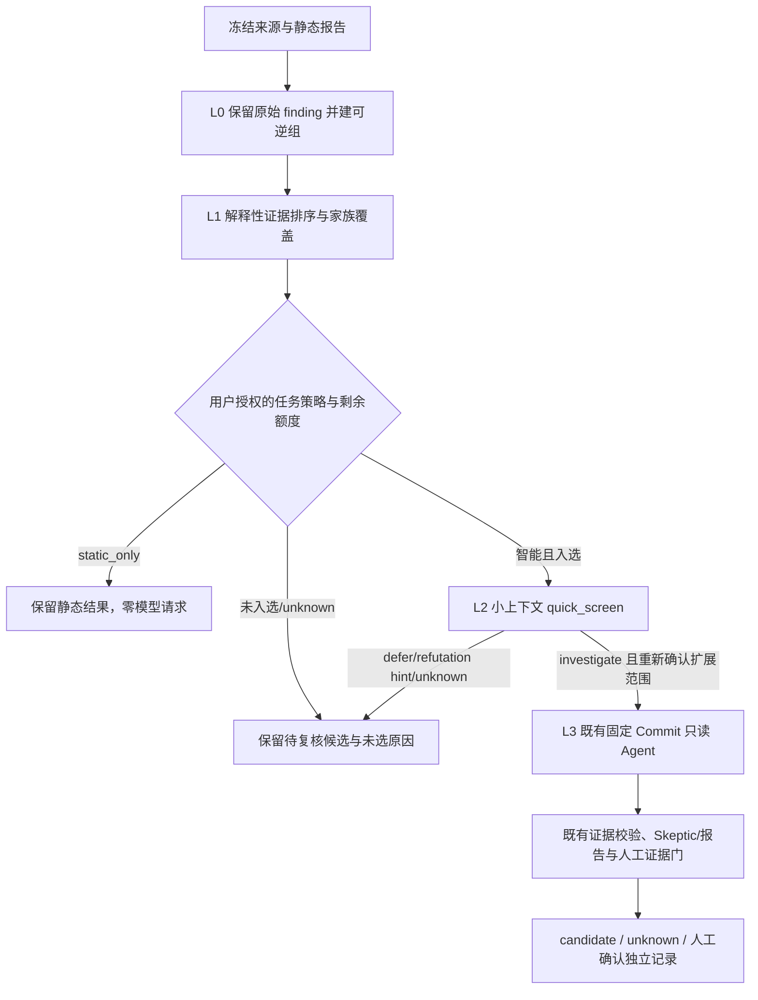

# OHScanner 渐进式智能审计架构与实施状态

更新：2026-10-22。当前复核基线为 `main@3069f49a29f31c76aa88de0e9d26f81d9c6fe262`；开发分支 `feat/progressive-ai-triage-phase5-20261022` 的上一个已推送节点为 `b82fbfa647789d74792487ded1f4be2f09c6db04`，本记录描述其后的单快照接线增量。旧的 L0-L3 policy、multi-endpoint runtime、L2/L3 operation 与账本已随 PR #56 等集成进入 main。本轮验证和缺口以文档前部更新记录为准；下方原 2026-10-21 能力矩阵保留为历史快照。

## 2026-10-22 主线复核与 Phase 5 验收进度

已补单仓快照的 policy revision/hash 冻结与 audit workflow 绑定；固定扫描报告完成后，`/api/v1/scans/{id}/progressive-triage` 通过同一 L0/L1 运行时归并并排序，任务详情显示分页候选组。静态模式显式标为 `ranked_static_only`，继续保留候选且不发起模型请求。多端点子扫描详情会指向父 Operation 统一计划，避免把端点局部排序误当成共享预算结果。单快照 L2 preview/Worker 复核冻结策略和完整 L0/L1 计划并在 worker 执行前重算摘要；该新路径已有专项回归，但尚未做浏览器操作或真实 Provider 请求。

浏览器路径 `/settings/policy` 曾因 `SettingsView` 的 tab allowlist 漏掉 `policy` 而落回“仓库与源码管理”。当前分支修复为共用 `settingsTab()` 并新增回归用例。隔离服务 `18788` 的策略读取 API 与静态页面 HTTP 状态已核实；Windows 浏览器窗口采集两次超时，真实浏览器点击/保存仍未验证。

截至本记录：单快照 L0/L1、父 Operation 委派、limited 保留 unknown、L2 固定计划复核与策略 hash 专项回归 34/34 通过（Python 3.14，测试依赖安装在 `/tmp/ohscanner-phase5-deps`）；此前四类 operation × 静态/智能八组合 API/Worker 测试 1/1 通过；前端 Node 127/127、TypeScript 与生产构建通过。Python 全量回归运行 2063 项，15 fail、31 errors、10 skipped。输出明确包含 sparse checkout 缺失的 `samples/`、`research/` 数据/脚本和 Windows 挂载目录的 CRLF 字节哈希不一致；全量失败未逐项归因，不据此断言剩余错误均由环境造成。此次专项仅在隔离依赖目录通过，不等于标准 Linux/Python 版本全套回归。

隔离 API 策略读写与持久化重读通过。Windows 浏览器状态采集两次超时，未完成浏览器点击验收。测试期间短暂发现另一个来自 `/home/audit/ohscanner-workbench/main-integration-20261021` 的 `serve --port 8765` 进程；其父进程与本测试无可证实关系，为防止争用已终止该 PID 及其 Worker。当前 8765 无监听，未重启，需由负责人核对运行状态。

没有真实 Provider 调用，也未执行冻结 vulnerable/fixed/safe 对照；`triage_benchmark.json` 和比赛对照结论仍未交付。美元预算保持 advisory，候选状态不因此变化。

## 当前能力矩阵

| 区域 | 已有代码/行为 | 当前边界 |
|---|---|---|
| 单仓快照授权 | `api.py` 冻结策略版本/SHA 并纳入 workflow SHA；扫描完成后提供 L0/L1 计划 API，详情页展示候选组；静态模式不调用模型；L2 preview/Worker 按固定 snapshot 计划和策略重新校验 | 单快照 L2 浏览器路径、真实 Provider 小样本仍未验收；旧 `auto_triage` R1/R2 仍是既有路径 |
| 日期、区间、分支、版本矩阵 | `operations_api.py` 冻结策略快照并把策略 SHA 纳入智能审计 workflow consent；Operation Worker 在端点完成后运行 `progressive_triage.runtime.build_operation_plan`，结果含端点绑定的 L0 manifest、L1 排序和未选原因；风险工作区显示摘要 | 当前只接入这四类父 Operation 的本地归并/排序；快照单任务仍走原路径。L2 仍 `not_scheduled`，新 SQLite 父任务账本及其发送前门尚未接线 |
| 现有 Agent | `agent.py` 固定 Commit、只读受限工具、脱敏、来源绑定、证据引用校验、已有累计预算扩展 | #41 的完整多阶段反证/evidence graph/补丁对照尚未完成；渐进策略不重写该模块 |
| 策略设置 | `progressive_triage/policy.py`：四档和自定义严格校验、私有版本化文件、原子替换、审计历史与 revision 冲突；多端点操作创建时持久化不可变策略快照；智能 consent 绑定策略 SHA | 每次保存只影响新任务；只读排序预算仍不等于真实模型调用额度 |
| L0 归并 | `grouping.py` 生成可逆 manifest 和 SHA；固定来源、提交、报告、文件源码哈希、候选定位满足强条件才做重复归并；root-cause 候选组额外要求确定性源分析字段；多端点 Operation Worker 已调用 | 不使用 CWE/路径/行号/模型文本单独合并；来源哈希或字段不全的观察保持独立；快照单任务尚未接入 |
| L1 排序 | `ranking.py` 对来源绑定、局部安全事实、未决义务、初判危害、版本变化排序；多端点 Operation 使用冻结策略并输出选择理由 | 只列优先组，不触发模型；unknown/partial 保留且不自动入选；快照单任务尚未接入 |
| L2/L3/预算 | L2 `/operations/progressive-quick-screens/{preview,start}` 与批量入口按固定 report/source SHA、冻结策略/L1 选择、Provider、脱敏版本、证据、nonce 和过期时间绑定授权；Worker 执行 no-tools 请求。L3 单组入口与 `/operations/progressive-deep-investigation-batches/{preview,start}` 仅接受完成且建议 `investigate` 的 L2 结果，展示逐组固定 Commit、上下文、只读工具范围和预算，并要求单独勾选授权；批次 Worker 串行复用现有 Agent/Skeptic/报告流程，逐次请求经过父任务 SQLite 账本预留/结算，Provider 重试关闭，未知结果保守占额且不重放 | L2/L3 任务级批次需分别预览和授权，不会自动外发；批次按顺序执行，不提供并发加速。父任务预算和取消门已接到 L2/L3 Worker；完整的撤权联动、Provider 崩溃后的外部账单核对、自动调度及真实 Provider 验收仍未完成。美元限制仍为 `advisory_only` |
| 风险中心设置 UI | `IntelligentAuditPolicySettings.tsx` 可读取/保存策略并显示集成状态 | 设置可见不代表审计使用它；三类创建表单、固定 consent hash、任务详情状态和继续调查尚未接线 |

## 冲突与集成顺序

| 公共区域 | 已核对的并行改动 | 处置 |
|---|---|---|
| `operations.py`、`operations_api.py`、`operations_store.py`、`OperationForms.tsx`、`OperationWorkspace.tsx` | Issue #40 的主要适配由 PR #44 落地；PR #44 已并入 PR #52，且 main 最新 SHA 包含此工作 | 不回拷旧 main 文件；后续仅向现有预览/持久化接口增加策略快照适配和测试，保留现有端点授权、状态与幂等语义 |
| `agent.py`、Agent 操作 Worker 与证据服务 | Issue #41 仍 open；当前 main 含 PR #51/#52 的有限预算、只读工具与 source-bound 行为 | 不改 Agent 主循环来实现新 Agent；通过现有 `agent_investigation` Operation 和授权预览接入，增加 adapter/contract tests；需要触碰核心时单独协调 |
| 风险详情、案例、报告与评测 | Issue #42 仍 open；main 已含多项确认门、报告与来源绑定更新 | 只读复用既有候选、案例/报告协议；不能用快筛、分数或 Agent 自评写入人工确认/`validated_vulnerability` |
| 静态 Detector / Catalog | A/B/C/D 各自维护，当前 main 包含近期集成 | 本功能不修改检测器、规则准入、静态输出或解析边界 |

当前 GitHub 证据：Issue #40、#41、#42 状态均为 open；PR #44 状态 closed/merged，后续合并入 PR #52。远端参考分支 HEAD 经 GitHub branch API 核对为 b469 SHA；本地 SSH host-key 校验失败，通过 HTTPS URL rewrite 完成只读 fetch；未改共享负责人/队友 checkout。

## 目标渐进流程



跨端点任务必须有唯一 parent audit-operation ID；每个端点仍有自己的 repository、Commit/tree、report/source hash 和 egress consent。跨端点只共享额度与调度队列，不把一个版本的证据套用于另一版本。策略选择、端点 manifest、Provider/model/tool/redaction、预算和 consent digest 在提交前冻结；设置修订后只影响新任务。

## 建议的任务级持久合同

```json
{
  "schema_version": 1,
  "audit_operation_id": "stable operation id",
  "audit_kind": "snapshot | date_range | branch_compare | version_matrix",
  "endpoints": [{"scan_id": "...", "repository": "...", "commit": "...", "report_sha256": "..."}],
  "policy_snapshot": {"policy_version": "progressive-triage-v1", "profile": "standard", "limits": {}},
  "policy_sha256": "sha256",
  "provider_fingerprint": "sha256",
  "model": "...",
  "tool_policy_version": "...",
  "consent_sha256": "sha256",
  "state": "active | stopped | completed | partial",
  "stop_reason": null
}
```

多端点 Operation 已持久化策略版本、策略内容与 SHA，并在智能模式把摘要绑定到既有每端点 consent；L0/L1 规划随父 Operation 结果持久化。上面的完整合同仍是目标记录格式。每个快速筛选/深度调用必须在发送前以 SQLite 事务预留 request、Token、并发槽和组配额；同一操作下跨端点共用账本，按 Operation/consent/group 幂等。可观测 Provider usage 用真实值结算；缺失 usage 或外发后进程崩溃则保守按预留额记 unknown 并阻止继续自动外发。`max_cost_usd` 在无法证明 Provider-side hard cap 时仅为价格估计，严格费用模式拒绝创建，不宣传账单硬封顶。

策略文件与预算账本是不同持久对象：策略文件保存管理员/操作者的当前默认，任务记录保存不可变快照。既有 operation 按原授权兼容读取，不迁移/覆盖历史报告。任何 Worker 重试都验证 report SHA、source SHA、Provider/model/tool/redaction 及同一 consent；不得重复外发未知结果。

## 分阶段实施与验收门

| 阶段 | 内容 | 验收证据/边界 |
|---|---|---|
| Phase 0 | 代码/远端/Issues/PR/冲突复核、架构与数据合同 | 本文矩阵、full SHA、PR/Issue 状态及兼容计划 |
| Phase 1 | policy 预设/校验/持久化/API、纯函数 grouping/ranking、设置页、500 候选控制测试 | 基础模块完成；本分支把 L0/L1 接到四类多端点 Operation。策略 revision/hash、每端点 SHA、500 全量保留/预算选择有测试 |
| Phase 2 | L2 独立 operation 与状态/usage 持久化、preview/start 用户授权 | 已接入单扫描及四类多端点审计候选级 API→Worker；多端点使用父任务冻结策略与完成的 L0/L1 选择。mock Provider 覆盖未授权零请求、来源/策略/排序变化拒绝、严格 schema、no-tools、usage 结算、重复执行不重放、错误保留 candidate；真实 Provider 未调用 |
| Phase 3 | 父 Operation 账本与真实调度门 | SQLite 事务预留/结算覆盖 L2/L3 单扫描及多端点父审计；组级幂等、并发/token/call/time 限制；父任务取消传播。L3 只在 L2 `investigate` 后二次预览授权，并复用现有 Agent；真实 Provider 崩溃后的外部账单核对与全链撤权仍未验收；USD 只有 advisory |
| Phase 4 | 三类审计与现有 Agent/Risk UI 接线 | 快照/日期/分支/矩阵 × static/intelligent API→Worker；端点 SHA 独立、每条 selected/unselected/status/reason 可追溯；详情页已连接任务级 L2 批次→单独授权的 L3 批次和逐组结果。浏览器端到端与三类真实界面验收仍待完成 |
| Phase 5 | 全量 QA、浏览器、真实 Provider 小样本与冻结 benchmark | 仓库全套 Python/Web/TypeScript/构建；mock E2E；经授权的真实 Provider；三类浏览器流程；vulnerable/fixed/safe frozen data；未执行项明确 unknown |

交付硬约束：静态模式零模型外发；候选不因分组、未选或失败而删除；分数/模型意见不改变漏洞确认状态；不重写 Agent 主循环或 A/B/C/D Detector；不将 synthetic fixture、mock Provider 或组件 Harness 写成产品准确率/漏洞确认。L2/L3 批次都必须对各自完整清单逐项预览并显式授权，L3 只接受 L2 `investigate`，执行串行且受任务级账本控制。Phase 5 全量 QA、浏览器验收、经授权的真实 Provider 小样本与冻结 benchmark 仍未完成。
