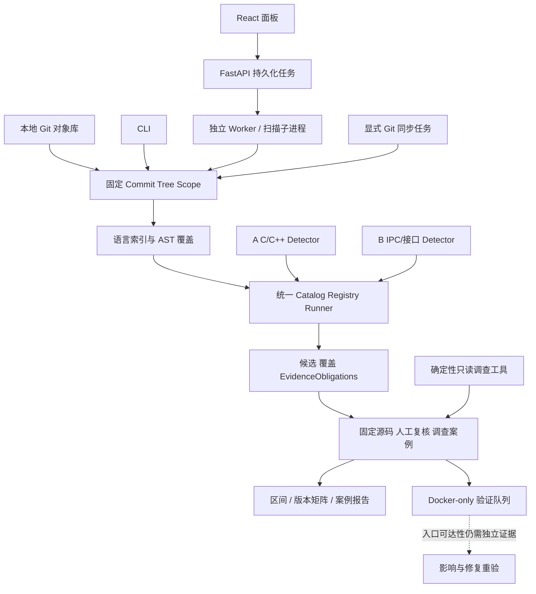

# 架构、模块边界与公共协议

更新：2026-10-19。实现状态以本分支代码、固定实验和项目现状文档为准。

## 一套内核，多个入口

Web 与 CLI 共用 execution.py；不得各造扫描器。历史工具对照与生产 Detector 分开。
未来 GitSyncService 独立显式联网；扫描仍只读本地固定对象，不隐式 fetch。

### 多根目录登记与路径身份

部署环境/JSON 中的 target_roots 是静态管理员白名单；面板添加的独立目录另存于工作台数据目录的 managed-source-roots.json，API 与各 Worker 按需重读。根目录记录包括稳定 root_id、别名、规范真实路径、校验时间、发现预算和注册时的设备号/inode。文件更新使用互斥锁、0600 临时文件与原子替换。

GET/POST/DELETE /api/v1/repositories/roots 仅用于本机设置页；仓库发现优先使用 root_id，旧 root_index 只保留兼容。服务端验证绝对路径、真实目录、权限、符号链接、数据目录隔离、重复/重叠授权和根目录身份。根目录失效时不再进入有效 allowlist；仓库移动不会改变旧记录的 repository_id，须重新登记新路径。历史任务由固定 Git 快照、哈希和报告绑定，不随目录管理变化。

## 模块与九层目标

| 层 / 模块 | 代码入口 | 当前与后续边界 |
|---|---|---|
| L0 来源/版本 | git_source.py、workbench/service.py、operations.py | 本地登记/对象核验与显式 HTTPS clone/fetch 已接入；同步来源受限。多仓 Manifest 待做 |
| L1 索引 | indexing.py、frontend.py、parser | Tree-sitter 轻量 AST；支持受限只读索引 Git 跟踪的 tar.gz/tgz 中 C/C++ 成员；不是完整类型/CFG/跨过程证明 |
| L2–L3 检测 | detectors/cpp、interface、runner.py | 已注册窄家族研究 Detector；语义增强由 A/B 做 |
| L4 证据/复核 | execution.py、workbench/service/store | 覆盖侧车、义务、源码绑定、追加复核已有；自动根因归并待评估 |
| L5 验证 | workbench/validation.py、validation_child.py、AUTH-01 Harness | Docker-only 服务与队列已接线；标准 WSL Docker Worker 不可用。2026-10-16 显式 Windows 暂存桥接通过一次组件 Harness，但不证明标准 Worker 可重复运行或产品入口可达 |
| L6 分类 | candidate CWE / 后续 CVE 绑定 | 关联须有来源，不能用名称猜 CVE 或严重度 |
| L7 影响/修复 | workbench/operations.py、案例报告 | 双 SHA/日期区间与版本矩阵候选比较已接入；影响状态均 unknown，修复重验未跑通 |
| L8 交付 | operations_api.py、JSON/Markdown 案例报告 | 原始扫描包与案例 JSON/Markdown 导出已接入；报告确认数不自动升级，产品闭环未验收 |

M0–M4 是研发里程碑，不替代上述功能层。当前是 M2 公共工程 + Web 快照/复核已实现，
A/B 继续提升算法，M3 评价/可选 Agent 与 M4 闭环仍需验收。

## 当前实际契约

新第一方 Detector 结果已经输出 schema v2，逐诊断绑定 source_sha256；外部历史工具结果仍兼容读取 v1。v2 不重写历史 JSON、报告哈希、候选 ID 或复核记录。
主要类型在 src/ohscanner/contracts.py：
- ScanRequest：目标 repository、full commit、snapshot、profile、provenance。
- SourceUnit：规范相对路径、language、text、SHA-256、parse_status。
- ScanContext：排序/去重 SourceUnits 与 shared_facts。
- DetectorFinding：位置、rule/message、候选 CWE、EvidenceObligations；可选 consequence 仍是候选。
- DetectorRun：ID/version/status、analyzed_files/findings/limitations、可选 file_outcomes。
- Detector：ID/version、supported_languages/required_facts、detect(context, units)；精确签名读代码。

Registry 显式批准 factory，浏览器不能提供 Python 模块名或 Shell 命令。
当前 Catalog 登记 A 的七项 C++ 检测器、B IPC 与 ArkTS/JS、C Ark Runtime TypedArray 静态研究候选、D 的敏感数据到日志研究检测器，以及默认开启的已披露组件 CVE 窄范围源码签名检测器。C 默认关闭且需显式选择；其 0.6.2 adapter / 0.8.13 model 只接受绑定的仓库 commit、目标 blob 和 creator 依赖 blob，依赖文件还须 SHA-256 一致且 AST 完整，并按 owner/method/signature 产生候选。版本、目标或依赖不匹配时为 not_analyzed；partial/unsupported 范围维持 blocked/unknown，不代表安全。宏、类型、继承与产品构建仍未证明。C/D/NULL 及已披露 CVE 的命中都不直接升级为产品漏洞结论，仍须确认精确构建、可达入口和安全影响。敏感数据 D 仍仅在仓库扫描页显式选择后执行，自动规划默认排除；未知版本会 blocked。example 不参与安全扫描。实际 ID/版本/默认策略从 /api/v1/detectors 读取。

POST /api/v1/audit-plans 在受限只读子进程读取固定 Git/AST，生成 SourceManifest 与语言/事实资格计划；不执行规则或入队。scan API 省略 detector_ids 时自动选择；显式列表继续兼容，空列表拒绝。计划、版本、源与元数据摘要入任务 spec；Worker 重算一致才执行/发布，报告记录原计划与真实覆盖。预览哈希变化需刷新。planning/sources 为无 FastAPI/DB 依赖的纯服务，由 CLI/Worker 共用。
可选 finding identity 字段作为增量证据，旧 diagnostic ID 和旧报告保持原样；缺失身份不回填成已验证。

状态必须分离：
- Web task：queued/running/completed_with_limitations/failed/cancelled/timed_out/interrupted 等。
- Detector execution：completed/blocked/failed。
- 文件覆盖：complete/partial/not_analyzed/failed；parse 状态另记。
- 人工复核与漏洞证据等级：不由 task completed 决定。

经过来源/范围验证的局部候选及义务不会因整体 blocked 而消失。
无 file_outcomes 的 legacy blocked 自报覆盖最多为 partial，不能推成 complete。
来源至少绑定 repository/full commit/tree/snapshot/file/blob/source SHA、
detector ID/version/rule/scope/profile；缺什么就记录缺口。归档成员使用 archive path/blob/SHA 与 member path/SHA 双重绑定，成员路径是虚拟路径，不能伪装成 Git blob；面板查看时从固定 commit 重新读取归档并重验两级哈希。归档展开不落盘，限 8 MiB 压缩、16 MiB 展开、2000 成员、1 MiB/成员；超限、链接、非 UTF-8 和损坏成员保留为 coverage limitation，不视作安全。

## v1 读取兼容与 v2 第一方输出

当前第一方扫描结果使用 schema v2，兼容读取历史 v1 外部工具结果。旧 JSON、报告哈希、候选 ID 和人工复核保持原样；缺少来源绑定的旧记录为 unbound/unknown，不补写成 verified。

已完成 v2 字段与覆盖/义务语义收口，并回归 malformed payload、证据混用、partial/blocked、source hash、历史报告与新旧候选集合。旧工作台任务做过只读核验；尚未执行旧外部工具重新写入、损坏数据库恢复和完整浏览器历史任务回归。后续 schema 扩展仍须先独立提交协议测试，不与检测规则变化混写。

## 证据门与边界

默认 candidate/unassessed；partial/failed/未执行是 unknown，不是 safe 或 miss。
确认/报告需要固定目标、真实入口/攻击者控制或权限边界、可达敏感操作、
必要触发条件及具体 CIA 影响，记录可复核证据和仍未知项。
满足证据门后应升级并交付 PoC、影响/修复/报告，不能永久停留在 candidate。

常规扫描 Worker 使用任务子进程与资源限制，不等于逐 Detector 沙箱。AUTH-01 动态 Harness 只允许走独立 Docker Worker；容器无网络、去 capabilities、只读根目录、限制资源。标准 WSL Docker CLI/Worker 当前不可用；2026-10-16 一次明确授权的 Windows 暂存桥接运行通过组件 Harness，但不能证明 WSL Worker 可重复运行，也不能确认产品漏洞。
超时不发布残缺候选包；缺失分析保持 unknown。
数据库中的报告 hash、报告内 Markdown hash 与固定 blob 清单防意外混用，
不保证主机/数据库被完全控制后的完整性。

## 扩展原则

新源码同步、区间/版本、Agent、验证模块复用同一任务/证据服务。
文件级 AST 缓存可用 blob+parser+配置；跨文件语义要绑定依赖/宏/编译配置。
2000 文件/32MiB 总源码/1MiB blob 是当前限制，不直接移除来冒充全系统覆盖。
扩容先 batch Git、分片/聚合与覆盖不变性实验，再测 wall/RSS。

## 本轮新增操作面与验收状态

workbench operations API 使用单独的 SQLite operation 表与迁移备份，范围包括显式仓库同步、固定双 SHA 区间、带时区的 committer-date 区间预览、无需案例的 branch/tag 双端点比较、版本矩阵、只读调查、验证任务、操作事件/取消/日志/结果 hash，以及案例 JSON/Markdown 报告。区间端点扫描与 operation 记录在同一事务创建；branch comparison 在入队时解析并保存完整 SHA；扫描仍只读本地固定对象。

运行时影响和漏洞确认仍是独立层。候选变化返回 added/persistent/disappeared/unknown 等观察关系，不推导漏洞引入或修复；版本矩阵 impact=unknown。候选聚类仅用于审查浏览，按固定快照、Detector 版本、规则、文件、符号、源码 SHA 聚合展示，原始候选身份和位置不变；聚类不代表共同根因。只读调查输出固定源码、义务、Git 历史和有限符号信息，不调用模型或 arbitrary shell。AUTH-01 组件触发不证明真实产品入口可达，confirmed/reportable 仍需人工审查与额外证据。

## 2026-10-18 集成契约补充

本轮新增受限真实模型适配器与 R0/R1/R2 流程，真实 Provider 调用尚未验收。Agent 单候选调查独立预览/授权，绑定 Git tree、原报告/源码、Provider、模式、预算和实现文件摘要；Worker 再验证。固定工具离线读取精确 commit，模型建议不改变 candidate。全部候选复核批次仅排队，自动批处理仍关闭；不因 Provider configured 就消费批次。操作迁移 v4 复用迁移锁和备份，未改写历史报告/复核。C 仍待准入；D 敏感信息研究检测器现可在仓库扫描页显式选择，默认关闭，unknown commit 阻断、partial 保留候选并标记覆盖不完整。此接入不确认漏洞、不宣称召回率。

## 2026-10-19 智能安全审计与仓库视图协议

POST /api/v1/audit-plans 和 POST /api/v1/scans 接受 audit_mode：standard_review（默认）或 static_only。静态 plan_sha256 仍只描述固定源码、规则和执行预算；另一个 workflow_sha256 绑定静态计划哈希与审计模式。面板创建任务时同时传 expected_plan_sha256 和 expected_workflow_sha256，后端分别重算并拒绝过期值。已创建任务在 job spec 内保存模式和流程哈希，重试沿用原模式；无模式的历史任务按兼容路径展示。

standard_review 默认执行静态扫描；不勾选任务级自动研判授权时不自动外发。用户可在新建审计中明确选择至多 5 条 R1 候选，并选择 0–5 条条件 R2（R2 上限不得超过 R1）。R1 是单轮候选研判；R2 仅在已绑定 R1 完成、high/critical 且存在未解决固定源码义务时使用只读工具。调度器从扫描报告重新读取候选和源码绑定，要求每项义务均有复核记录；R1 输出只充当路由提示，不能作为 R2 证据。R2 原子入队同时校验授权、R1 结果 SHA 和固定报告；批次决策持久化以支持重启幂等。撤销授权会记录审计事件并取消尚未完成的绑定 Agent 操作。授权预览绑定 R2 名额、工具/源码披露、Provider、版本和预算。请求、token、时间是应用硬边界；Provider 实际账单仅为估算。HTTP 429/5xx 可在总预算内重试一次；连接或超时的未知结果不重试，可能额外计费的 transient 失败会标注费用未知。

GET `/scans/{key}/triage` 同时返回独立的 scan_progress 和 triage_progress，并只关联该 job 与当前 report_sha256。GET `/scans/{key}/risks` 按确定策略分层：来源绑定不一致为 unknown；有效的完整人工 R0 复核，或通过固定源码/报告/候选绑定校验的 AI 源码调查，均可把候选列入“高可信风险候选”。AI 路径要求结构化研判被接受、结论为 likely_true_positive、至少一个源码义务标为 evidence_found，并有报告源码清单内的文件/行号/引文；源码反证、绑定不匹配、无可定位引文或 unsupported claim 均不提升。此宽松门槛用于优先安排人工复核，未解决义务仍保留，引用存在和逐字匹配不代表语义支持。风险项区分 `severity`、`risk_tier`、`confidence_basis` 与漏洞状态；详情可返回 `ai_summary`、`ai_evidence`、`ai_review_operation_id` 和 `ai_review_result_sha256`。高可信始终保留 `candidate`，Agent 的结论不能写入确认状态；人工 refuted/likely_false_positive 仅降为低优先级线索，不表示安全。GET `/scans/{key}/coverage` 汇总解析、检测器和未认领范围。

POST `/scans/{key}/reports/snapshots` 将当时的双阶段状态、风险/覆盖、授权摘要、Agent operation/result SHA 和现有合规验证门写入 SQLite v7 的 `risk_snapshots`、`report_snapshots`。快照按内容摘要幂等；后续复核或研判状态变化会生成新版本，旧 JSON/Markdown SHA 和内容不变。原始静态报告保持独立。数据迁移先在线备份；不会在报告里复制 Provider 密钥。`validated_vulnerability` 只沿用案例人工评估与通过运行时可达性门的既有路径，风险层级本身不写入确认状态。

仓库视图分为三种：GET /api/v1/repositories/list 供普通导航和表单，仅返回 id/name；GET /api/v1/repositories/managed 供本机设置页显示登记路径；GET /api/v1/repositories/roots 供本机设置页显示可信根路径、别名、可用状态和仓库计数。GET /api/v1/health 只返回 target_root_count，不再枚举绝对路径。旧 /repositories 路由暂保留以兼容本地客户端，新的普通页面不得用它展示路径。

条件 R2 状态由操作 schema v8 保存，迁移前在线备份。GET /scans/{key}/triage 的每个 batch 包含 conditional_r2.state、操作 ID、逐候选决定清单、决定摘要及安全错误码/原因；R1 未终态期间显示 in_progress。R2 状态包括 awaiting_r1、queued、budget_limited、not_needed、failed_selection 与授权变化阻断。budget_limited 可同时包含已排队的名额内操作和未选择候选。结果不会把候选升级为漏洞；validated_vulnerability 仍由既有独立人工/运行时证据门决定。

操作 schema v9 在 v8 基础上增加 `triage_cancellations`，记录任务级停止智能研判或整项审计取消的持久标记，并在迁移前生成在线备份。`POST /api/v1/scans/{key}/triage/cancel` 只停止该扫描任务绑定的 R1/R2 研判：扫描状态、静态报告和任务级外发授权保留；尚未开始的 Agent 操作取消，运行中的操作收到取消请求。`POST /api/v1/scans/{key}/cancel` 取消整项审计，并同时写入研判取消标记，防止扫描结束或 Worker 重启后再自动排入 R1/R2。R1 批次创建在同一写事务重新检查标记，避免取消与调度并发时出现迟到的任务。该标记只约束关联审计，不取消其他任务。

`GET /api/v1/overview/risks?scan_limit=10` 提供首页最近审计风险摘要，最多读取 20 份报告，汇总 candidate、待验证、未评估和独立人工确认计数，并给出至多 12 条相对路径候选定位。聚合候选数是报告观察数，可能跨报告重复，不能解读为唯一漏洞数；绝对本机仓库路径不会从该接口返回。首页显示 Provider 是否已配置，不推断连通性；任何源码外发仍需逐任务授权。

## 2026-10-20 Provider 费率与接入约束

Agent 外发预览版本升级为 `agent-egress-preview-0.6.0`，将匹配费率卡后的预算估算写入授权摘要。MiMo 实时按量 API 费率卡仅对官方 pay-as-you-go endpoint `api.xiaomimimo.com` 与精确模型 ID `mimo-v2.6-pro`、`mimo-v2.6-flash`、`mimo-v2.6-pro-ultraspeed` 生效；完成调用按报告的缓存命中/未命中与输出 Token 价格分别计算官方 CNY、USD 价格参考，预算估算按输入全部未命中缓存计算。只采用实时 API 费率，不混用 Batch API 价格。费率来源为 Xiaomi MiMo 定价页，快照日期为 2026-10-20。账号适用的结算地区/币种没有由面板配置，因此双币种只是官方价目参考，实际扣费以 Provider 账单为准；OHScanner 无法限制或核验最终账单。缺少完整 Token/缓存用量、未知模型或不同 endpoint 时显示 unknown。

MiMo Token Plan 使用独立 `token-plan-*.xiaomimimo.com` endpoint 和订阅密钥。官方条款将其限定为受支持的编程工具，并禁止自建应用后端接入；Provider 设置拒绝这些 endpoint。按量 API 的正常 endpoint 可保存，凭据仍留在本地私有配置。此项不发起真实模型请求，也不改变漏洞 `candidate/confirmed/unknown` 或 `validated_vulnerability` 状态。

### 2026-10-20 任务级费用预算绑定

新建标准研判任务若启用自动 R1/R2，必须提交正数 max_cost_usd。服务端只允许具有已复核费率卡的 Provider/model；按任务名额、每候选最大输入/输出 token 和允许重试上界计算 USD 最坏估值，并在估值不高于用户上限时生成授权。费用上限、估值和费率卡摘要写入授权 manifest；workflow_sha256 版本 4 也绑定任务级上限，防止沿用旧预览。扫描提交时重新计算授权，Agent 发出前再用已保存的上限复验，字段漂移或费率不再支持时拒绝自动队列。

platform_enforced=true 表示 OHScanner 会按此费率卡门槛约束任务级自动批次，不代表对 Provider 实际账单设立硬上限。结算地区/币种、失败请求费用和供应商侧价格变化不由工作台控制；明细仍须对照真实账单。静态扫描和单候选独立授权不因缺少任务级上限而受阻。离线测试使用固定费率卡，不执行真实 Provider 请求。
