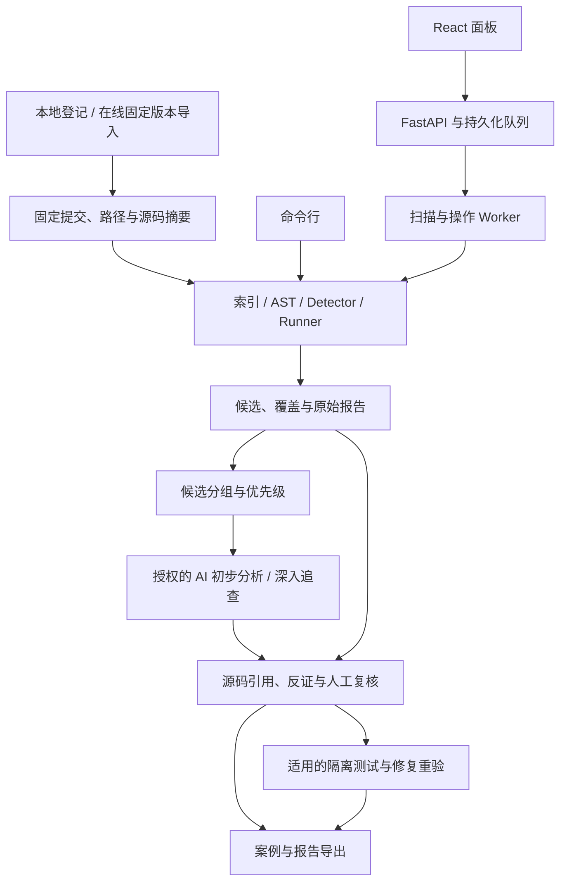

# 系统架构与证据协议

本文按当前源码说明系统组成。实现范围见[项目现状](项目现状与下一步.md)，使用步骤见[面板操作手册](面板操作手册.md)。

## 一套扫描内核，多个审计入口

CLI 与 Web 复用 `src/ohscanner/execution.py`。源码下载是显式操作；扫描固定的本地 Git 对象，不隐式更新目标版本。

启动器分别管理扫描 Worker、普通操作 Worker、隔离验证 Worker 和 API。任务与操作持久化到工作台数据目录；不同实验应使用独立数据目录，避免队列、锁和证据混用。

## 模块职责

| 模块 | 职责 |
|---|---|
| `src/ohscanner/git_source.py`、`indexing.py` | 固定 Git 对象、读取源码及分析覆盖 |
| `src/ohscanner/contracts.py`、`runner.py`、`detectors/` | 公共检测契约、检测器调度与自研规则 |
| `src/workbench/planning/`、`service.py`、`store.py` | 扫描预览、任务、结果、候选与人工复核 |
| `src/workbench/operations*.py` | 时间区间、跨版本、调查、验证、报告及操作事件 |
| `src/workbench/progressive_triage/` | 策略快照、候选分组、排序、AI 快筛、共享预算及深入调查接线 |
| `src/workbench/agent*.py` | 模型请求、受限源码工具、输出与引用校验、参考资料检索 |
| `src/workbench/validation*.py` | 已登记的受控测试与验证结果 |
| `web/src/` | 审计、风险、任务、调查、报告和系统设置界面 |

## 审计对象与调查方式

审计对象回答“比较哪些源码”：仓库固定快照、按日期选择的提交区间、指定提交或分支/标签端点，以及案例版本矩阵。时间范围按指定时区和 committer 时间解析，再固定实际提交。

调查方式回答“如何分析候选”：静态检测、人工审查、单轮模型分析或使用只读工具的深入调查。三种审计入口共享这些能力，不对应三套扫描器。

渐进流程先保留静态候选，再按固定源码身份分组并确定优先级，最后对授权范围开展 AI 初步分析及深入追查。分组用于减少重复审查，不合并或改写原始候选身份，也不证明同组候选有相同根因。

## 来源绑定与兼容

第一方检测输出使用 schema v2，历史 v1 输入保留读取兼容。旧报告、候选 ID、哈希和人工复核不因新协议而改写。

主要绑定信息包括仓库标识、完整 commit/tree、固定快照、相对路径、blob 与源码 SHA-256、检测器和规则版本、扫描范围及 profile。缺失的身份信息保持未绑定或未知，不补写为已验证。

任务计划与工作流分别具有摘要；提交任务和 Worker 执行时核验固定来源及配置。模型授权还绑定实际预览、Provider、模型、源码范围和实现/策略信息；变更后须重新核对授权。

Git 跟踪的受支持归档源码使用“归档 blob/摘要 + 成员路径/摘要”双重身份。成员不是独立 Git blob，读取时须重新验证归档和成员来源，并遵守展开和读取限制。

## 模型与只读工具

Provider 支持 `openai-responses` 和 `openai-chat-completions`。兼容端点仍需支持所用结构化输出和函数工具调用；原生 Anthropic Messages、Gemini API 不属于当前适配协议。

模型只能使用服务提供的固定版本源码、符号检索、调用语法线索、历史与证据义务等受限工具。没有任意 Shell、Git 写入或无限制联网权限。源码注释、文档和工具输出作为待分析数据处理。

服务校验结构化结果及引用来源。引用匹配只能证明文字出自指定材料，不能证明模型推理、攻击可达性或安全影响成立。独立反证步骤和人工复核仍须分别记录。

本地 BM25 参考检索仅在已接入的候选调查流程中使用：返回材料路径、行号、摘要及哈希，作为历史 CVE/PoC 参考，不能替代当前目标源码证据，也不能推断所有批量或渐进流程均已接入检索。

## 资源、费用与授权

新任务冻结所选策略，系统设置变化不反向改写旧任务。渐进式流程有任务共享账本；普通单候选调查按其路径的请求、工具、Token 与时间限制执行。兼容保留的旧自动分诊路径并不具备相同的累计账本，不能把一种流程的预算语义推广到所有流程。

单次模型输出限制和 Provider 上下文限制另行适用。费用估算及本地账本不能作为模型服务商的账单硬上限；缺失 usage 保留未知，不能记成零费用。

源码外发先预览再授权；本地脱敏只能减少常见凭据误发，不能保证检出全部秘密。密钥不进入 Git、扫描结果或外发授权快照。

## 状态与证据等级

| 维度 | 含义 |
|---|---|
| 任务状态 | 排队、运行、完成、有局限地完成、失败、取消或中断 |
| 分析覆盖 | 完整、部分、未分析或失败；解析覆盖另记 |
| 候选判断 | 检测器、模型或人工对某条线索的意见 |
| 源码可信程度 | 引用与源码链满足了哪些来源和语义复核条件 |
| 实际复现 | 是否执行适用测试、触发了什么、仍有哪些缺口 |
| 漏洞确认 | 真实入口、攻击者控制/权限边界、敏感操作、触发条件和实际影响的综合证据 |

局部有效候选与未解决义务可以在整体分析受阻时保留。候选消失不自动表示修复；版本比较不自动证明漏洞引入时间或受影响产品范围。

扫描子进程资源限制不是不可信代码执行沙箱。动态测试通过独立的受控验证路径，并核对镜像、目标版本、依赖和测试范围；组件 Harness 成功不能直接证明完整产品入口可达。
