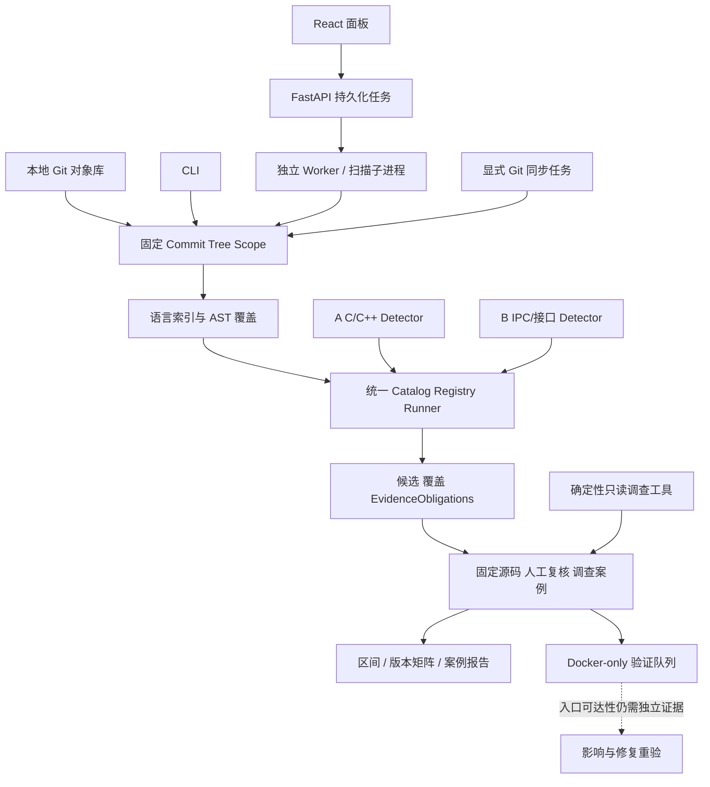

# 架构、模块边界与公共协议

更新：2026-10-14。实现状态以本分支代码、固定实验和项目现状文档为准。

## 一套内核，多个入口

Web 与 CLI 共用 execution.py；不得各造扫描器。历史工具对照与生产 Detector 分开。
未来 GitSyncService 独立显式联网；扫描仍只读本地固定对象，不隐式 fetch。

## 模块与九层目标

| 层 / 模块 | 代码入口 | 当前与后续边界 |
|---|---|---|
| L0 来源/版本 | git_source.py、workbench/service.py、operations.py | 本地登记/对象核验与显式 HTTPS clone/fetch 已接入；同步来源受限。多仓 Manifest 待做 |
| L1 索引 | indexing.py、frontend.py、parser | Tree-sitter 轻量 AST；不是完整类型/CFG/跨过程证明 |
| L2–L3 检测 | detectors/cpp、interface、runner.py | 已注册窄家族研究 Detector；语义增强由 A/B 做 |
| L4 证据/复核 | execution.py、workbench/service/store | 覆盖侧车、义务、源码绑定、追加复核已有；自动根因归并待评估 |
| L5 验证 | workbench/validation.py、validation_child.py、AUTH-01 Harness | Docker-only 服务与队列已接线；当前 WSL daemon/固定镜像不可用，真实容器验证 blocked |
| L6 分类 | candidate CWE / 后续 CVE 绑定 | 关联须有来源，不能用名称猜 CVE 或严重度 |
| L7 影响/修复 | workbench/operations.py、案例报告 | 双 SHA/日期区间与版本矩阵候选比较已接入；影响状态均 unknown，修复重验未跑通 |
| L8 交付 | operations_api.py、JSON/Markdown 案例报告 | 原始扫描包与案例 JSON/Markdown 导出已接入；报告确认数不自动升级，产品闭环未验收 |

M0–M4 是研发里程碑，不替代上述功能层。当前是 M2 公共工程 + Web 快照/复核已实现，
A/B 继续提升算法，M3 评价/可选 Agent 与 M4 闭环仍需验收。

## 当前实际契约

新第一方 Detector 结果已经输出 schema v2，逐诊断绑定 source_sha256；外部历史工具结果仍兼容读取 v1。v2 不重写历史 JSON、报告哈希、候选 ID 或复核记录。
主要类型在 src/ohscanner/contracts.py：
- ScanRequest：目标 repository、full commit、snapshot、profile、provenance。
- SourceUnit：规范相对路径、language、text、SHA-256、parse_status。
- ScanContext：排序/去重 SourceUnits 与 shared_facts。
- DetectorFinding：位置、rule/message、候选 CWE、EvidenceObligations；可选 consequence 仍是候选。
- DetectorRun：ID/version/status、analyzed_files/findings/limitations、可选 file_outcomes。
- Detector：ID/version、supported_languages/required_facts、detect(context, units)；精确签名读代码。

Registry 显式批准 factory，浏览器不能提供 Python 模块名或 Shell 命令。
Catalog 当前三个研究检测器：ohscanner.cpp.lifetime、ohscanner.cpp.shared_ptr_race、
ohscanner.interface.ipc。example Detector 不是正式漏洞检测能力。

状态必须分离：
- Web task：queued/running/completed_with_limitations/failed/cancelled/timed_out/interrupted 等。
- Detector execution：completed/blocked/failed。
- 文件覆盖：complete/partial/not_analyzed/failed；parse 状态另记。
- 人工复核与漏洞证据等级：不由 task completed 决定。

经过来源/范围验证的局部候选及义务不会因整体 blocked 而消失。
无 file_outcomes 的 legacy blocked 自报覆盖最多为 partial，不能推成 complete。
来源至少绑定 repository/full commit/tree/snapshot/file/blob/source SHA、
detector ID/version/rule/scope/profile；缺什么就记录缺口。

## IPC/接口确定性层与草案层

公共 Detector 契约和 schema v2 不变；`src/investigation` 是追加式调查支持层。

- `ohscanner.ipc-fact-bundle-v1`：绑定 repository/commit/tree/snapshot/report/file/blob/source SHA，
  重算 candidate/diagnostic/source identity，保留 Detector observation、coverage、EvidenceObligation
  与稳定 `fact_id`。机械完整性门可为 `met`；入口可达性、callee/policy、guard dominance、
  attacker control、CIA impact 默认保持 `unknown/missing`。
- `ohscanner.investigation-draft-v1`：保存 producer/model/prompt/tool provenance、输入 hash 与预算、
  假设、主张、缺失证据、建议探针和人工复核建议。所有主张必须引用有效 fact/evidence ID，
  模型输出按 untrusted content 处理，状态固定为 `draft_only` 且 `can_promote=false`。
- Workbench 新增候选级 investigation GET、append-only draft POST 和 JSON/Markdown 导出。
  SQLite investigation schema 是 operations v3 之后的 v4 迁移；旧报告、候选 ID、review 和
  source evidence 不重写。任何 draft API 都不能更新/删除草稿或改变扫描/漏洞状态。
## v1 读取兼容与 v2 第一方输出

当前第一方扫描结果使用 schema v2，兼容读取历史 v1 外部工具结果。旧 JSON、报告哈希、候选 ID 和人工复核保持原样；缺少来源绑定的旧记录为 unbound/unknown，不补写成 verified。

已完成 v2 字段与覆盖/义务语义收口，并回归 malformed payload、证据混用、partial/blocked、source hash、历史报告与新旧候选集合。旧工作台任务做过只读核验；尚未执行旧外部工具重新写入、损坏数据库恢复和完整浏览器历史任务回归。后续 schema 扩展仍须先独立提交协议测试，不与检测规则变化混写。

## 证据门与边界

默认 candidate/unassessed；partial/failed/未执行是 unknown，不是 safe 或 miss。
确认/报告需要固定目标、真实入口/攻击者控制或权限边界、可达敏感操作、
必要触发条件及具体 CIA 影响，记录可复核证据和仍未知项。
满足证据门后应升级并交付 PoC、影响/修复/报告，不能永久停留在 candidate。

常规扫描 Worker 使用任务子进程与资源限制，不等于逐 Detector 沙箱。AUTH-01 动态 Harness 只允许走独立 Docker Worker；容器无网络、去 capabilities、只读根目录、限制资源。当前 WSL 缺 Docker daemon/固定镜像，实际 PoC 没有运行。
超时不发布残缺候选包；缺失分析保持 unknown。
数据库中的报告 hash、报告内 Markdown hash 与固定 blob 清单防意外混用，
不保证主机/数据库被完全控制后的完整性。

## 扩展原则

新源码同步、区间/版本、Agent、验证模块复用同一任务/证据服务。
文件级 AST 缓存可用 blob+parser+配置；跨文件语义要绑定依赖/宏/编译配置。
2000 文件/32MiB 总源码/1MiB blob 是当前限制，不直接移除来冒充全系统覆盖。
扩容先 batch Git、分片/聚合与覆盖不变性实验，再测 wall/RSS。

## 本轮新增操作面与验收状态

workbench operations API 使用单独的 SQLite operation 表与迁移备份，范围包括显式仓库同步、固定双 SHA 区间、带时区的 committer-date 区间、版本矩阵、只读调查、验证任务、操作事件/取消/日志/结果 hash，以及案例 JSON/Markdown 报告。区间端点扫描与 operation 记录在同一事务创建；扫描仍只读本地固定对象。

运行时影响和漏洞确认仍是独立层。候选变化返回 added/persistent/disappeared/unknown 等观察关系，不推导漏洞引入或修复；版本矩阵 impact=unknown。候选聚类仅用于审查浏览，按固定快照、Detector 版本、规则、文件、符号、源码 SHA 聚合展示，原始候选身份和位置不变；聚类不代表共同根因。只读调查输出固定源码、义务、Git 历史和有限符号信息，不调用模型或 arbitrary shell。AUTH-01 组件触发不证明真实产品入口可达，confirmed/reportable 仍需人工审查与额外证据。
