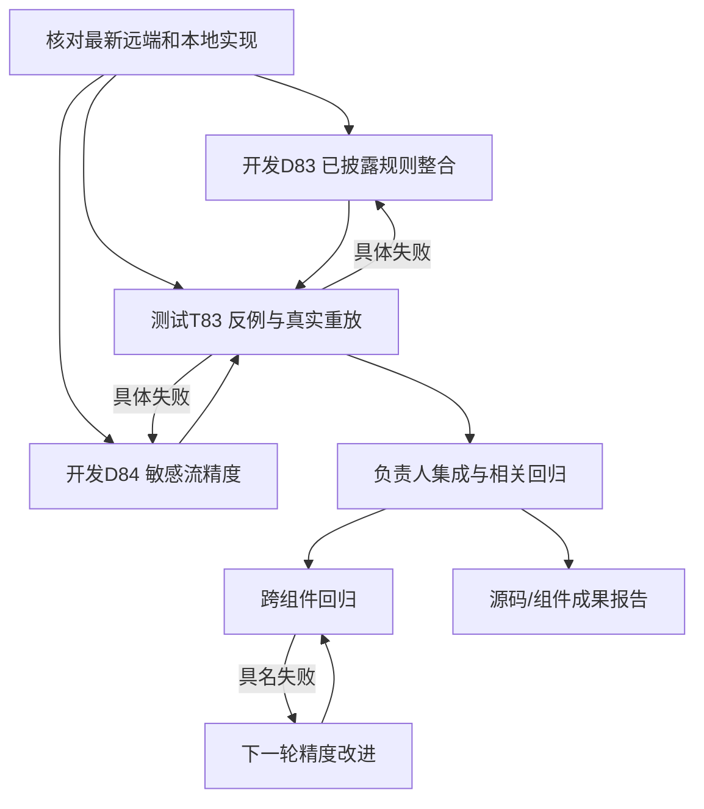

# D 线并行开发与测试计划（2026-10-20）

已成功 fetch 远端。当前负责人基线包含最新 origin/main 与远端 D-next；本地 D68 的 Pasteboard 修复现已由 D83 逐文件迁入并修正具体反例。所有分支、完整 SHA 和工作树见同目录 D_LINE_TASK_TREE_20261020.json，本机路径见 records/d-line-parallel-20261020-01a1571f/workspace-manifest.json。

本轮结果：D83/D84/D85、T83/T84已完成并集成，140项相关测试通过。详见 [交付报告](D_LINE_ROUND_SUMMARY_20261020.md)。以下提示词保留本轮角色和接续设计；实际状态以任务树为准。

接续轮已执行 D86/T85：`alignof` 类型对齐误报修复至敏感流0.21.3；T85固定源码和D86固定实现复放均已集成。负责人集成验证为108项data + 39项known/corpus，共147项通过。第二层模型仍未实现。

## 基线情况与本轮取舍

本轮起点敏感数据 detector 为 0.21.0，已有有界跨文件 helper summary、成员写入/返回 may-flow 和固定 profile；known-CVE 起点为 0.18.0，本地已测代码当时到 0.19.10；本轮结果分别为0.21.2与0.19.11。旧产品画像和真人holdout记录只描述证据局限，不阻塞本轮开发。先整合成熟修复，再修具体反例，避免重做旧审查。

静态层优先提供有具体源码位置、source/sink关系与guard观察的少而有依据候选。可供未来模型逐案查看；本轮不开发、接入或调用第二层模型。保留未知与有效局部候选，不靠硬数量上限或无依据抑制制造“低误报”。

## 任务树与并行

首轮 D83、D84、T83 已真实执行完成，三条线文件所有权互不冲突；开发者可补其原有控制，测试者维护独立反例文件。负责人只在各线提交后选择性集成，保留其他工作树改动。

## 各线结构化 Vibe Coding 提示词

### D83

角色：已披露组件规则开发。目标：整合本地已测 Pasteboard 修复，处理一个实际候选质量问题。输入：当前基线与固定 D68 ref，先比较再迁入。范围：known_cves.py、其原测试和 D83 报告。动作：保留正例/fixed/safe/unrelated/unknown；关注配额guard容器、时序、退出与返回值，权限provenance未知不作有效guard。与T83交换最小失败，修复后复测。交付：本地提交、规则版本、相关测试、固定源码候选及差异。完成：具体反馈闭环；不另做产品治理审计。

### D84

角色：敏感流静态开发。目标：修一个日志格式参数、public/private/脱敏或值重赋值绑定的实际缺口，少出无依据候选。输入：sensitive_exposure.py 0.21.0、models及现有控制。范围：data实现与专属测试、D84报告。动作：先给修复前失败，最小实现，正反/未知控制和必要真实重放；与T83互馈。交付：代码提交、命令、实际候选变化与限制。完成：具体失败关闭且相关回归通过。不得用一律抑制候选来“提精度”。

### T83

角色：反例测试与真实重放。目标：独立挑战D83/D84的实际行为并回传可复现失败。输入：明确开发提交、固定源码；准备工作无需等开发。范围：两个独立adversarial测试文件和T83报告。动作：用guard错序/错receiver/忽略返回、格式参数和重赋值反例测试；向开发发最小失败；取得修订提交后复测；至少一次固定真实源码重放。交付：测试提交、开发输入SHA、命令与真实结果。完成：失败闭环或明确限制；不对同一unknown无限复验。

### D85

角色：下一轮候选精度开发。当前具名目标：修复T83发现的有效std::string值经c_str()输出时传播丢失，仅在接收者依据充分时建模，不泛化任意同名方法。随后依据T83/T84的具名失败挑选下一项可执行改进。输入：集成后的固定版本、失败样本和候选差异。范围：事先记录所需最小实现/测试，公共接线已授权。动作：分析具体source-to-sink关系或抑制误判，修复并与T84互馈。交付：实现、正反控制、同源复放。没有真实失败时先扩大一个可获取组件的回归，不能编造任务或重复未知报告。

### T84

角色：跨组件回归测试。目标：对集成版本检查候选依据和跨组件回归。输入：冻结集成提交、可获取的DSoftBus/Wi-Fi/Pasteboard固定源码。动作：按同源同范围记录候选、覆盖、耗时；审查新增/消失的具体原因，具体失败回D85修复后复测。交付：真实重放与差异表、命令和未知。无可靠标签不报Precision/Recall，不把0候选称为安全。

## 持续执行目标

首轮交付为两条开发变更、测试反馈闭环、至少一个真实源码重放与集成报告。随后按T84具名失败或可获取的下一组件推进D85，不等待产品fingerprint、真人盲审、签署或全案例闭合。每轮以实际代码/测试/可用报告完成，不无限追加无变化审计。机器任务树随执行状态更新；正式准确率与产品结论只按实际证据报告。

### D86（下一开发切片）

角色：候选精度开发。目标：依据T83的heuristic覆盖观察定义明确来源与硬编码秘密的语义边界。输入：当前0.21.2、具名对照；范围：data模型/实现和专属控制。动作：先验证何种值能明确认定公开，不把env空流等同公开、不删除真实硬编码秘密候选；只有证据充分的误报才修。交付：实际反例、最小实现、相关正反/未知测试，与T85互馈。

### T85（下一测试切片）

角色：真实结构回归测试。目标：选择实际包含compound/c_str新增结构的公开固定源码样本。动作：自行获取可用源码，记录原始字节/版本/范围，执行前后对照，把具名source-to-sink差异反馈D86；没有找到就报告搜索范围并选其他可执行组件，不要求产品资料。交付：可重放样本、候选/覆盖差异和限制，不报无标签准确率。

### D87（下一开发切片）

角色：敏感流候选精度开发。具名输入：T85发现证书框架的 `CERT_PASSWORD` 固定定义为属性键字符串 `"password"`，经 `.c_str()` 用于 NAPI 属性名检查，并进入当前 unresolved-escape 候选；这不是已证明的密码值泄漏。先沿常量定义、赋值、已知 API 参数角色建立 AST 可证明的用途关系，再决定可否排除纯属性名候选。只为精确绑定的常量/参数角色增加窄规则；保留真实密码字节、未知包装函数和不完整解析候选。交付：修复前反例、具名正/安全/歧义/未知控制、T86独立反馈、同一固定证书源码前后复放、版本/测试/限制。若 sink 角色证据不足，交付语义分析与不可安全抑制的结论，不靠名称或字面值硬删候选。

### T86（下一测试切片）

角色：D87独立反例与用途绑定测试。目标：固定证书源码中的 `CERT_PASSWORD` 证据链，拆分“属性键字符串”“用户密码值”“仅被命名为password的无关文本”“经未知helper包装的值”。准备独立测试，先对D87提交运行；逐个记录候选身份、source/sink/参数角色和覆盖状态。出现误抑制立即反馈D87并要求修复后复测；无变化时保留结果并转测另一个有源码依据的常量用途边界，不重复堆砌unknown检查。交付：独立测试提交、修订SHA、固定实源复放和限制，不报告无标签准确率。
