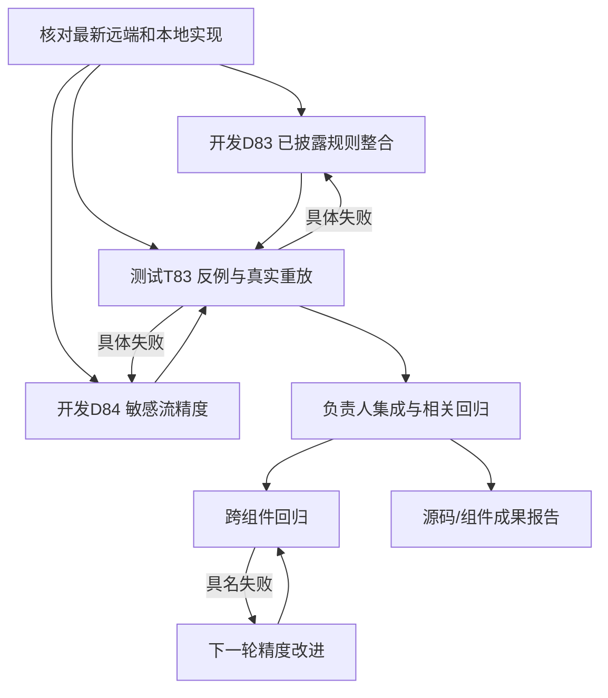

# D 线并行开发与测试计划（2026-10-20）

已成功 fetch 远端。当前负责人基线包含最新 origin/main 与远端 D-next；本地 D68 的 Pasteboard 修复现已由 D83 逐文件迁入并修正具体反例。所有分支、完整 SHA 和工作树见同目录 D_LINE_TASK_TREE_20261020.json，本机路径见 records/d-line-parallel-20261020-01a1571f/workspace-manifest.json。

本轮结果：D83/D84/D85、T83/T84已完成并集成，140项相关测试通过。详见 [交付报告](D_LINE_ROUND_SUMMARY_20261020.md)。以下提示词保留本轮角色和接续设计；实际状态以任务树为准。

接续轮已执行 D86/T85、D87/T86 与 D88/T87：敏感流到0.21.5；T86独立发现并关闭三类引用遮蔽误抑制，T87独立验证成对空C++ linkage投影。负责人当前复验为132项data + 39项known/corpus + 16项新解析控制，共187项通过。第二层模型仍未实现。

## 基线情况与本轮取舍

本轮起点敏感数据 detector 为 0.21.0，已有有界跨文件 helper summary、成员写入/返回 may-flow 和固定 profile；known-CVE 起点为 0.18.0，本地已测代码当时到 0.19.10；本轮结果分别为0.21.2与0.19.11。旧产品画像和真人holdout记录只描述证据局限，不阻塞本轮开发。先整合成熟修复，再修具体反例，避免重做旧审查。

静态层优先提供有具体源码位置、source/sink关系与guard观察的少而有依据候选。可供未来模型逐案查看；本轮不开发、接入或调用第二层模型。保留未知与有效局部候选，不靠硬数量上限或无依据抑制制造“低误报”。

## 任务树与并行

首轮 D83、D84、T83 已真实执行完成，三条线文件所有权互不冲突；开发者可补其原有控制，测试者维护独立反例文件。负责人只在各线提交后选择性集成，保留其他工作树改动。

## 各线结构化 Vibe Coding 提示词

### D83

角色：已披露组件规则开发。目标：整合本地已测 Pasteboard 修复，处理一个实际候选质量问题。输入：当前基线与固定 D68 ref，先比较再迁入。范围：known_cves.py、其原测试和 D83 报告。动作：保留正例/fixed/safe/unrelated/unknown；关注配额guard容器、时序、退出与返回值，权限provenance未知不作有效guard。与T83交换最小失败，修复后复测。交付：本地提交、规则版本、相关测试、固定源码候选及差异。完成：具体反馈闭环；不另做产品治理审计。

### D84

角色：敏感流静态开发。目标：修一个日志格式参数、public/private/脱敏或值重赋值绑定的实际缺口，少出无依据候选。输入：sensitive_exposure.py 0.21.0、models及现有控制。范围：data实现与专属测试、D84报告。动作：先给修复前失败，最小实现，正反/未知控制和必要真实重放；与T83互馈。交付：代码提交、命令、实际候选变化与限制。完成：具体失败关闭且相关回归通过。不得用一律抑制候选来“提精度”。

### T83

角色：反例测试与真实重放。目标：独立挑战D83/D84的实际行为并回传可复现失败。输入：明确开发提交、固定源码；准备工作无需等开发。范围：两个独立adversarial测试文件和T83报告。动作：用guard错序/错receiver/忽略返回、格式参数和重赋值反例测试；向开发发最小失败；取得修订提交后复测；至少一次固定真实源码重放。交付：测试提交、开发输入SHA、命令与真实结果。完成：失败闭环或明确限制；不对同一unknown无限复验。

### D85

角色：下一轮候选精度开发。当前具名目标：修复T83发现的有效std::string值经c_str()输出时传播丢失，仅在接收者依据充分时建模，不泛化任意同名方法。随后依据T83/T84的具名失败挑选下一项可执行改进。输入：集成后的固定版本、失败样本和候选差异。范围：事先记录所需最小实现/测试，公共接线已授权。动作：分析具体source-to-sink关系或抑制误判，修复并与T84互馈。交付：实现、正反控制、同源复放。没有真实失败时先扩大一个可获取组件的回归，不能编造任务或重复未知报告。

### T84

角色：跨组件回归测试。目标：对集成版本检查候选依据和跨组件回归。输入：冻结集成提交、可获取的DSoftBus/Wi-Fi/Pasteboard固定源码。动作：按同源同范围记录候选、覆盖、耗时；审查新增/消失的具体原因，具体失败回D85修复后复测。交付：真实重放与差异表、命令和未知。无可靠标签不报Precision/Recall，不把0候选称为安全。

## 持续执行目标

首轮交付为两条开发变更、测试反馈闭环、至少一个真实源码重放与集成报告。随后按T84具名失败或可获取的下一组件推进D85，不等待产品fingerprint、真人盲审、签署或全案例闭合。每轮以实际代码/测试/可用报告完成，不无限追加无变化审计。机器任务树随执行状态更新；正式准确率与产品结论只按实际证据报告。

### D86（下一开发切片）

角色：候选精度开发。目标：依据T83的heuristic覆盖观察定义明确来源与硬编码秘密的语义边界。输入：当前0.21.2、具名对照；范围：data模型/实现和专属控制。动作：先验证何种值能明确认定公开，不把env空流等同公开、不删除真实硬编码秘密候选；只有证据充分的误报才修。交付：实际反例、最小实现、相关正反/未知测试，与T85互馈。

### T85（下一测试切片）

角色：真实结构回归测试。目标：选择实际包含compound/c_str新增结构的公开固定源码样本。动作：自行获取可用源码，记录原始字节/版本/范围，执行前后对照，把具名source-to-sink差异反馈D86；没有找到就报告搜索范围并选其他可执行组件，不要求产品资料。交付：可重放样本、候选/覆盖差异和限制，不报无标签准确率。

### D87（下一开发切片）

角色：敏感流候选精度开发。具名输入：T85发现证书框架的 `CERT_PASSWORD` 固定定义为属性键字符串 `"password"`，经 `.c_str()` 用于 NAPI 属性名检查，并进入当前 unresolved-escape 候选；这不是已证明的密码值泄漏。先沿常量定义、赋值、已知 API 参数角色建立 AST 可证明的用途关系，再决定可否排除纯属性名候选。只为精确绑定的常量/参数角色增加窄规则；保留真实密码字节、未知包装函数和不完整解析候选。交付：修复前反例、具名正/安全/歧义/未知控制、T86独立反馈、同一固定证书源码前后复放、版本/测试/限制。若 sink 角色证据不足，交付语义分析与不可安全抑制的结论，不靠名称或字面值硬删候选。

### T86（下一测试切片）

角色：D87独立反例与用途绑定测试。目标：固定证书源码中的 `CERT_PASSWORD` 证据链，拆分“属性键字符串”“用户密码值”“仅被命名为password的无关文本”“经未知helper包装的值”。准备独立测试，先对D87提交运行；逐个记录候选身份、source/sink/参数角色和覆盖状态。出现误抑制立即反馈D87并要求修复后复测；无变化时保留结果并转测另一个有源码依据的常量用途边界，不重复堆砌unknown检查。交付：独立测试提交、修订SHA、固定实源复放和限制，不报告无标签准确率。

### D88（下一开发切片）

角色：共享C/C++前端的窄语法修复开发。具名失败：T85证书框架固定 `cf_log.h` 在分开的 `#ifdef __cplusplus` 中跨行包住 `extern "C" {` 与 `}`；原始tree-sitter解析把整个条件区间标为ERROR，导致常量跨文件绑定保守失效。先把字节级最小复现和固定源失败交给T87。只识别成对、结构完整、无歧义的C++链接包装并以等字节/等行归一化；不得忽略任意条件分支或把partial强改complete。加合法正例、缺闭合/重复/alternate branch/相似普通extern负例，记录offset不漂移。完成后同一T85三文件重放并运行共享相关测试。

### T87（下一测试切片）

角色：独立前端边界测试。目标：固定复现 `cf_log.h` 的成对跨条件extern C；独立构造完全匹配、未配对、顺序歧义、分支有实际声明、普通extern等控制。检验解析状态、函数/宏体保留、源码行列/字节映射不变；用原T85三文件和D87固定版本跑候选/coverage同源对照。任何未配对变complete或真实路径/行偏移改变即反馈D88，修订后复测。交付独立用例、固定源差异、partial限制和完整命令，不报无标签准确率。

### D89（下一开发切片）

角色：敏感流候选语义开发。输入：T87固定源码显示，证书框架 `utils.cpp:349` 的 unresolved-escape候选把 `CERT_PASSWORD.c_str()` 传入 `LOGE`；完整固定 `cf_log.h` 中 `LOGE→CF_LOG_E→CfPrintLog/HILOG_ERROR` 是有据可查的日志宏链，来源则是值为 `"password"` 的schema属性名。目标：证明精确局部宏定义链、绑定属性常量和该日志参数的数据角色后，消除纯属性名材料候选；真实密码内容仍可达同类日志/输出时必须继续报警。只认完整解析、无宏重定义/歧义的同一固定源码；altered macro、unknown wrapper、partial header及实际密码值保留。先对T88最小失败，交付源码前后Runner诊断/identity/coverage及正反控制。

### T88（下一测试切片）

角色：D89独立日志宏/材料边界挑战。对固定证书真实源码以及具名最小控制测试：schema-key常量经准确`LOGE`宏链、同名但真实password参数、用户值进入format operand、unknown wrapper、重定义/别名宏、partial header。先对D89提交独立跑测，逐案记录候选source、sink、宏链与运行器诊断身份；任何实际secret漏检立即反馈并复测。固定T85三文件比较Runner完整finding identity和覆盖；不能把直接detector结果代替Runner，不能仅凭候选数判断准确度。

### D90（当前开发切片）

**结构化 vibe coding 提示词**

- **角色**：敏感流静态分析开发负责人。
- **固定输入**：整合后的 D89/T88；`D89_VALIDATION_20261020.json` 与其 SHA 绑定的 T85 三文件 direct/Runner 重放。remaining Runner traces 在 `napi_cert_utils.cpp` 的 `CfFree`、`CF_FREE_PTR`、`CfBlobDataFree`、`memset_s` 清理调用处出现 unresolved-escape。
- **目标**：调查这些候选是否属于释放/擦除而非数据外泄，并从真实精确头文件/实现建立身份与参数角色。只有可证明的精确函数体/声明和无泄漏效果，才考虑局部排除；函数名相似、未知实现、同名自定义包装、宏别名歧义或不完整源码都保留候选。
- **正控制**：已绑定的纯清理调用在精确证明下可减少候选。
- **反控制**：参数被写日志/返回/保存到全局的同名包装，敏感值与清理参数混合，函数/宏重定义、未知 wrapper、部分头文件均保留候选。
- **验证**：固定开发 SHA；新增独立单元控制；运行数据检测器套件；比较 T85 原三文件 direct 和 Runner 的完整 finding identity、coverage、源字节和 AST 位置。只报告实际证据，不把候选数量称为准确率。
- **交付**：实现与自有测试/研究证据独立提交，说明身份、作用域、剩余未知和对 T89 的挑战点；不推送。

### T89（与 D90 并行的独立测试线）

**结构化 vibe coding 提示词**

- **角色**：独立安全测试与源码证据审查员；不要复用 D90 的结论作为预期答案。
- **输入**：D89 固定 T85 源码归档和 Runner 身份证据；独立检查 `CfFree`、`CF_FREE_PTR`、`CfBlobDataFree`、`memset_s` 的真实定义、声明、宏展开来源及调用参数。
- **测试矩阵**：确证的释放/擦除；同名但把材料写入全局/日志/返回值的自定义实现；清理与实际输出混合；宏别名/重定义；未知或缺失头文件；局部遮蔽。
- **反馈规则**：任何反控制被压掉立即反馈 D90 并在修复 SHA 上重测；若源码无法证明纯清理，明确记录“保留候选”的证据，不为了减少候选而放宽规则。
- **验证**：对固定 D90 SHA 独立运行测试，并用原 T85 三文件分别跑 detector 与 Runner；记录每条诊断身份、消息、覆盖、raw hashes 和 AST spans 的前后变化。不得用 direct 结果代替 Runner，也不得声称正式精确率/召回率。
- **交付**：独立测试、复现命令和证据报告；保留工作树中的源档缓存，不推送。

### D91（当前开发切片）

**结构化 vibe coding 提示词**

- **角色**：敏感流数据角色建模开发者。
- **固定证据**：D89/T88/T90 handoff 指向 `napi_cert_utils.cpp:185` 的 `napi_typeof` unresolved-sink候选；同一函数的 `napi_get_value_string_utf8` 第192/208行实际提取材料，不能被连带压掉。
- **目标**：从固定版本 N-API 声明/实现确认 `napi_typeof(env,value,&type)` 的精确输入、输出和返回角色；只有确定扫描输入中绑定到该 API 的调用，且完整声明与局部/宏身份未被遮蔽时，才能考虑把类型枚举/status与秘密字节分离。
- **必须保留**：同名本地函数/函数指针、自定义包装、宏改写、缺失/partial头、未知版本和 `napi_get_value_string_utf8` 实际数据输出。不得按拼写全局豁免，不得把 API 知识伪装成源码绑定事实。
- **验证**：具名元数据正例、实际材料提取正例、同名/宏/partial/unknown反例；固定T85三文件 direct 与 Runner完整诊断、coverage、call facts 前后对照，所有身份字段unknown如实记录。
- **交付**：实现或“保留候选”的证据报告、测试、T90反馈修订闭环；如果API身份无法由静态输入证明，默认不作排除。

### T90（并行独立测试切片）

**结构化 vibe coding 提示词**

- **角色**：独立API契约与数据流边界测试员，不依赖D91的安全结论。
- **输入**：固定证书版本和 T85 三文件；独立确认对应 N-API 公共契约/版本及 `napi_typeof` 的入参、输出参数、返回值。
- **控制**：精确 type-check元数据调用；相邻真实 `napi_get_value_string_utf8` 字节提取；同名自定义函数/回调、重定义宏、未知包装、缺失或partial声明。
- **反馈**：若同名或未知绑定被排除，立即交D91修复并在固定SHA重跑；若仅API文档证明一般契约却无法证明当前调用身份，明确报告unknown并建议保留。
- **验证**：fresh-process D91前后完整src归档；严格固定三文件 direct/Runner诊断identity、message、coverage、原始source/call facts比较。不能用直接detector替代Runner，也不能将诊断计数当准确率。

### D92（当前开发切片）

**结构化 vibe coding 提示词**

- **角色**：NAPI schema-key 数据角色开发者。
- **固定证据**：T85 certificate commit `e270363a042bf8f0126881c76d1341ad457cc187`，源文件 SHA-256 `5b5e868bb0b11d8b5172a46c4de49a4fd1548f0a8c261c3c1f141eb033f72bc3`；`napi_cert_utils.cpp:298` 把 `CERT_PRIVATE_KEY.c_str()` 放在 `napi_get_named_property` 第三实参（0基 arg2），同一固定 `napi_cert_defines.h` SHA-256 `32280166d5a19a2dc4a9709458bcb878d28ef13f2ca06b488d6222d310e2ec80` 定义该不可变字符串为 `"key"`。当前只识别 `CERT_PASSWORD="password"`，因此产生名称启发式候选。
- **目标**：精确绑定常量符号和值及 property-read API 的名称参数角色，只排除这个 schema key 的值来源；不抑制 NAPI 输出参数取出的 private-key 内容及后续 sinks。
- **反控制**：同名局部变量/参数、不同字面量、常量出现在输出位置、未知 wrapper、API 同名自定义实现、缺少/partial头、实际材料输出都保留候选。不得放宽成“所有 const string 都是安全key”。
- **验证**：固定 T85 三文件 direct 与 Runner重放；完整诊断ID/message/identity status、coverage、source byte/hash与AST位置比较；只在确凿角色证据下减少候选。
- **交付**：开发代码、具名正反控制和限制报告，收到T91挑战后修复复测。

### T91（并行独立挑战线）

**结构化 vibe coding 提示词**

- **角色**：独立源码/语义挑战者；不复用D92测试作为独立基线。
- **输入**：从固定 upstream Git objects 自行提取e270的utils和defines文件，复核commit/tree/blob/bytes/SHA，以及第298行参数索引和 `CERT_PRIVATE_KEY="key"` 声明。
- **矩阵**：arg2 精确property key；arg3输出引用；不同key常量/同名字面量；参数/局部遮蔽；错位实参；未知包装/同名函数；partial/missing defines；实值流至日志/复制/返回。
- **反馈规则**：若输出实值、错位参数或未知调用被压掉，立即交D92修复并固定SHA复测。
- **验证**：对D92完整`src/` Git archive在新进程运行独立控制与T85原三文件direct/Runner；报告所有finding变化、identity字段未知、coverage与raw source/call spans。不能凭count宣称准确率。

### D93（当前开发切片）

**结构化 vibe coding 提示词**

- **角色**：N-API 字符串访问语义与敏感流候选开发者。
- **固定输入**：D92/T91 的原证书三文件和完整身份重放。`napi_cert_utils.cpp:890` 使用 `napi_get_value_string_utf8(env,arg,nullptr,0,&length)`查询长度；第915行才把真实字节写入 `newBlob->data`。
- **目标**：确认空缓冲区/零容量调用的精确API角色、length输出如何流动，以及证书组件的BUILD/include是否绑定到某个具体声明和实现版本。只有调用身份与参数角色可由当前选定输入证明时，才处理第890行的候选。
- **必须保留**：第915行字节复制、length进入日志/分支等实际依赖、同名自定义函数/函数指针、宏改写、未知wrapper、缺失或partial声明。不能仅凭函数名全局豁免。
- **验证**：最小query、实际buffer write、length日志和输出、same-name body/callback、宏重定义和partial/missing API控制；固定T85三文件 direct/Runner诊断身份/coverage/原始跨度前后比对。
- **交付**：若版本绑定无法证明，报告保留candidate的证据，不为减少数量编造安全结论；提交报告、控制测试、完整源档replay及对T92反馈修复。

### D94（当前开发切片）

**结构化 vibe coding 提示词**

- **角色**：敏感数据流与有界指针输出建模开发者。
- **固定失败证据**：阅读 `D93_POINTER_OUTPUT_GAP_20261020.json`。完整可见自定义helper执行 `*length = (unsigned char)value[0]`，调用者随后记录 `length`；当前结果为0 candidate、coverage partial，原因为 `pointer/member assignment requires alias proof`。此项是已知未通过，不是安全metadata正控。
- **目标**：让无法证明目标别名的material-derived标量指针写入至少保留 unresolved write/call candidate；目标别名可证明时，将材料继续传播到后续sink。literal-only常量metadata写入不应产生material来源候选。
- **反控制**：局部变量/指针成员/引用和安全可证明别名；同名自定义helper、参数与局部shadow、目标未知、callback、宏覆盖、missing/partial声明、混合literal与material写入。不得按函数名放行或将unknown alias推断为安全。
- **反馈和边界**：先新增能复现原失败的测试，反馈T93；仅实现必要的alias/write范围，不扩成通用C++别名分析。不能跟踪时保留候选并标明partial/unknown。
- **验证交付**：专项控制与全data测试；T85三文件及D93/T92固定重放，比较诊断身份/证据、coverage、638调用事实及890/915；提交源码、测试、固定重放报告与限制。

### T93（并行独立挑战线）

**结构化 vibe coding 提示词**

- **角色**：独立敏感流反例测试员；自行从最新owner HEAD构建基线，不把D94的期望结论当作oracle。
- **测试矩阵**：复现材料派生的 `*length=(unsigned char)value[0]` 后续日志；可证明与不可证明的指针别名；literal-only metadata；shadow/局部遮蔽；同名helper真实副作用；callback/macro；unknown和partial输入。
- **反馈规则**：若material-derived write在目标未知时静默变为无候选，立即反馈D94并在修订SHA复测；若literal metadata引入材料候选或已证明alias没有传播，也反馈修正。所有未覆盖情形保留unknown/partial。
- **固定回归**：用D94固定完整src归档和原T85 direct/Runner重放，并复核D93/T92 890/915 source identity、共同诊断/coverage、638调用事实。不得只跑detector或将candidate数当准确率。
- **交付**：独立控制测试、source/build身份、hash、精确候选差异和限制报告；不删除缓存或原始证据，不推送。

### D95（当前开发切片）

**结构化 vibe coding 提示词**

- **角色**：有界 C/C++ 指针目标状态与分支合并开发者。
- **基线**：D94/T93最终owner集成，敏感规则0.21.9。D94只追踪有限raw-pointer槽；这轮只核验路径合并/作用域状态，不扩成通用别名分析。
- **目标控制**：if/else两支均指向同一个已知标量/成员目标时，`*p=material`应继续传播到该目标sink；两支指向不同目标、一路无效或目标未知时，应保留unresolved material-write candidate，不能同时把两个目标都当作确定受影响。
- **状态控制**：分支后重绑定必须替换旧目标；内层同名pointer/scalar离开scope后恢复外层绑定；循环内目标变化不能泄漏过期alias。保留literal-only写入无材料候选、真实memcpy/out-slot写入传播、未知目标候选和`static_cast<T>(nullptr)`不生source。
- **反馈和范围**：先复现具体失败并交T94。只实现最小路径状态合并；没有失败就不改代码，提交具名验证与边界报告。不得放宽候选规则以迎合分支正控。
- **验证**：固定T85 direct/Runner仍24；24共同ID/message/evidence、638调用事实、890/915与3 partial coverage不退；专项测试与完整data、AST/parser/known/linkage回归通过。

### T94（并行独立挑战线）

**结构化 vibe coding 提示词**

- **角色**：独立指针路径状态挑战员；从owner D94/T93 HEAD自行构建baseline，独立生成代码片段并核对Runner。
- **矩阵**：两支汇合到相同目标；两支目标不同；存在无效/null/未知分支；分支后重绑定；块级pointer/scalar shadow与scope恢复；循环内重新绑定。记录哪些路径可证明、哪些必须unknown。
- **安全反例**：literal-only metadata不得造材料；真实material经memcpy或pointee写入且后续日志必须保留；unknown write不得静默消失；nullptr cast不生source。
- **反馈**：对每个失败立即反馈D95并固定修订SHA重跑；当D95没有修复必要时，提交“现有保守行为满足控制”的独立证据，不强行要求代码变化。
- **固定回归**：fresh-process完整src、T85 direct/Runner以及D93/T92 890/915。逐项比24共同诊断身份/消息/证据、638原始调用位置与coverage；不把数量当准确率。
- **交付**：独立源码测试、重放脚本、固定对象及SHA/coverage报告；不提交cache/临时records，不推送。

### D96（当前开发切片）

**结构化 vibe coding 提示词**

- **角色**：C++ 控制语句声明/初始化器作用域与有界指针绑定开发者。
- **基线**：owner 集成 HEAD `9c298fefe`，规则0.21.10，D95 已恢复 for-header 声明的循环外绑定。
- **范围**：只检查 `if`/`while`/`switch` 的 condition declaration、init-statement 和其内层 pointer/scalar shadow 是否在控制语句结束后恢复外层状态；另检查受支持语法下 range-for 声明生命周期，不改通用C++别名模型。
- **正反控制**：外层 `p=&outer`；控制语句内声明/重绑 `p=&inner` 并退出，后续 `*p=material` 应回到 outer。覆盖 body block shadow、分支目标不同/无效路径、break/continue/return，以及嵌套控制语句。只跟踪能由解析器证明的绑定；未知语法保留 unknown/partial。
- **反馈**：先以最小fixture复现并交T95；有具体失败才修改。严禁把新语法解析失败当作安全，或同时污染两个不确定目标。
- **验证和交付**：具名专项控制、完整data和兼容性测试；固定T85 direct/Runner候选身份、638调用事实、890/915及partial状态不退。提交修复/无缺陷验证、固定回放、限制和SHA。

### T95（并行独立挑战线）

**结构化 vibe coding 提示词**

- **角色**：不依赖D96实现的独立控制语句作用域挑战员。
- **基线**：自行冻结 owner D95/T94集成提交，独立构造编译器可接受的C++ fixture；确认工具链/解析器是否支持对应语法。
- **挑战矩阵**：if init-statement与condition declaration；while condition declaration及循环退出/continue；switch init-statement/condition；嵌套shadow；range-for iterator；break/return后外层指针恢复。区别“控制语句声明生命周期结束”和“body块本地shadow结束”。
- **反馈**：报告实际绑定/候选与期望语义；具体漏流或错误扩散立即交D96，并对固定修订SHA复测。不可把编译器/解析器不支持算通过；记录not_run/unknown。
- **固定回归**：fresh-process完整src和T85 direct/Runner；比对候选ID/evidence、638 calls、coverage状态与版本字段。无缺陷时说明语法覆盖边界，不强迫改代码。
- **交付**：独立测试、源码/工具链身份、控制矩阵结果、重放报告和commit SHA；不推送owner分支。

### D97（当前开发切片）

**结构化 vibe coding 提示词**

- **角色**：C++ switch case 目标合流与敏感流候选精度开发者。
- **基线**：D96/T95 owner 集成，规则0.21.11。T95已确认：switch header pointer 声明可绑定，但case内部对外部指针的多路径重绑，即使目标相同也仍被保守标成 unresolved，因为尚未证明case覆盖和fallthrough。
- **目标**：只评估能否对显式、有限且无歧义的 case/default 控制流证明所有到达写入点的指针目标相同，从而减少 unresolved 候选；不可证明则保持现状并交付边界报告。不得用候选数当标签。
- **矩阵**：穷尽与非穷尽标签；有/无default；case break；自然fallthrough；return；重复/冲突标签；未知selector；不同目标/无效目标；内层shadow和switch后外层绑定。
- **护栏**：任何可到达路径目标分歧、缺失default、unknown selector相关状态不明或case语法不支持时，必须保留 unresolved，不把多个目标都定为命中。不能扩展为通用CFG。
- **反馈/验证**：先冻结小型reproducer并交T96；有严格可证明安全的静态反例才改动。跑独立矩阵、data和兼容性、T85 direct/Runner并比较finding identity/evidence、638 call facts、coverage；提交限制、SHA和复放。

### T96（并行独立挑战线）

**结构化 vibe coding 提示词**

- **角色**：独立 switch 分支语义挑战者；先独立建立C++控制流期望，不复用D97的分类作为oracle。
- **矩阵**：switch每个case指向相同/不同标量；有无default；break/fallthrough/return混合；case间重绑定；selector unknown与literal；嵌套shadow；结束后外层指针恢复。区分仅语法可枚举与运行时确实可达。
- **反馈**：发现实际material sink静默漏报或不确定路径被定为exact时立即给D97最小片段和证据；对D97修订SHA fresh-process复测。若目前只能保持unresolved，明确这属于候选精度限制，不宣称已验证安全。
- **固定回归**：完整src固定归档与T85三文件direct/Runner；记录identity/evidence、638 call facts、890/915和coverage。输出测试代码、数据、固定源身份与报告；不推送owner。

### T92（并行独立挑战线）

**结构化 vibe coding 提示词**

- **角色**：独立实现身份和数据流边界测试员。
- **输入**：从固定upstream对象独立检查e270证书utils、BUILD.gn/include和D91/T90记录的arkui_napi/third_party_node对象。不要把同名函数或“master”分支视为版本绑定。
- **挑战矩阵**：line890标准query、length值后续日志/返回/条件、line915真实buffer写入、同名自定义函数/函数指针、宏覆盖、缺失/partial声明与未知wrapper。
- **反馈**：若仅名称/空指针形状就抑制自定义或未绑定调用，反馈D93修复；若证据不够，要求原范围保留候选。
- **验证**：fresh-process完整src档案对照，T85严格三文件direct和Runner逐项记录findings、legacy ID/message、identity unknown、coverage和source/call spans；不把数量变化当准确率。
