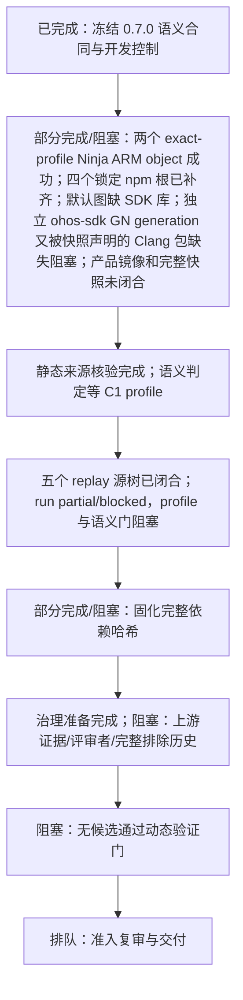

# C 线任务树与 Vibe Coding 提示词

更新时间：2026-10-19（中国标准时间；本轮 fetch 后复核，并在 2026-10-19 补充 C1/C2/C4 证据）

## 状态依据

- 当前 C 线工作树：`CyberSecurity-Innovation-Audit-c4`，分支 `codex/c-line-ark-runtime-20261018`；刚执行 `git fetch origin` 后，HEAD 与 `origin/codex/c-line-ark-runtime-20261018` 一致，完整 SHA `e4e0761501a83ac25cc67d04c527eefe9f4a1b50`（`feat(c): integrate Ark Runtime scan evidence`），无 ahead/behind 提交。工作树保留多项既有修改和未跟踪证据，本轮未覆盖、未清理。
- 本轮进展：`git fetch origin` 成功；HEAD 和 `origin/codex/c-line-ark-runtime-20261018` 均为 `e4e0761501a83ac25cc67d04c527eefe9f4a1b50`，分支无 ahead/behind。此前 WSL 9P 路径的扫描已由 ext4 顶层 Git archive 方案替代：525 个 manifest 项目均已按 pin 导出，但完整性审计发现 19 个嵌套 gitlink commit tree 未被归档（16 个在 parent `.gitmodules` 有 URL，3 个没有来源声明），且五个 linkfile 中 `vendor/ohemu/common/qemu-run` 精确源缺失；materializer 的 `unresolved_gitlinks=0` 仅表示这些路径不是独立 manifest 项目，不能据此声称子树已物化。
- C0 语义适用合同已在 `ff03077` 冻结并补充控制用例。v3 评估 README 记录 dedicated suite 本地对象库配置下 8 passed，以及 Ark Runtime/Runner focused suite 103 passed、10 skipped；这些是开发控制，不代表独立性能评估。旧 C0 检查项转为版本变更时的回归门。
- C1 本轮进一步推进：用户指定 `hihope/rk3568`；两条 ARM action 的 `-E`、`-M`、`-dM -E` 六项均 exit 0，原容器外同参数直接编译对象也成功。随后用只读源 snapshot lower + COW upper，在 `/` 只读的 user/mount/network namespace 中强制重编两个确切 ARM object target，均 `[1/1] CXX`、rc 0，argv 与 profile 一致，COW upper 为零改动。该轮复用已有 GN 输出，证据和对象哈希见 `c1_20261017/ninja_cow_target_build_20261019/`。本轮另从精确 snapshot `build/prebuilts_config.json` 确认 Node 14.21.1 Linux x64 预置声明，按 Huawei Cloud mirror `.sha256` 下载并核对 archive SHA-256 `8ae854dac7fa5e7dfd5dae8fe8e001c0599821705f650b32c4819149cfda1d0e`，隔离解包至外部 staging（Node binary SHA-256 `6f920cf526ac67c66756848a9622d29d8596b136fec7b93cfe43f8290fc2d223`）。只运行 `ninja -n` 测量默认全图：仍有 631 条重复输出警告，未执行构建命令；当前阻塞转为缺少 `developtools/ace_ets2bundle/compiler/node_modules/@babel/cli/bin/babel.js`，dry-run rc 1，COW upper 0 文件，记录见 `ninja_cow_target_build_20261019/default_dry_run.v1.json`。完整产品镜像、clean full build 和源码完整性缺口仍未闭合，C1 gate 仍 blocked。
- C2 profile-context 增量核查：两条 ARM action 的 `.d` 和 `.ii` 精确映射显示 8/18 项变化依赖出现在两个选定 TU 中；另 10 项只是不在这两个 TU 的作用域内，不能推为产品未使用或不影响 detector。新 profile 的 234,245 条 compile database 已逐字节重哈希；10 个非目标行对应 8 个变化 `.cpp` 源文件，共找到 49 条 ARM product compile action。动作存在不代表已经执行或与 detector 语义相关。早期对 12 个本地可用 release/feature refs 的有界审计未找到旧 commit `a0e30483...` 的精确 pin；现已补充将 18 条漂移中的三个不同旧 Ark commit 全部纳入全量公告 refs 历史检索：GitCode manifest 远端捕获时公告的 10,315 refs / 10,420 个可达提交均无精确 pin，refs/commit graph 与原捕获哈希一致。该结论不覆盖第三方仓库及未公告/不可达对象。v5.0.3 HiHope 候选的 Ark commit 不同且不是该旧 commit 的后代。18/18 仍为 `unknown`，旧 revision 匹配 profile 和语义/IR/CFG 对照未取得。详见 C2 的 `triage_matrix.json`、action census、`full_manifest_history_audit_20261019.json` 和 capture script。
- C4 活动 include 闭包：两条 `.d` 共 1,196 个唯一依赖，478 个 manifest 源 blob 与 pin 一致、718 个生成/工具文件已内容哈希。69 个活动生成依赖均已绑定 producer（57 条独立 Ninja 输出边、12 个经 UAPI stamp/目录复制边证明的 side effects）；递归图闭合到 1,935 个生成输出和 1,828 个终端源码输入，所有终端源码均与 manifest Git blob 一致。纳入补充对象编译、新 profile 产品 action census、旧 profile 候选审计、全量公告 refs 历史审计及只读根隔离 COW Ninja target 证据后，C4 输入为 151 项，摘要 `948783cd288213aed89908b8ab5df4096bc7de401bde5b41b10bb0bbfd0f1e1a`；verifier 的 expected/declared/observed 一致，三项准入门仍 blocked。
- C7 historical replay（roadmap C3 的开发对照部分）原 scoped replay 的完整树 inventory 曾因缺少非目标 subtree 而 blocked；本轮已在独立 bare DB 获取五个精确 commit 的完整快照，并用 frozen replay 重新通过 pinned-source loader。父版本分别有 1/2 个候选，fixed/unrelated 对照为 0 个；五个 run 仍 partial + blocked。完整树来源缺口已对这五个样本解除，但结果不能证明漏洞、修复或安全，也不能替代匹配产品 profile 的重放。
- C7 来源树与父历史现已交叉闭合：五个 pinned commit 的 root tree 全匹配，递归 tree/blob 完整且 fsck 无缺失/损坏对象；独立上游 ancestry fetch 显示五个 commit 均可从捕获的 head/tag 到达，完整 parent walk 无缺边并到达同一 root。只读 combined verifier 按 commit ID/root tree 绑定两个证据集（状态 `complete_for_five_selected_commits`）。范围仅限这五个 commit；replay 仍 partial/blocked，build/profile 和检测语义门未解除。
- C7 历史补核进展：独立 scratch bare DB 检查 431 个公告 refs，五个目标 commit 各为 26–152 个已抓取 refs 的祖先，父链均闭合至 `ac58bbe578f0eb61e985a450c6ceab03bd9ad2ec`；精确 OID fetch 成功。该 ancestry capture 使用 `tree:0`，与既有 C7 tree/blob closure 证据合并后，来源历史与快照树均有单独证明；历史重放仍受同 profile 和语义门阻塞。证据摘要见 `c7_20261018/upstream_parent_history_20261019.json`。
- C5 已补充 G0-G9 顺序准入门、空 gate/artifact register、自检说明及家族历史和 reviewer/access readiness 请求模板；结构自检通过，但样本/标签/预测/评分仍为 0/0/0/0。没有访问 escrow 或隐藏数据；G2/G4 与 C0-C4、外部/未跟踪家族历史、评审者与权限控制仍阻塞。C6 已有动态验证准入审计，但没有案例通过入口、攻击者控制、敏感操作、触发条件和 CIA 影响门，未构建、未运行 PoC、未制作修复。
- 工作区有两个未跟踪目录：`research/evidence/ark_runtime/independent-holdout/` 与 `research/experiments/ark_runtime/c7_20261018/run_001/`。前者含 admin-only 材料，后者是已由 `run_final/` 替代的预备重放；均不纳入发布或推送。已提交工作区内 C3/C4/C6 与最终 C7 记录以当前 HEAD 为准。
- 文档记载的当前主风险仍是缺少可复现的预处理/产品构建配置、18 项依赖漂移的语义影响未判定、未见源码适用性未冻结、真实运行时可达性与 CIA 影响未验证。
- 本轮 `git fetch origin --prune` 成功，当前 C 线远端头部已核验。A 线主工作树 `CyberSecurity-Innovation-Audit` 有大量既有改动，本轮未在该工作树执行 pull、切分支或覆盖操作。C 线本地两处未跟踪目录按上述边界保留。

## 任务树



## 排期与完成门

| 顺序 | 任务 | 状态 | 依赖 | 完成门 |
|---|---|---|---|---|
| C0 | 冻结并验证未见源码语义合同 | 已完成开发冻结 | — | 语义身份决定适用性；Git 来源只做 provenance；控制结果有记录，partial/unknown 仍 fail closed。 |
| C1 | 取得 exact snapshot 的可复现预处理/产品构建配置 | 两次 GN 生成和 compile DB 稳定；两条 ARM action 预处理成功；两个确切 Ninja object target 在 `/` 只读隔离中成功，argv 与 profile 一致；默认图 dry-run 已把四个锁定 `node_modules` 根补齐，当前缺无 producer 的 SDK 外部输入 `libbundle_ndk.z.so`；Ninja query 确认它直接影响 webview adapter；本机限定 artifact 搜索未找到库或 SDK archive；SDK API `26.0.0` 与 `version.gni` `26.0.1.47` 的版本字段映射未证；631 条 duplicate-output warnings；GN 输出仍为增量复用，没有产品镜像；19 个嵌套 gitlink commit tree 未归档（16 个有声明 URL、3 个无来源声明），五个 linkfile 中一个精确源缺失 | C0 | 已通过只读源 lower + COW upper 处理 Musl notice 写入行为，两个目标 object 可在只读 root 下编译；下一步评估精确源码 closure 与 bootstrap inputs，单独生成 `ohos-sdk` GN 图并确认能否在隔离环境构建所需 SDK 库；同时解释版本字段映射及重复输出规则影响，补齐缺失快照内容并在依赖闭合后尝试 clean full product build/image。仓库 SDK downloader 动态选择近期 master 构建且无固定 artifact hash，不能直接作为快照证据。不得改生成规则或把增量 object build 冒充产品镜像。
| C2 | 审查 18 个漂移依赖的语义影响 | 19 项对象核验完成；新 revision profile 与 C4 活动依赖闭包已核验；8 项出现在两条 ARM TU，另 10 项对应 49 条新 profile ARM source actions；三个不同旧 Ark commit 的全量公告 refs 历史审计覆盖 10,315 refs / 10,420 commits，均未找到精确旧 pin；第三方及未公告对象不在范围，v5.0.3 HiHope 候选不匹配；18 项语义仍 unknown | C1 | 已确认捕获到的完整 manifest history 对三个旧 commit 均无精确 pin；不重复搜索同一 ref 集，改查其他可验证的历史 profile 来源，若不可取得则记录外部阻塞。为新 revision action 确认变更行/分支激活并补齐 modeled call/guard/sink 证据；不得把 compile action 存在外推为无影响。 |
| C3 | 历史父/修复、安全及无关控制重放（本地工作项 C7） | 五个所选 commit 的递归 tree closure 已独立核验；五个同配置开发重放已记录但仍 partial/blocked | C1、C2 | 同一 Detector/model/parser/config；来源可核验；partial/blocked/unknown 不降级；解释父/修复差异。父版本候选 1/2、fixed/unrelated 为 0，仍不能当作漏洞命中、修复验证或安全结论；产品 profile 与 C2 语义判定仍缺。 |
| C4 | 固化 exact snapshot 预处理依赖哈希 | 两条 `.d` 的 1,196 项闭包和 69 个生成 producer 均有证据；递归图为 1,935 个生成输出/1,828 个已 pin 源输入；151 输入摘要可复算，C1、C2、parser 三门 unresolved，状态 blocked | C1-C3 | manifest 覆盖实际源、活动头文件/生成文件、宏、编译参数、工具版本；摘要可复算；缺依赖 fail closed。 |
| C5 | 建立可计分的独立留出集 | 阻塞在选样前 | C0-C4，评审者与完整排除历史 | 冻结规则后抽取适用的未见漏洞/修复/安全/无关样本；双人独立盲标、事先声明、分歧裁决与泄漏账本齐全。 |
| C6 | 隔离动态验证与修复复验 | 阻塞，无达门候选 | C3-C5 | 仅对证明入口/控制/触发/影响的案例做隔离复现、PoC、修复和复验。 |
| C7 | 准入复审与竞赛交付 | 排队 | C0-C6 | 独立核验来源、覆盖、影响、修复、性能和限制；不自动改默认准入或 PR 状态。 |

## 独立 Vibe Coding 提示词

## 并行执行设计（本轮负责人规划）

负责人规划五条可并行线；每条使用独立输出目录和明确文件边界，不得共同改写状态总表。P1 推进 C1：两条 exact-profile ARM object targets 已在只读根/source COW 隔离中成功；四个图中 `node_modules` 根已按 lockfile staged 并只读挂载，默认全图 dry-run 当前暴露缺少无 producer 的 SDK `libbundle_ndk.z.so`；只读 Ninja query 证明它是 webview adapter 的外部输入，本机限定 artifact 搜索无结果。独立 exact-source `ohos-sdk` GN generation attempt 9 在网络隔离和只读源码条件下失败：快照声明的 Clang 15.0.4-02fbe8 x86_64 包未暂存，GN 找不到 `llvm/NOTICE`，未生成图；固定归档约 789 MB，尚未下载或核验。下一步验证固定归档 sidecar 后外置暂存并新目录重试，随后继续 SDK 库来源/版本核验。再解释 631 条 duplicate-output 警告，只有在快照依赖闭合后尝试 clean full product build/image。仓库下载器动态选择 master 且无固定 artifact hash。仅从精确 parent URL 获取已声明的 gitlink commit；3 个无来源声明的 gitlink 与缺失 linkfile 源继续作为 blocker。P2 推进 C2：消费新 profile 的 49 条非目标源 ARM action 记录，逐项找变更行激活与 modeled call path；三个旧 commit 全量 manifest 历史均无精确 pin，转查其他历史 profile 来源，证据不足仍 unknown。P3 推进 C4：维护 151 项清单和可复算摘要，保持三个未解门 fail-closed。P4 推进 C5：只补外部/未跟踪家族历史和 reviewer/权限凭据缺口，停在 sample gate 之前。P5 维护 C7 五个选定 commit 的来源树及父历史交叉证明；同配置重放仍 partial/blocked，不升级结论。C3 同配置重放、C6 动态验证和最终准入继续等待相应依赖门。

| 并行线 | 优先级 | 范围 | 依赖/交接 |
|---|---|---|---|
| P1 — C1 目标动作与产品 profile 收尾 | P0，关键路径；GN profile/预处理及两条 exact-profile Ninja ARM object build 已成功；四个锁定 npm 依赖根已 staging，默认目标 `ninja -n` 当前缺无 producer 的 SDK 外部输入 `libbundle_ndk.so`，未运行构建动作；attempt 9 的隔离 exact-source `ohos-sdk` GN generation 因快照声明的 Clang 15.0.4-02fbe8 Linux x86_64 包缺失 `llvm/NOTICE` 失败，未生成图；固定归档约 789 MB，尚未下载或核验；Ninja query 已确认 webview adapter consumer，本机 artifact 搜索无结果；API 26.0.0 与 `version.gni` 26.0.1.47 的版本字段映射未证；下载器动态选择 master 且无固定哈希；增量 GN 输出复用、631 条 duplicate-output 警告、clean full build/image 和快照完整性仍未闭合 | 复核只读根隔离 Ninja 证据、限定本机 artifact search 和 SDK 产品源码；从快照配置固定 URL 获取 Clang 包并验证 sidecar SHA-256，在外部只读 staging 后新隔离输出目录重试 SDK GN 图；评估能否生成所需库和固定输出身份；验证版本元数据映射；解释重复输出并推进 19 个嵌套 gitlink（16 个有 parent URL、3 个无来源声明）与缺失 linkfile source；相关输入闭合后再尝试 clean full product build/image | 交付只读边界、dry-run 缺失输入和完整快照缺口结论；duplicate-output 仍需影响分析，外部直接编译仅作补充，不得冒充完整产品构建 |
| P2 — C2 18 项模型依赖语义审查 | C1 两动作预处理档与新 profile source-action census 已交；可并行消费 | 对每项 drift 使用匹配 profile 的宏、include 与 generated-header context，复核旧/新符号、类型、调用与控制流；为 8 个非目标源文件的 49 条 action 找变更行激活和 modeled path 证据 | 18 项分别给有证据支持的 changed/unaffected/unknown；缺匹配使用点或构建上下文时保留 unknown；不得据文本相似或 action 存在推断无影响 |
| P3 — C4 exact dependency digest 闭合 | 与 P1/P2 并行；当前 151 输入摘要一致，3 门仍 unresolved | 维护成功 `.d`、宏 dump、预处理体、GN 生成头、递归生成输入闭包、补充对象编译记录、新 profile action census 和旧 profile 候选审计的内容身份及 provenance；更新只读 verifier/摘要 | 独立重算一致；C1 产品/全快照门、C2 case matrix 与 parser binary identity 继续 blocked；不得将 inventory digest 当完整缓存键 |
| P4 — C5 评估治理与家族排除历史 | 只能停在 sample-selection 前 | 现有 G0-G9 与空 register 已齐；只盘点外部/未跟踪家族历史、reviewer 资质/声明和权限证据，不看 escrow、不抽样、不生成预测或评分 | 形成明确责任人类型、来源和缺证列表；C0-C4 未过或 reviewer/家族历史未齐时保持 `blocked_before_sample_selection` |
| P5 — C7/C3 来源树与同配置重放准备 | 五个 selected commit 的 tree closure 与完整 parent walk 已由 combined verifier 按 root OID 交叉绑定；run 仍 partial/blocked | 保持来源证据只读；仅在 C1/C2 profile 和语义门交接后准备统一配置的父/修复/安全/无关重放 | 不把 0 finding 当安全，不把 partial/blocked 降级；重放需绑定同一 detector/model/parser/config 与精确对象身份 |

### P1 — C1 `hihope/rk3568` 产品构建 profile 结构化 Vibe Coding 提示词

```text
角色：你是 C 线 Ark Runtime 构建上下文负责人。复核 C1 profile JSON、两次 HB GN 日志、预处理失败观察和当前任务树。产品目标固定为 manifest 中的 `hihope/rk3568`；Ark Runtime 目标源为 `a65a2853ccae13da167d9aa4720ab8b11ec16656` 下的 `ecmascript/compiler/builtins/builtins_typedarray_stub_builder.cpp`。

当前事实：两次隔离 HB GN 运行成功；compile database 两次完全一致（234,245 命令），profile digest 为 `e86461191c065e3e140afb734c9d8c27818851ae51651f9ba004231fa7d52063`。两条 ARM action 的隔离 preprocess、dependency scan、macro dump 均 rc 0；随后确切 Ninja object targets 在只读根/source COW 隔离中各自 `[1/1] CXX` 成功，argv 与 profile 一致。默认目标 `ninja -n` 记录在 `ninja_cow_target_build_20261019/default_dry_run.v1.json`：Node 14.21.1 与四个锁定 npm 根均已校验并外置 staging。当前 dry-run 缺少 `prebuilts/ohos-sdk/linux/26.0.1/native/sysroot/usr/lib/arm-linux-ohos/libbundle_ndk.z.so`；只读 Ninja query 确认该文件没有 rk3568 图内 producer，是 `web/webview/libnweb_ohos_adapter.z.so` 及 unstripped 输出的外部输入。本机限定缓存/输出路径搜索没有找到库或 SDK archive。snapshot 配置请求 `ohos-sdk-full-linux` API 26.0.0，`version.gni` 声明 26.0.1.47；两字段映射仍需 pinned artifact metadata 证明，暂不推断不兼容。仓库 downloader 动态选近 30 天 master artifact 且无固定 SHA-256，不能视为 exact snapshot 来源。精确快照含独立 `ohos-sdk` 产品定义和 SDK GN 生成器；独立图第 9 次 GN-only 尝试在只读 root/source、网络 namespace 隔离条件下因缺少 `prebuilts/clang/ohos/linux-x86_64/llvm/NOTICE` 失败，未生成图、未执行 build action。快照配置声明该 Clang 15.0.4-02fbe8 固定 Linux x86_64 归档，约 789 MB；尚未下载或核验 sidecar SHA-256，本机搜索未发现缓存。attempt 9 记录见 `sdk_source_gn_attempt_20261019.v1.json`。dry-run 未执行构建命令，631 条 duplicate-output 警告、COW upper 0 文件。产品镜像未证明。全 source export 仍缺 19 个 gitlink 和一个 linkfile source。`device_path` 实际解析为 Rockchip board，而选定 product config 在 HiHope vendor 路径，须分别记录。证据见 `sdk_input_reconciliation_20261019.v1.json`。

目标：在不放宽源码只读的前提下，维护两个成功 object target 的边界，补齐快照声明的 Clang 固定包并验证 sidecar SHA-256，在新隔离输出目录重试 `ohos-sdk` GN-only 图；若图成功，再闭合 `libbundle_ndk.z.so` 的来源/版本和可复算 SDK 产物身份。从 Ninja graph 解释 631 条 duplicate-output 警告，并核对 API 26.0.0 与 `version.gni` 26.0.1.47 的元数据映射。npm 图依赖已按锁文件隔离暂存；SDK 只接受独立固定来源和 hash 的 artifact，或来源、工具链和输出均可复算的 exact-source build。不要运行动态选择近期 master 构建的仓库 downloader。推进源快照缺口，只有输入闭合后才尝试 clean full product build/image。保留完整命令、工具身份、生成输入来源及日志哈希。

步骤：
1. 仅使用精确 manifest pin 的源码归档和现有 GN 输出；先检查源树不完整、19 个 gitlink 和缺失 linkfile 是否影响相关 target。
2. 只读查询 Musl/duplicate-output/SDK targets 的 action graph、输入输出与脚本；已确认 `libbundle_ndk.z.so` 是 webview adapter link 的外部输入，没有 rk3568 图内 producer。本机限定 artifact 搜索无结果；检查 snapshot `ohos-sdk` 产品定义与 SDK GN 生成器，确定独立 profile 的精确输入 closure/bootstrap，并核对两个版本字段的映射。不得删规则或改产品 BUILD 文件规避错误。
3. 评估从精确 snapshot 源码生成 SDK 的可复现方案；固定 GN args、工具链、活动源码和输出 hash，在隔离 scratch 生成独立 GN 图，并在源码闭包和只读/无网络边界可证明后再考虑执行构建。独立固定 hash 的外部 artifact 也可作为候选；不将动态选择的近期 master 包当可复现输入。
4. 依赖与相关源码闭合后，才在原 no-network、只读 root/source/toolchain、独立 writable output 的隔离边界中重跑默认 dry-run，再评估声明 target/full build。记录完整 argv、边界、输入输出 hash 和日志；只更新 C1 专属目录，不改 detector、C2 语义结论或共享状态表。

验收：两 ARM action 的 preprocess、依赖扫描、macro dump、两个只读根隔离 Ninja object target、默认全图 dry-run、Node 与四套 lockfile 依赖来源、SDK 外部输入图边和本机限定 artifact search 均有 hash 绑定和边界说明；下一步解释 duplicate-output warnings、评估 exact-source SDK profile/build 并核对版本元数据，推进完整 snapshot，并在依赖闭合后尝试 clean full product build/image；各状态及 generated-input provenance 分开记录。当前 GN digest 不得称为完整缓存键。不推送、不合并、不改 PR 状态、不运行测试。

持续目标：逐轮消除一个可验证的 C1 blocker，直到 exact snapshot 的有效 product profile、活动依赖与目标构建输入均可复现；若上游构建图/环境无法解决，持续记录证据并保持 fail-closed。
```

### P2 — C2 18 项依赖漂移结构化 Vibe Coding 提示词

```text
角色：你是 C 线 Ark Runtime 依赖漂移审查负责人。先读 AGENTS.md、C 线任务树、c3_20261018/source_drift_review.md 与 JSON、C1 当前 profile 状态；核对当前 HEAD、工作树及所有历史对象来源，保留冻结 scanner/model/config 不变。

目标：消费 C1 两个成功 ARM action 的精确 `.d`、宏 dump、预处理结果与生成头，以及 `new_profile_product_action_census_20261019.json` 中 49 条非目标源 ARM action，完成 18 个漂移依赖的逐项语义影响判断。已有静态旧/新来源身份和文本差异；profile 可供新版本上下文审查，但不能把依赖存在、路径相似或 token 相似直接视为 affected/unaffected。

步骤：
1. 复核每个依赖旧/新 commit、tree、blob OID、原始 source SHA-256 与逐项 diff；新增记录只引用可复算的对象证据。
2. 按规则使用点、声明/定义、调用点、类型、宏与相关控制流线索归类差异；清楚标注观察事实、静态推断、需要 profile 才能判断的事项。
3. 对八个非目标 `.cpp` 的 49 条新 profile action，结合精确 compile command 和 Ninja 图确定变更行/宏分支是否激活，再追踪到 modeled caller/guard/sink；compile database 只证明 action 被导出，不能证明已执行或适用。
4. 完整公告 refs 审计已覆盖矩阵中的三个不同旧 Ark commit，均无精确 manifest pin；可检索其他历史 profile 来源，但不得把 v5.0.3 非后代 pin 当作对应基线。若仍无可验证 profile，清楚记录外部阻塞。profile-matched old/new 对照取得前，18 项继续 unknown，不使用手拼宏表补全。
5. 更新仅限 `research/experiments/ark_runtime/c2_drift_triage_20261018/`；不改冻结 detector、C3 run、共享状态表或 C4 manifest。

验收：18 项都有旧/新对象引用、差异摘要、观察/推断分层、profile 依赖问题与 unknown 状态；其他开发者可从既有对象记录复核；不声称语义门已过、不调参、不计算评估指标，不推送、不合并。

持续目标：逐项将成功 profile 上下文与 drift 使用点对应，直到 18 项各自得到有证据支持的 changed、unaffected 或 unknown 结论；必要上下文仍不可用时保留 unknown 并写清缺口。
```

### P3 — C4 exact dependency digest 闭合结构化 Vibe Coding 提示词

```text
角色：你是 C 线 exact snapshot 依赖身份审计负责人。先读 AGENTS.md、C4 manifest/verifier、C1 profile 与 preprocessor_success_20261019 证据，以及 C2 当前逐项状态。只处理 C4 专属目录和明确引用的 C1 证据。

当前状态：C4 verifier 已绑定 151 项并可复算摘要 `948783cd288213aed89908b8ab5df4096bc7de401bde5b41b10bb0bbfd0f1e1a`；状态 blocked，剩余 C1_PRODUCT_BUILD_PROFILE、C2_CASE_MATRIX、PARSER_BINARY_IDENTITY 三门。两条 ARM action 的隔离预处理/依赖扫描/宏 dump、补充边界外对象编译及只读根隔离 Ninja object build 均成功；69 个活动生成依赖和递归输入图已绑定。C2 另绑定 49 条新 profile 非目标源 ARM action，并以全量公告 refs 历史搜索未发现精确旧 pin（10,315 refs / 10,420 commits；第三方及未公告对象不在范围）；verifier 的证据请求字符串已改为幂等规范化并重生成，18 项仍全部 unknown。只读根下的两个 exact Ninja object target 已通过；GN 输出采用增量复用，clean full product build、产品镜像及完整 source materialization 仍未闭合。

目标：把两份活动依赖清单中每个输入绑定为可复算身份：精确 source tree/blob 与 SHA，GN 生成 action + input/output hash，或者工具包/系统头身份；将编译命令、宏 dump、compiler、profile digest 一并纳入依赖摘要。定位重复项并按字节去重但保留 action-to-dependency 映射。

步骤：
1. 从两份 `.d` 解析 active include closure，按 compile working directory 解析真实路径；区分 manifest source、GN-generated file、toolchain header、Musl generated sysroot 与系统输入。
2. 对 source 通过 pinned commit/tree/blob 复核；对 generated file 绑定声明 GN/Ninja target、输入及输出哈希；对工具包绑定精确 archive/binary hash。来源不明保持 unresolved。
3. 更新 C4 verifier 与 machine-readable manifest，使任何缺项、字节漂移、profile/command/macro/tool change 都令 observed digest 不匹配或状态 blocked。
4. 只改 C4 目录；不可为减少 unresolved 数而改写证据含义。C1 产品/全快照、C2 case matrix、完整生成输入和 parser identity 未解决时，overall status 保持 blocked。

验收：输入清单、活动依赖映射、工具与生成 provenance 可读可复算；同一证据重复验证 summary 稳定；路径名不作为内容证明；三个剩余门逐一有证据后才可移除。不要运行 build/test，不改 C1/C2/C3/C5/C7，不推送或合并。

持续目标：持续补齐 C4 每个活动依赖的可审计身份，直到所有输入与 parser/toolchain/profile 一致绑定；缺少可信来源时保持 blocked 并列出最小证据请求。
```

### P4 — C5 评估治理准备结构化 Vibe Coding 提示词

```text
角色：你是 C 线独立评估治理协调负责人。先读 AGENTS.md、C0 语义合同、C5 任务定义、现有 holdout README 和 admin readiness audit。严格遵守 admin-only/reviewer-only 边界；不得打开、复制或摘要任何 escrow 预测或隐藏审阅标签。

当前已交付 G0-G9 admission gates 与空 gate/artifact registers，结构检查通过；评估计数仍为 0/0/0/0。目标：在 C1-C4 证据门仍未满足期间，只完善将来开展独立评估所需的治理与家族排除历史盘点，不抽样、不生成预测、不评分、不调参。

步骤：
1. 复核现有 reviewer 声明、盲化、裁决、排除账本模板和 G0-G9 门登记，补充必要的访问角色/审计字段，避免复制已有模板。
2. 仅从可访问的公开、本地仓库历史整理开发/调参家族排除线索，逐项记录来源和覆盖限制；不读取 admin-only escrow/hidden labels，不推断外部历史完整。
3. 为外部历史、合格 reviewer 与裁决人声明、权限验证列出明确责任人类型和证据请求；缺少这些输入时状态维持 blocked_before_sample_selection。
4. 对 C5 专属目录的模板做结构/一致性自检，确保所有计数为零、状态 preparation_only；不改 C0-C4 或共享状态表。

验收：现有材料明确谁能访问什么、何时冻结协议、如何处理不适用样本/标签分歧/评审者冲突；历史覆盖限制和待索取证据明确；模板状态保持 preparation_only，不能被评分脚本误读成有效数据。不得计算 TP/FP/FN 或 precision/recall；不得解除 C5 阻塞或把旧九条样本包装成评估集。不推送、不合并。

持续目标：持续完善独立性、盲化和泄漏治理，直到 C0-C4 冻结、规则存在可处理的未见来源、两名合格审查者及裁决人已确认；达门前保持零样本、零分数状态。
```

### P5 — C7 shallow history 与同配置重放准备结构化 Vibe Coding 提示词

```text
角色：你是 C 线历史重放的历史来源审计负责人。先核对 C7 tree closure report、`upstream_parent_history_20261019.json`、五个 run manifest、精确 commit/tree 和当前任务树。父历史已在独立 scratch bare DB 闭合至共同 root，五个精确 commit 均可从公告 refs 到达；tree/blob closure 由单独报告覆盖。不得重复抓取历史或修改 frozen run 结论。

目标：维护五个所选 commit 的父历史与递归树 provenance。复核已捕获公告 refs、目标 commit 祖先关系、父链共同 root 和 tree:0 的证据边界；如证据摘要不一致，仅在新 scratch bare DB 重查。把后续工作集中在 C1/C2 gate 通过后的同 profile replay 准备。

步骤：
1. 只读复核已有 source-tree closure、parent-history capture 和 run manifests；不读取 admin-only holdout 或预测材料。
2. 核对五个 target commit 的 ref reachability、父链闭合与 root OID，确认 tree:0 历史抓取没有被误当作 tree/blob 证明。
3. 在 C1/C2 仍未达门时，只维护 replay 的输入清单与最小阻塞说明；达门后才制定同 profile replay 的具体候选、工具和结果比对，不提前变更 frozen runs。
4. 只将 provenance 或 replay 准备记录写入 `research/experiments/ark_runtime/c7_20261018/`；不得更改 C1/C2/C4 或任何 frozen replay 的 finding/status。

验收：同一输入重复核验摘要稳定；五个父链、共同 root、公告 ref 范围和 tree/blob 证据边界可定位。历史完整不代表重放完整、finding 正确、漏洞/修复成立或样本安全；仍需同一冻结 profile 重跑。不推送、不合并、不改 PR 状态、不运行测试。

持续目标：持续维护五个样本的 ancestry/tree provenance；在 C1/C2 准备好后推动同配置重放；profile 或语义证据不足时保留 blocker，绝不升级 partial/blocked 结论。
```

### C0：未见源码语义合同冻结（版本变更时复用）

```text
你负责 C 线 Ark Runtime 检测器。先读 AGENTS.md 要求的六份当前文档，以及 docs/项目现状与下一步.md、docs/架构与公共协议.md、docs/开发协作与交付指南.md；检查当前分支和工作树，不覆盖或清理任何既有脏文件/证据。

目标：审查并完成本地提交 `a2fce96` 中的 `ArkRuntimeUnseenTypeSafetyDetector` / `UnseenRuntimeTypeModel` 0.7.0 实现，使适用性由有界的 owner/method/signature 语义合同决定，而不是由预先枚举的 commit/path/blob/content hash 决定。Git commit/tree/blob/source hash 仍用于证明输入来源和字节一致性；不得把仓库名、方法名或语法命中单独当成漏洞证明。

先核对 `src/ohscanner/detectors/ark_runtime/` 的现有分析器、catalog 注册、Runner 选择/coverage 协议和旧模型。重点查：模型字段继承是否仍泄漏精确来源约束；函数签名/重载/命名空间解析是否会误选；selector 与 detector 看到的文件集合是否一致；共享 AST / blob provenance 缺失或冲突时是否 fail closed；两个规则共用同一文件时 outcome 是否准确；异常、预算耗尽和 partial 输入是否能被错误标为 complete/safe。修复应限定在 C 线范围。

补充正例、修复版、安全对照、无关同名/近似方法、重命名路径/新 commit/新 blob、缺失或伪造 provenance、unsupported language/profile、截断和 partial 语法、重复/重载方法等回归。运行与本次改动直接相关的测试和既有格式/静态检查，记录实际命令和结果；不要用测试通过推断真实产品可达或 CIA 影响。

完成标准：新来源身份可由语义合同进入分析；无关文件不会只因路径/仓库身份被纳入；精确来源字段只负责 provenance；未解析语义始终 unknown/partial/blocked；模型/Detector 版本摘要稳定且有变更记录；docs/项目现状与下一步.md 如实记录验证、限制和下一项。交付改动清单、测试结果、残余风险，不推送、不合并、不改 PR Draft 状态。
```

### C1：建立可复现的预处理与产品构建配置（当前任务）

```text
你负责 C 线 Ark Runtime 的构建上下文复现。先读 AGENTS.md 要求的六份当前文档，并检查本地 OpenHarmony checkout、目标精确 commit/tree 和现有 C3 证据；保留所有工作树改动，不要隐式 fetch 或更换源码版本。

目标：为 `openharmony/arkcompiler_ets_runtime` 的 exact snapshot `a65a2853ccae13da167d9aa4720ab8b11ec16656` 及目标文件建立可复现的预处理/产品构建 profile。查明实际编译命令、工具链版本、目标平台、宏定义、include 搜索路径、生成头文件及构建目标。优先从仓库构建系统和可复现的本地产品配置取证，不以手写宏列表冒充产品配置。当前已有两条 exact-profile action 的 Ninja 对象构建，但 GN 输出是增量复用，产品镜像未生成；完整性审计记录19个未物化嵌套 gitlink tree（16个有 URL、3个无来源声明）及五个 linkfile 中一个缺失的精确源。

实现一个只读、显式调用的采集/重放工具或 manifest，绑定 commit/tree、目标文件、编译数据库来源、命令规范化规则、工具版本、头文件和生成文件哈希。输入不足、宏展开失败、配置不匹配或路径缺失时输出 unknown/blocked，并保留诊断；禁止将源文件 token 替换后的解析结果宣称为完整预处理。

验证同一快照重复运行得到相同配置摘要；改变一个宏、头文件、工具版本或编译参数时摘要变化；缺文件/缺 profile 时 fail closed。记录命令、原始证据位置、复现步骤和限制，更新状态文档。不得运行不可信构建脚本于宿主环境；无法安全复现的步骤只做静态取证并说明阻塞原因。不要推送、合并或调整 PR 状态。
```

### C2：逐项审查 18 个模型依赖漂移

```text
你负责 C 线 Ark Runtime 模型依赖漂移语义审查。先读项目 AGENTS.md 和当前六份文档，检查 `research/experiments/ark_runtime/c3_20261018/source_drift_review.{md,json}`，并使用已审核的 C1 构建/预处理 profile。保留 admin-only 留出材料，不复制其中预测或隐藏审阅数据。

目标：对 source drift review 中的 18 个变化依赖逐项判定它们对冻结 Detector/规则语义的影响。每项先验证旧/新 commit、tree、blob OID、source SHA-256，再在 exact build profile 下对照预处理输出、声明、宏、类型、调用点、控制流和影响摘要。逐项标为 changed、unaffected 或 unknown，附可复核证据和差异；无法建立完整上下文一律 unknown，不能因标识符未变或文本 diff 很小就判 unaffected。

为每项给出规则受影响的具体路径，区分来源身份变更、语法变化、语义变化和构建条件变化。不要修改冻结模型或据此调参；若发现规则需要变化，单独提出变更建议，等待重新冻结后再评估。

验收：18 项逐项有可追溯输入、profile 摘要、结论、理由和限制；未覆盖依赖明确列出；可重复脚本校验 Git 对象及输入摘要；状态文档写明 unknown 数量和阻塞点。执行相关只读校验并记录命令，不推送、不合并、不改 Draft。
```

### C3：同一冻结环境重放历史与负例

```text
你负责 C 线 Ark Runtime 历史对照重放。先阅读 AGENTS.md 和当前六份文档，复核 C 线历史对象恢复记录、0.7.0 语义合同冻结结果及 C1/C2 已交付的 profile/语义审查。不要使用不同 parser/model/config 的旧 run 拼接指标。

目标：在同一个冻结 Detector、模型摘要、parser/toolchain、预处理配置和 scope 下重放可用的历史漏洞父版本、修复版本、安全版本和无关版本。逐个绑定 commit/tree/path/blob/source SHA，确认对象确实存在且字节匹配，再运行相同管线。保留候选、partial、blocked、not_analyzed、failed 各自含义；0 finding 不能自动记作安全或 miss。

对每组父/修复版本解释预期差异；若对象、依赖或构建配置无法恢复，输出具体阻塞，不通过伪造 fixture 或跨版本拼接补齐。开发控制不能计入 holdout，也不能作为 precision/recall 真值。

验收：可复现 manifest 和命令、逐样本结果、来源完整性校验、正/负例差异说明、unknown/blocked 原因齐全；状态文档同步。只运行适用的重放及回归验证，不修改产品准入状态，不推送或合并。
```

### C4：固化 exact snapshot 预处理依赖哈希

```text
你负责 C 线 exact snapshot 的预处理依赖身份和缓存/复现边界。先读 AGENTS.md 和当前六份文档，使用已经验收的 C1 构建 profile、C2 依赖语义审查及 C3 重放配置。保留已有 evidence 目录及其访问限制。

目标：建立 exact snapshot 的完整输入清单与确定性依赖摘要，覆盖目标源文件、实际 include/生成头文件、宏和编译参数、目标平台、预处理器/parser/toolchain 版本、配置文件及必要的构建产物。每个条目绑定可验证来源与字节哈希；排序/编码/规范化规则必须明确。无法解析的 include 或生成依赖不能静默忽略。

把摘要写入清晰版本化的 manifest，并提供只读重算/验证入口。任一依赖字节、命令、宏、工具版本或 profile 改变时，摘要应变化；缺失或不受信任依赖使结果 blocked/unknown。避免把路径名哈希当内容依赖证明，避免把整个大型源码树无差别复制进交付。

验收：两次重算稳定；逐项修改输入的负向测试能检测摘要变化；缺失依赖 fail closed；历史重放和 Detector 报告可引用同一摘要。更新状态文档，记录剩余无法绑定项，不推送、不合并。
```

### C5：构造独立留出集并实施双人盲标

```text
你负责 C 线 Detector 的独立评估集治理。先读 AGENTS.md 和当前六份文档、holdout README、admin readiness audit 与评分工具；尊重 admin-only / reviewer-only 文件的分发边界。旧 9 个样本全部不适用冻结规则且缺少标签，它们不得被重新包装成性能集。

目标：先冻结可分析未见来源身份的 Detector、规则版本、模型摘要、parser/build profile、适用性定义、评分协议和排除标准；之后从开发/调参家族之外抽取规则确实适用的 vulnerable/fixed、safe/unrelated 样本。确保来源 commit/tree/blob/source SHA 可复核，并为每项记录规则适用性。样本不足时明确报告不能评估，不降低适用门槛。

生成盲化样本包和独立随机 ID，预测 escrow 与审查者材料分离；两位未接触预测、开发样本、调参与对方标签的审查者独立判断漏洞机制、可达性、影响、修复和标签依据，预先声明既往接触；分歧由预先指定的第三方裁决。记录纳入/排除与家族泄漏账本。不得让模型为自己打标签或向审查者暴露预测。

只有样本适用、标签完整、裁决完成且评估协议未被查看结果后修改时才计算 TP/FP/FN、precision/recall 和分层指标；否则只报告覆盖限制。完成哈希、盲化/权限和评分工具校验，并更新状态文档。不得调参后复用同一留出集，不推送、不合并。
```

### C6：对达标候选做隔离动态验证和修复复验

```text
你负责 C 线达到证据门的候选动态验证。先读 AGENTS.md、当前六份文档、候选证据和精确来源/构建 manifest；确认案例已具备现实入口、攻击者控制路径、敏感操作及可检验影响。没有达到门槛的候选继续保持 candidate/unknown，不要为了产出 PoC 降低条件。

目标：只在本地隔离、可销毁的环境中复现候选，固定源码 commit/tree、工具链、构建配置和依赖；不得攻击在线生产服务，不执行来源不可信的构建脚本于宿主。建立最小 PoC，记录输入、入口、触发条件、崩溃/状态变化或 CIA 影响，并提供重复运行结果和失败条件。

对确认问题制作最小修复，保留漏洞版、修复版、安全/无关控制。按相同配置重新构建并验证 PoC 在修复版失效、合法行为仍通过；保存 patch、测试、构建日志和哈希。若真实影响无法证明，清楚降级结论并说明缺口。

验收：其他开发者能按文档在隔离环境重放；每个结论绑定精确来源和产物；PoC 与修复复验相互对应；安全限制和剩余 unknown 完整。更新状态文档，不推送、不合并、不更改 PR Draft。
```

### C7：准入复审与竞赛交付

```text
你负责 C 线 Ark Runtime Detector 的独立准入复审和交付核验。先读 AGENTS.md 及当前六份文档，并逐项读取 C0-C6 的冻结记录、来源/构建摘要、重放、独立标签、动态验证、修复和性能证据。不要只依据负责人自述或状态表摘要作决定。

目标：独立核对适用性合同、Detector/模型/parser 版本、来源对象、依赖完整性、partial/failed 处理、历史控制、holdout 独立性、审查者分歧裁决、真实入口/权限/攻击者控制、CIA 影响、PoC 重放、修复和修复后回归。把已证明、未证明、互相矛盾与缺失材料分开；任何门未满足都说明原因和最小补救任务。

竞赛交付还需列出支持的 CWE/CVE（仅在证据支持时）、受影响模块/版本/分支、可复现 PoC、修复建议与复验、性能/创新证据、覆盖/精度限制和完整报告。复核公开材料未包含 admin-only 或泄露预测资料。

输出准入决策和证据索引。只有全部门都得到独立支持时才建议准入；保持非默认显式选择，除非另有明确批准。不要自动标记 PR Ready、合并或发布；把需要负责人/人工审批的最后事项作为清楚的决定项交付。
```

