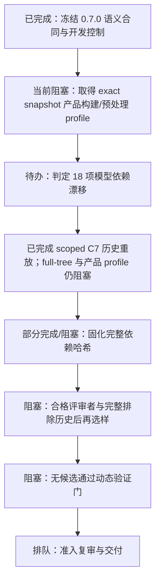

# C 线任务树与 Vibe Coding 提示词

更新时间：2026-10-18（中国标准时间）

## 状态依据

- 当前 C 线工作树：`CyberSecurity-Innovation-Audit-c4`，分支 `codex/c-line-ark-runtime-20261018`；本轮复核起点 HEAD `bcfd3fc`。
- C0 语义适用合同已在 `ff03077` 冻结并补充控制用例。v3 评估 README 记录 dedicated suite 本地对象库配置下 8 passed，以及 Ark Runtime/Runner focused suite 103 passed、10 skipped；这些是开发控制，不代表独立性能评估。旧 C0 检查项转为版本变更时的回归门。
- 主依赖阻塞是 C1：取得目标 exact snapshot 的可复现产品编译/预处理 profile。C4 本地工作区已有依赖清单/摘要 verifier 草稿，但状态为 blocked：没有可接受的产品 compile database、有效宏/工具链和已确认 include closure；当前摘要不是可信编译缓存键。C2 的 18 项依赖语义影响仍 unknown。
- C7 historical replay（roadmap C3 的开发对照部分）已产出 scoped final manifest：历史 C1/C2 漏洞父版本分别有 1/2 个候选，fixed/unrelated 对照为 0 个；五个 run 均 partial + blocked。精确目标文件 commit/tree/blob/source hash 已复核，但完整树 inventory 仍因缺失非目标 subtree object 而 blocked。它不能证明漏洞、修复或安全，也不能替代匹配产品 profile 的重放。
- C5 独立评估在选样前停止：没有两位合格独立评审者的预先声明，且外部/未跟踪的开发/调参家族历史不全；没有新样本、标签、预测或评分。C6 已有动态验证准入审计，但没有案例通过入口、攻击者控制、敏感操作、触发条件和 CIA 影响门，未构建、未运行 PoC、未制作修复。
- 工作区有 C3 依赖漂移审计、C4 manifest/test、C6 gate 等未提交文件；另有旧 `research/evidence/ark_runtime/independent-holdout/` 目录未跟踪。admin/holdout 资料需遵守隔离规则，不把旧目录整体纳入推送。
- 文档记载的当前主风险仍是缺少可复现的预处理/产品构建配置、18 项依赖漂移的语义影响未判定、未见源码适用性未冻结、真实运行时可达性与 CIA 影响未验证。
- 本轮 `git fetch origin --prune` 因 GitHub HTTPS 连接失败；缓存比较为本地 8 个独有提交、缓存远端 1 个独有提交，但不能视为实时状态。之前的 push/pull 尝试也失败。当前远端头部未知；提交尚未推送，工作树仍有未提交和未跟踪研究内容。

## 任务树



## 排期与完成门

| 顺序 | 任务 | 状态 | 依赖 | 完成门 |
|---|---|---|---|---|
| C0 | 冻结并验证未见源码语义合同 | 已完成开发冻结 | — | 语义身份决定适用性；Git 来源只做 provenance；控制结果有记录，partial/unknown 仍 fail closed。 |
| C1 | 取得 exact snapshot 的可复现预处理/产品构建配置 | 当前阻塞 | C0 | 命令、工具链、宏、include 搜索顺序和配置输入可复现；绑定固定 commit/tree；缺项明确标 unknown。 |
| C2 | 审查 18 个漂移依赖的语义影响 | 待办 | C1 | 每项有旧/新对象、预处理上下文、差异和 changed/unaffected/unknown 结论；不得默认 unaffected。 |
| C3 | 历史父/修复、安全及无关控制重放（本地工作项 C7） | scoped replay 已记录，整体门仍阻塞 | C1、C2 | 同一 Detector/model/parser/config；来源可核验；partial/blocked/unknown 不降级；解释父/修复差异。当前受限回放父版本候选 1/2、fixed/unrelated 为 0，不能当作漏洞命中、修复验证或安全结论；完整 tree 与产品 profile 仍缺。 |
| C4 | 固化 exact snapshot 预处理依赖哈希 | 部分完成/阻塞 | C1-C3 | manifest 覆盖实际源、头文件、宏、编译参数、工具版本与生成输入；摘要可复算；缺依赖 fail closed。 |
| C5 | 建立可计分的独立留出集 | 阻塞在选样前 | C0-C4，评审者与完整排除历史 | 冻结规则后抽取适用的未见漏洞/修复/安全/无关样本；双人独立盲标、事先声明、分歧裁决与泄漏账本齐全。 |
| C6 | 隔离动态验证与修复复验 | 阻塞，无达门候选 | C3-C5 | 仅对证明入口/控制/触发/影响的案例做隔离复现、PoC、修复和复验。 |
| C7 | 准入复审与竞赛交付 | 排队 | C0-C6 | 独立核验来源、覆盖、影响、修复、性能和限制；不自动改默认准入或 PR 状态。 |

## 独立 Vibe Coding 提示词

### C0：未见源码语义合同冻结（版本变更时复用）

```text
你负责 C 线 Ark Runtime 检测器。先读 AGENTS.md 要求的六份当前文档，以及 docs/项目现状与下一步.md、docs/架构与公共协议.md、docs/开发协作与交付指南.md；检查当前分支和工作树，不覆盖或清理任何既有脏文件/证据。

目标：审查并完成本地提交 `a2fce96` 中的 `ArkRuntimeUnseenTypeSafetyDetector` / `UnseenRuntimeTypeModel` 0.7.0 实现，使适用性由有界的 owner/method/signature 语义合同决定，而不是由预先枚举的 commit/path/blob/content hash 决定。Git commit/tree/blob/source hash 仍用于证明输入来源和字节一致性；不得把仓库名、方法名或语法命中单独当成漏洞证明。

先核对 `src/ohscanner/detectors/ark_runtime/` 的现有分析器、catalog 注册、Runner 选择/coverage 协议和旧模型。重点查：模型字段继承是否仍泄漏精确来源约束；函数签名/重载/命名空间解析是否会误选；selector 与 detector 看到的文件集合是否一致；共享 AST / blob provenance 缺失或冲突时是否 fail closed；两个规则共用同一文件时 outcome 是否准确；异常、预算耗尽和 partial 输入是否能被错误标为 complete/safe。修复应限定在 C 线范围。

补充正例、修复版、安全对照、无关同名/近似方法、重命名路径/新 commit/新 blob、缺失或伪造 provenance、unsupported language/profile、截断和 partial 语法、重复/重载方法等回归。运行与本次改动直接相关的测试和既有格式/静态检查，记录实际命令和结果；不要用测试通过推断真实产品可达或 CIA 影响。

完成标准：新来源身份可由语义合同进入分析；无关文件不会只因路径/仓库身份被纳入；精确来源字段只负责 provenance；未解析语义始终 unknown/partial/blocked；模型/Detector 版本摘要稳定且有变更记录；docs/项目现状与下一步.md 如实记录验证、限制和下一项。交付改动清单、测试结果、残余风险，不推送、不合并、不改 PR Draft 状态。
```

### C1：建立可复现的预处理与产品构建配置（当前任务）

```text
你负责 C 线 Ark Runtime 的构建上下文复现。先读 AGENTS.md 要求的六份当前文档，并检查本地 OpenHarmony checkout、目标精确 commit/tree 和现有 C3 证据；保留所有工作树改动，不要隐式 fetch 或更换源码版本。

目标：为 `openharmony/arkcompiler_ets_runtime` 的 exact snapshot `a65a2853ccae13da167d9aa4720ab8b11ec16656` 及目标文件建立可复现的预处理/产品构建 profile。查明实际编译命令、工具链版本、目标平台、宏定义、include 搜索路径、生成头文件及构建目标。优先从仓库构建系统和可复现的本地产品配置取证，不以手写宏列表冒充产品配置。

实现一个只读、显式调用的采集/重放工具或 manifest，绑定 commit/tree、目标文件、编译数据库来源、命令规范化规则、工具版本、头文件和生成文件哈希。输入不足、宏展开失败、配置不匹配或路径缺失时输出 unknown/blocked，并保留诊断；禁止将源文件 token 替换后的解析结果宣称为完整预处理。

验证同一快照重复运行得到相同配置摘要；改变一个宏、头文件、工具版本或编译参数时摘要变化；缺文件/缺 profile 时 fail closed。记录命令、原始证据位置、复现步骤和限制，更新状态文档。不得运行不可信构建脚本于宿主环境；无法安全复现的步骤只做静态取证并说明阻塞原因。不要推送、合并或调整 PR 状态。
```

### C2：逐项审查 18 个模型依赖漂移

```text
你负责 C 线 Ark Runtime 模型依赖漂移语义审查。先读项目 AGENTS.md 和当前六份文档，检查 `research/experiments/ark_runtime/c3_20261018/source_drift_review.{md,json}`，并使用已审核的 C1 构建/预处理 profile。保留 admin-only 留出材料，不复制其中预测或隐藏审阅数据。

目标：对 source drift review 中的 18 个变化依赖逐项判定它们对冻结 Detector/规则语义的影响。每项先验证旧/新 commit、tree、blob OID、source SHA-256，再在 exact build profile 下对照预处理输出、声明、宏、类型、调用点、控制流和影响摘要。逐项标为 changed、unaffected 或 unknown，附可复核证据和差异；无法建立完整上下文一律 unknown，不能因标识符未变或文本 diff 很小就判 unaffected。

为每项给出规则受影响的具体路径，区分来源身份变更、语法变化、语义变化和构建条件变化。不要修改冻结模型或据此调参；若发现规则需要变化，单独提出变更建议，等待重新冻结后再评估。

验收：18 项逐项有可追溯输入、profile 摘要、结论、理由和限制；未覆盖依赖明确列出；可重复脚本校验 Git 对象及输入摘要；状态文档写明 unknown 数量和阻塞点。执行相关只读校验并记录命令，不推送、不合并、不改 Draft。
```

### C3：同一冻结环境重放历史与负例

```text
你负责 C 线 Ark Runtime 历史对照重放。先阅读 AGENTS.md 和当前六份文档，复核 C 线历史对象恢复记录、0.7.0 语义合同冻结结果及 C1/C2 已交付的 profile/语义审查。不要使用不同 parser/model/config 的旧 run 拼接指标。

目标：在同一个冻结 Detector、模型摘要、parser/toolchain、预处理配置和 scope 下重放可用的历史漏洞父版本、修复版本、安全版本和无关版本。逐个绑定 commit/tree/path/blob/source SHA，确认对象确实存在且字节匹配，再运行相同管线。保留候选、partial、blocked、not_analyzed、failed 各自含义；0 finding 不能自动记作安全或 miss。

对每组父/修复版本解释预期差异；若对象、依赖或构建配置无法恢复，输出具体阻塞，不通过伪造 fixture 或跨版本拼接补齐。开发控制不能计入 holdout，也不能作为 precision/recall 真值。

验收：可复现 manifest 和命令、逐样本结果、来源完整性校验、正/负例差异说明、unknown/blocked 原因齐全；状态文档同步。只运行适用的重放及回归验证，不修改产品准入状态，不推送或合并。
```

### C4：固化 exact snapshot 预处理依赖哈希

```text
你负责 C 线 exact snapshot 的预处理依赖身份和缓存/复现边界。先读 AGENTS.md 和当前六份文档，使用已经验收的 C1 构建 profile、C2 依赖语义审查及 C3 重放配置。保留已有 evidence 目录及其访问限制。

目标：建立 exact snapshot 的完整输入清单与确定性依赖摘要，覆盖目标源文件、实际 include/生成头文件、宏和编译参数、目标平台、预处理器/parser/toolchain 版本、配置文件及必要的构建产物。每个条目绑定可验证来源与字节哈希；排序/编码/规范化规则必须明确。无法解析的 include 或生成依赖不能静默忽略。

把摘要写入清晰版本化的 manifest，并提供只读重算/验证入口。任一依赖字节、命令、宏、工具版本或 profile 改变时，摘要应变化；缺失或不受信任依赖使结果 blocked/unknown。避免把路径名哈希当内容依赖证明，避免把整个大型源码树无差别复制进交付。

验收：两次重算稳定；逐项修改输入的负向测试能检测摘要变化；缺失依赖 fail closed；历史重放和 Detector 报告可引用同一摘要。更新状态文档，记录剩余无法绑定项，不推送、不合并。
```

### C5：构造独立留出集并实施双人盲标

```text
你负责 C 线 Detector 的独立评估集治理。先读 AGENTS.md 和当前六份文档、holdout README、admin readiness audit 与评分工具；尊重 admin-only / reviewer-only 文件的分发边界。旧 9 个样本全部不适用冻结规则且缺少标签，它们不得被重新包装成性能集。

目标：先冻结可分析未见来源身份的 Detector、规则版本、模型摘要、parser/build profile、适用性定义、评分协议和排除标准；之后从开发/调参家族之外抽取规则确实适用的 vulnerable/fixed、safe/unrelated 样本。确保来源 commit/tree/blob/source SHA 可复核，并为每项记录规则适用性。样本不足时明确报告不能评估，不降低适用门槛。

生成盲化样本包和独立随机 ID，预测 escrow 与审查者材料分离；两位未接触预测、开发样本、调参与对方标签的审查者独立判断漏洞机制、可达性、影响、修复和标签依据，预先声明既往接触；分歧由预先指定的第三方裁决。记录纳入/排除与家族泄漏账本。不得让模型为自己打标签或向审查者暴露预测。

只有样本适用、标签完整、裁决完成且评估协议未被查看结果后修改时才计算 TP/FP/FN、precision/recall 和分层指标；否则只报告覆盖限制。完成哈希、盲化/权限和评分工具校验，并更新状态文档。不得调参后复用同一留出集，不推送、不合并。
```

### C6：对达标候选做隔离动态验证和修复复验

```text
你负责 C 线达到证据门的候选动态验证。先读 AGENTS.md、当前六份文档、候选证据和精确来源/构建 manifest；确认案例已具备现实入口、攻击者控制路径、敏感操作及可检验影响。没有达到门槛的候选继续保持 candidate/unknown，不要为了产出 PoC 降低条件。

目标：只在本地隔离、可销毁的环境中复现候选，固定源码 commit/tree、工具链、构建配置和依赖；不得攻击在线生产服务，不执行来源不可信的构建脚本于宿主。建立最小 PoC，记录输入、入口、触发条件、崩溃/状态变化或 CIA 影响，并提供重复运行结果和失败条件。

对确认问题制作最小修复，保留漏洞版、修复版、安全/无关控制。按相同配置重新构建并验证 PoC 在修复版失效、合法行为仍通过；保存 patch、测试、构建日志和哈希。若真实影响无法证明，清楚降级结论并说明缺口。

验收：其他开发者能按文档在隔离环境重放；每个结论绑定精确来源和产物；PoC 与修复复验相互对应；安全限制和剩余 unknown 完整。更新状态文档，不推送、不合并、不更改 PR Draft。
```

### C7：准入复审与竞赛交付

```text
你负责 C 线 Ark Runtime Detector 的独立准入复审和交付核验。先读 AGENTS.md 及当前六份文档，并逐项读取 C0-C6 的冻结记录、来源/构建摘要、重放、独立标签、动态验证、修复和性能证据。不要只依据负责人自述或状态表摘要作决定。

目标：独立核对适用性合同、Detector/模型/parser 版本、来源对象、依赖完整性、partial/failed 处理、历史控制、holdout 独立性、审查者分歧裁决、真实入口/权限/攻击者控制、CIA 影响、PoC 重放、修复和修复后回归。把已证明、未证明、互相矛盾与缺失材料分开；任何门未满足都说明原因和最小补救任务。

竞赛交付还需列出支持的 CWE/CVE（仅在证据支持时）、受影响模块/版本/分支、可复现 PoC、修复建议与复验、性能/创新证据、覆盖/精度限制和完整报告。复核公开材料未包含 admin-only 或泄露预测资料。

输出准入决策和证据索引。只有全部门都得到独立支持时才建议准入；保持非默认显式选择，除非另有明确批准。不要自动标记 PR Ready、合并或发布；把需要负责人/人工审批的最后事项作为清楚的决定项交付。
```

