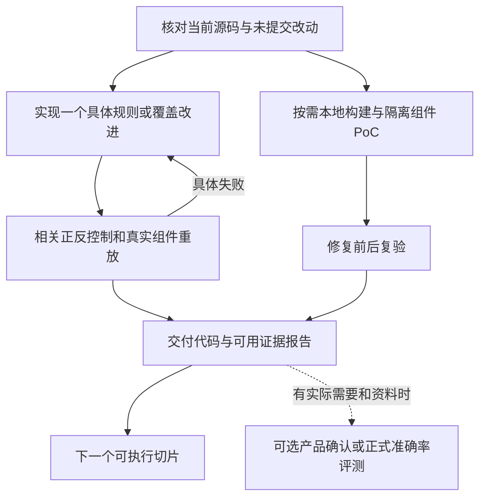

# C 线开发计划与 Vibe Coding 提示词

组长于 2026-10-20 授权取消项目自设的逐次审批、真人评测、产品确认和全部案例准入前置条件。授权持续有效直到用户撤销，见根 `AGENTS.md` 与 `config/collaboration/standing_authorization.json`。缺项记 unknown/not_run，继续可执行工作；豁免不代表测试通过。

## 当前工作方式

C 线开发 Ark Runtime 静态候选与源码关系分析，直接推进规则、解析/语义能力、正反控制和组件重放。沿用统一 Catalog/Runner；必要公共接线已授权。目录分工用于防冲突，不再要求 integrator 发 base SHA、逐任务分配写权限或真人签署。

实际源码、分支和 HEAD 由接手 Agent 自查。历史 `842948084660207fd64399cfd598ed93e5593dcc` 是当时计划基线，不是后续必须停留的版本。旧计划与执行记录可从 Git 历史及本机 `records/constraint-cleanup-20261020-01a1571f` 追溯，不能重新成为审批门。

## 可执行任务树

| 工作 | 日常动作 | 完成标准 |
|---|---|---|
| 规则/覆盖开发 | 选择具体漏检、误报或解析/关系缺口；保留真实来源和必要 unknown | 实现具体改进，相关 positive/fixed/safe/unrelated 控制及有价值的真实源码重放 |
| 测试反馈 | 给出能复现的失败；修复后针对受影响范围重测 | 具体失败已关闭或留下准确局限，不为已通过且未变化的输入反复验收 |
| 模型候选复核 | 有可读源码与候选即能审查，产品上下文未知就记录未知 | 引用可检查、解释支持度；不等待 build profile、真人双盲或全部候选冻结 |
| 本地组件验证 | 自选可复现的公开版本，在合适的临时隔离环境构建/PoC | 保存命令、版本和实际输出；可按单案例交付，不要求 16 案或 shipped image |
| 成果报告 | 输出源码/组件层结论、失败与剩余未知 | 当前可用证据可交付，不以产品准入作为本轮完成门 |
| 正式评测/产品确认 | 仅在需要相应结论且有资料时开展 | 无标签不编造 Precision/Recall，无产品证据不声称产品受影响；这不阻塞上面各项 |

## PC 事项的用途

PC-1 是可用 source/build 资料清点，不是强制完整产品画像；PC-2 为可选正式评测；PC-3 为可选产品关联。PC-4 的本地隔离组件 PoC 已长期授权，PC-5 可逐案修复复验。PC-6 改为按现有证据输出报告。机器任务树 `task_tree.json` 记录 `ACTIVE_DEVELOPMENT`，所有这些事项均 `blocks_development=false`。

`product_closure_matrix.json` 仅记录产品证据状态，保留未知和未执行事实；生成器不再将其转换成开发阻塞。既有 profile verifier、双盲 pipeline 可作为可选研究工具，不是日常开发入口。

## 直接可用的开发提示词

角色：C 线开发者。目标：选择一个具体规则/覆盖缺口，完成实现和相关测试，并交付当前可用报告。
输入：当前代码、已有 issue/失败控制、可获取的公开 Ark 源码；自行确认版本，不等用户提供产品资料。
动作：保留未提交工作；必要公共文件可改；实现最小有效切片；运行相关控制和组件重放；发现具体失败就修复复测。
授权：代码、测试、文档、公开源码、本地构建、隔离 PoC、提交和常规分支交付均已授权，无需重复申请。
输出：变更、实际验证、源码/组件结果和未知项。不要新建人为审批/保管/签署流程，不要无新信息地重复审计。

## 直接可用的测试提示词

角色：C 线测试者。依据实际改动选择有意义的边界和真实源码反例，核对候选位置与版本；只回传可复现的具体问题。修复后的受影响检查通过即可交付，不要求真人角色分离、额外签名或全量产品画像。没有可靠标签时报告控制矩阵结果，不把它称为独立准确率。

## 持续目标

每轮完成一个实际开发/验证切片，再选择下一项。某个产品资料或构建依赖确实缺失，只把该项记为待补，不能把整条 C 线 blocked，也不能反复请求已获授权。静态层优先少而有依据的候选；第二层产品功能的开发仍按用户具体任务决定。
