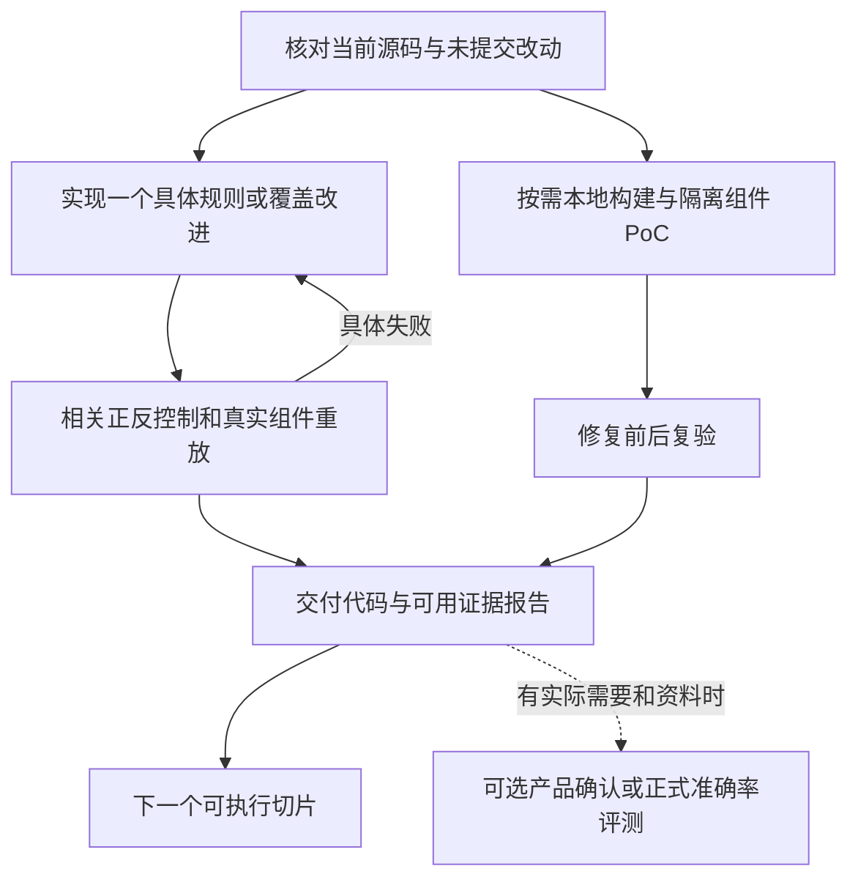

# C 线开发计划与 Vibe Coding 提示词

组长于 2026-10-20 授权取消项目自设的逐次审批、真人评测、产品确认和全部案例准入前置条件。授权持续有效直到用户撤销，见根 `AGENTS.md` 与 `config/collaboration/standing_authorization.json`。缺项记 unknown/not_run，继续可执行工作；豁免不代表测试通过。

## 当前工作方式

C 线开发 Ark Runtime 静态候选与源码关系分析，直接推进规则、解析/语义能力、正反控制和组件重放。沿用统一 Catalog/Runner；必要公共接线已授权。目录分工用于防冲突，不再要求 integrator 发 base SHA、逐任务分配写权限或真人签署。

实际源码、分支和 HEAD 由接手 Agent 自查。历史 `842948084660207fd64399cfd598ed93e5593dcc` 是当时计划基线，不是后续必须停留的版本。旧计划与执行记录可从 Git 历史及本机 `records/constraint-cleanup-20261020-01a1571f` 追溯，不能重新成为审批门。

## 可执行任务树



| 工作 | 日常动作 | 完成标准 |
|---|---|---|
| 规则/覆盖开发 | 选择具体漏检、误报或解析/关系缺口；保留真实来源和必要 unknown | 实现具体改进，相关 positive/fixed/safe/unrelated 控制及有价值的真实源码重放 |
| 测试反馈 | 给出能复现的失败；修复后针对受影响范围重测 | 具体失败已关闭或留下准确局限，不为已通过且未变化的输入反复验收 |
| 模型候选复核 | 有可读源码与候选即能审查，产品上下文未知就记录未知 | 引用可检查、解释支持度；不等待 build profile、真人双盲或全部候选冻结 |
| 本地组件验证 | 自选可复现的公开版本，在合适的临时隔离环境构建/PoC | 保存命令、版本和实际输出；可按单案例交付，不要求 16 案或 shipped image |
| 成果报告 | 输出源码/组件层结论、失败与剩余未知 | 当前可用证据可交付，不以产品准入作为本轮完成门 |
| 正式评测/产品确认 | 仅在需要相应结论且有资料时开展 | 无标签不编造 Precision/Recall，无产品证据不声称产品受影响；这不阻塞上面各项 |

## PC 事项的用途

PC-1 是可用 source/build 资料清点，不是强制完整产品画像；PC-2 为可选正式评测；PC-3 为可选产品关联。PC-4 的本地隔离组件 PoC 已长期授权，PC-5 可逐案修复复验。PC-6 改为按现有证据输出报告。机器任务树 `task_tree.json` 记录 `ACTIVE_DEVELOPMENT`，所有这些事项均 `blocks_development=false`。

`product_closure_matrix.json` 仅记录产品证据状态，保留未知和未执行事实；生成器不再将其转换成开发阻塞。既有 profile verifier、双盲 pipeline 可作为可选研究工具，不是日常开发入口。

## 直接可用的开发提示词

角色：C 线开发者。目标：选择一个具体规则/覆盖缺口，完成实现和相关测试，并交付当前可用报告。
输入：当前代码、已有 issue/失败控制、可获取的公开 Ark 源码；自行确认版本，不等用户提供产品资料。
动作：保留未提交工作；必要公共文件可改；实现最小有效切片；运行相关控制和组件重放；发现具体失败就修复复测。
授权：代码、测试、文档、公开源码、本地构建、隔离 PoC、提交和常规分支交付均已授权，无需重复申请。
输出：变更、实际验证、源码/组件结果和未知项。不要新建人为审批/保管/签署流程，不要无新信息地重复审计。

## 直接可用的测试提示词

角色：C 线测试者。依据实际改动选择有意义的边界和真实源码反例，核对候选位置与版本；只回传可复现的具体问题。修复后的受影响检查通过即可交付，不要求真人角色分离、额外签名或全量产品画像。没有可靠标签时报告控制矩阵结果，不把它称为独立准确率。

## 持续目标

每轮完成一个实际开发/验证切片，再选择下一项。某个产品资料或构建依赖确实缺失，只把该项记为待补，不能把整条 C 线 blocked，也不能反复请求已获授权。静态层优先少而有依据的候选；第二层产品功能的开发仍按用户具体任务决定。

## 当前并行切片（2026-10-20）

最新远端已获取。C 静态基线为 `origin/codex/c-line-static-20261019`，提交 `d07dc397ca1ff3bddc0be52cfa98c6e4c783fd03`；接收对象守卫规则及正反控制位于 `src/ohscanner/detectors/ark_runtime/receiver_guard.py` 与 `tests/detectors/ark_runtime/test_receiver_guard.py`。当前切片验证对象身份、绑定解析和分支支配关系是否产生可复现的错误候选/漏报，尚不预判有缺陷。开发线和独立测试线已从同一基线分开执行；测试线将在开发线提交上复验并反馈。既有 dirty worktree 及其中未提交交付目录保持不动。完整机器任务树为 `C_LINE_EXECUTION_TREE_20261020.json`。

### 结构化 Vibe Coding 提示词：开发线

```yaml
role: C 线 Ark Runtime 静态规则开发者
objective: 在 receiver_guard 找到并修复一个有具体复现的 precision/soundness 问题，让候选更少且依据更强；无复现时不要为改代码而改代码。
baseline: origin/codex/c-line-static-20261019@d07dc397ca1ff3bddc0be52cfa98c6e4c783fd03
scope: [src/ohscanner/detectors/ark_runtime/receiver_guard.py, tests/detectors/ark_runtime/]
steps:
  - 检查实现、现有正反控制及工作区状态
  - 围绕对象身份、同名/遮蔽、赋值、反向分支及 guard dominance 构造最小反例
  - 仅实现由复现支持的最小修复，并保留危险与安全控制
  - 运行相关测试，报告命令和实际结果
  - 提交本地变更，将 commit、复现与局限交给测试线复核
constraints: [保留其他 worktree 与未提交内容, unsupported/证据不足保持 unknown, 不编造产品影响或正式准确率, 不增加审批和产品输入门槛]
deliverables: [最小补丁或有证据的未发现缺陷报告, 测试结果, commit, 已知局限]
```

### 结构化 Vibe Coding 提示词：独立测试线

```yaml
role: C 线 Ark Runtime 独立测试者
objective: 独立验证 receiver_guard 对象绑定和 guard dominance，反馈可复现缺陷
baseline: origin/codex/c-line-static-20261019@d07dc397ca1ff3bddc0be52cfa98c6e4c783fd03
scope: [tests/detectors/ark_runtime/test_receiver_guard.py, receiver_guard 源码反例]
steps:
  - 运行基线针对性测试并记录结果
  - 尝试正反分支、别名/重新赋值、同名遮蔽、不同对象及不可解析控制流
  - 记录反例的期望、实际结果和最小复现；不确定预期标 unknown
  - 开发提交后在同一 commit 复验，失败时回传具体复现
constraints: [不修改生产代码, 不覆盖共享计划或其他 worktree, 不声称独立准确率/产品验证, 不要求全量案例或真人评审]
deliverables: [可复现测试反馈, 同一 commit 的复验命令和实际结果, 未覆盖边界]
```

### 结构化 Vibe Coding 提示词：第二层候选审查

```yaml
role: 第二层代码审查模型
objective: 审查 source-bound 静态候选是否有漏洞依据，并识别误报/漏报边界
inputs: [候选记录, 精确源码位置, 静态规则解释, 正反控制, 源码版本]
steps:
  - 逐条核对候选位置及数据/控制关系
  - 分别给出支持证据、反证、安全路径或 unknown
  - 每个判断提供可检查源码依据或最小反例，不以标签代替论证
constraints: [只做候选复核, 不开发第二层功能, 缺产品画像时适用性记 unknown, 不编造无标签准确率]
deliverables: 每条候选的支持/反证/unknown、引用位置及具体规则建议
```

### 当前切片结果与下一轮

测试线复现并推动修复了三类静态误报：否定/复合 TypedArray 条件、guard 前类型 token 被改写、guard 后接收对象重新绑定。提交 `ae5792f84e6b641e8857d0d58fab508f3a306af4` 和 `71950e65f46e204e6aec21210c8de73fa4f2a1a9` 位于隔离代码分支 `codex/c-static-dev-20261020`；开发线 Ark Runtime 全套测试为 152 passed、3 skipped，独立线定向复验为 10 passed、1 skipped。反例、命令、具体输出和剩余限制记录于 `research/deliveries/c-line/receiver_guard_test_review_20261020.md`。代码分支与计划分支基于不同 C 线演进点，因此保留为独立分支，不强行覆盖集成点；测试证据和代码提交均可单独审阅。

下一切片优先级：先评估 alias/同源类型重新采样及 rebinding 后恢复值时能否在不放宽安全性的前提下减少 unknown/candidate；测试线先给出可证明正反控制。随后排查 `replay_20261019` 中 Ark Runtime `type_safety` 的 blocked coverage 是路径映射还是解析局限，并针对性修复已复现的扫描问题。两项都可与逐条 source-bound 候选的第二层模型审查并行；模型只给证据支持/反证/unknown，不负责功能开发。持续目标见 `C_LINE_EXECUTION_TREE_20261020.json`。

## 当前继续执行（2026-10-20 状态复核）

上一轮 `receiver_guard` 修复仍在独立代码分支 `codex/c-static-dev-20261020`，开发提交为 `ae5792f84`、`71950e65f`；计划分支没有合入这些代码，因为两条分支的 C 实现基线不同。任务树已更正此状态。远端 fetch 本轮因 GitHub 443 网络连接失败；最后确认的远端跟踪基线仍为 `d07dc397ca1ff3bddc0be52cfa98c6e4c783fd03`，没有宣称已拉取新远端。

可执行的下一轮已并行启动三条线：开发线检查注册研究 profile 是否可覆盖已有 exact-bound 历史 exception guard parent/fixed 版本并跑 CLI；测试线从同一基线独立检验边界与报告状态；第二层审查线直接检查两版 Ark C++ 源码和创建器语义，判断源码候选支持度及产品影响未知项。历史本地 Git store 可用，避免了联网依赖。动态任务状态与工作树见 `C_LINE_EXECUTION_TREE_20261020.json`。

### 结构化 Vibe Coding 提示词：注册 profile/重放开发线

```yaml
role: C 线 Ark Runtime source-bound profile 开发者
objective: 让已有精确绑定的异常路径 parent/fixed 样本能通过注册 CLI 复现，并保留版本/源文件身份边界
baseline: codex/c-static-replay-dev-20261020 at 71950e65f46e204e6aec21210c8de73fa4f2a1a9
inputs:
  git_store: D:/openHarmonyScanner/tmp/c-line-ark-history-full-snapshots-20261018.git
  parent: c758818dbfd0b146a908d43d21f6ca1706c33783
  fixed: 81ca57487d04ea30cd11c271e86494a4e130f43e
steps:
  - 检查 RuntimeTypeModel 中的精确绑定与 catalog 注册路径
  - 只把已验证仓库/commit/blob/SHA 绑定纳入显式研究 profile，并更新 profile 版本和对照测试
  - 通过 CLI 重放 parent 与 fixed，保留 parser partial、blocked 和 unknown 实情
  - 给出最小修复、命令、实际诊断、范围限制并提交本地代码/报告
constraints:
  - 不放宽到无绑定 commit/path/blob
  - 不把候选或 partial 解释为确认漏洞、无漏洞或产品影响
  - 不新增产品、真人评审或审批前置条件
```

### 结构化 Vibe Coding 提示词：独立 profile 测试线

```yaml
role: C 线独立重放测试者
baseline: codex/c-static-replay-test-20261020 at 71950e65f46e204e6aec21210c8de73fa4f2a1a9
objective: 复现历史 exact-bound parent/fixed 在注册 CLI 下的阻断，并独立验证开发修复
steps:
  - 在变更前检查默认 C1 profile 与历史 model bindings 的差异
  - 用固定本地 Git store 核对 full commit、blob、source SHA
  - 开发提交后 cherry-pick 相同提交，验证 parent 有同规则 candidate、fixed 无同规则 candidate
  - 验证非绑定版本仍被拒绝，partial coverage 始终可见且未被称作 complete/safe
output: 独立测试报告含命令、逐案实际 CLI 状态、精确源身份和未解决限制
constraints: 不改生产 profile 代码；没有标签时不报准确率
```

### 结构化 Vibe Coding 提示词：第二层模型审查线

```yaml
role: 第二层漏洞审查模型
objective: 判断 exact-source candidate 的漏洞链是否被代码与运行时 helper 支持
sources:
  repository: openharmony/arkcompiler_ets_runtime
  path: ecmascript/compiler/builtins/builtins_typedarray_stub_builder.cpp
  parent: c758818dbfd0b146a908d43d21f6ca1706c33783
  fixed: 81ca57487d04ea30cd11c271e86494a4e130f43e
steps:
  - 定位每个候选的函数/源码行，追踪 NewTypedArray、结果 GateRef 与 LoadHClass 顺序
  - 检查 parent 的异常分支是否先于敏感读取、fixed 的改动是否建立异常检查/提前退出
  - 检查创建器实现是否证实 allocation 可留下 pending exception，记录调用可达性和反证
  - 把源码规则支持、漏洞成立、可利用性、产品影响分开判断
output: 每个候选给出 source evidence、counterevidence、confidence 和 unknown obligations
constraints: 不把检测器结果当事实；parse partial、build profile 缺失和产品映射未知均明确保留；不开发第二层功能
```

### 第二层审查与重放基线结果

第二层审查已实际完成并提交于 `research/deliveries/c-line/second_layer_exception_guard_review_20261020.md`：parent `Filter`/`Map` 在 `NewTypedArray` 之后、`LoadHClass` 之前缺少 pending-exception 退出；fixed 将读取放到异常检查的正常边之后。`NewTypedArray` 的 species/runtime slow path 可返回 Exception sentinel；但 fast path 的 `NewByteArray` 失败时 result 仍可能是已分配对象，不能混为一谈。源码级路径缺保护有依据，Map 的精确触发条件、运行时可达性和产品影响仍 unknown，未认定确认漏洞。

测试线基线报告已保存于 `research/deliveries/c-line/exception_guard_cli_replay_20261020.md`。当前注册 profile 对两条历史 commit 输出 0 diagnostics / `blocked-not_analyzed`，原因是 `c_line_static_model()` 截掉了 `RuntimeTypeModel` 中已有的历史精确绑定；手动默认模型的 registered-adapter 历史测试则验证 parent 两条 candidate、fixed 无该规则 finding。开发线正在把两个已精确绑定的历史版本显式加入研究 profile，并用 CLI 重放。接受结果必须同时满足 parent 2 candidates、fixed 0 same-rule candidates、来源精确匹配、aggregate `blocked/partial` 如实保留；完整 suite 与独立同提交复验尚待完成。

## 并行切片：receiver guard 的 alias 精度（已启动）

开发线发现当前分析把 guard 记在参数绑定/布尔状态上，遇到 `GateRef saved = input` 或 `input=count; input=saved` 时会丢失可证明的 SSA 对象身份。测试线独立构造 immutable alias、错误 alias、重绑定后恢复与不可证明恢复的矩阵。该优化只在 CFG 路径可证明 receiver identity 不变时减少保守 candidate/unknown；无法证明的路径仍 unknown。任务树已分别登记开发与独立测试 workstream。

### 结构化 Vibe Coding 提示词：Alias 开发线

```yaml
role: C 线 receiver_guard 静态分析开发者
objective: 在不放宽 soundness 的前提下，利用可证明的 GateRef 局部别名恢复过度保守的 candidate/unknown
baseline: codex/c-static-alias-dev-20261020 at 71950e65f46e204e6aec21210c8de73fa4f2a1a9
cases:
  - immutable GateRef alias=input; guard alias; sink input
  - receiver reassigned to count then restored from a saved input alias
  - negative controls where alias captures count or receiver cannot be resolved
steps:
  - read existing CFG/value transfer and adversarial report
  - model source-bound identity only for simple identifier init/copy/assignment
  - keep complex effects, branches with ambiguous joins and unsupported writes unknown
  - add positive matched controls and negative candidate/unknown controls
  - run focused tests and Ark Runtime suite; report limitations and commit
constraints: [do not change profile or other detector, preserve rebinding invalidation, no product/accuracy claims]
```

### 结构化 Vibe Coding 提示词：Alias 独立测试线

```yaml
role: C 线独立测试者
baseline: codex/c-static-alias-test-20261020 at 71950e65f46e204e6aec21210c8de73fa4f2a1a9
objective: 明确每种 alias/rebinding 结构的 sound expected result，复现当前结果并在开发提交上复验
matrix: [same-object immutable alias, alias to different object, guard then rebind then restore saved alias, restore from different object, token/receiver resampling, unresolved branch join]
steps:
  - run current focused suite and baseline harness
  - record source, expected reason, actual observation kind and line
  - cherry-pick same development commit after implementation
  - rerun all positives/negatives and report any unsound matched or still-conservative safe path
constraints: [no production edits, no accuracy labels, no safe conclusion from unknown]
```

## 最新执行状态与下一并行切片（2026-10-20 续）

本轮从任务树核实出的状态：exception-guard 注册 profile 已完成同提交独立复验；开发提交 `a6b1cf699781c6c74ff3fca4559a1b7c9a9cb501` 的 CLI 对 exact-bound parent 产生 2 条候选、fixed 产生 0 条同规则候选，二者仍为 `partial/blocked`。独立报告 `research/deliveries/c-line/exception_guard_cli_replay_20261020.md` 记录了候选行、source identity 和未绑定版本控制。原始 parent^1 对象缺失，GitHub 443 不通、Gitee 拒绝 unadvertised SHA；使用的源码等价 mirror neighbor 只证明“未绑定 commit 会被拒绝”，不能冒充原始 parent 的精确控制。测试为 Ark Runtime 155 passed、3 skipped。

Alias 开发提交的**实际** HEAD 已从开发 worktree 核验为 `2d79560cad45db75bb1b0c6d0677200294e17d10`（此前消息中有一字符笔误，以该 worktree 的 `git rev-parse HEAD` 为准）。提交让简单 `GateRef` 标识符副本按对象身份恢复 guard；开发侧定向测试 16 passed、1 skipped，Ark Runtime 158 passed、3 skipped。测试线正基于该确切 SHA 复验 safe alias、cross-object、restore、resampling、opaque/complex alias 反例；结果未回来前不关闭该任务。

远端 refresh 再次尝试失败：GitHub HTTPS 443 不可达。当前可复现基线仍是 `origin/codex/c-line-static-20261019@d07dc397ca1ff3bddc0be52cfa98c6e4c783fd03`；不宣称已拉到更新。已有固定源码对象和本地快照允许上述开发/测试继续。

### 下一条并行线：type_safety partial/blocked 成因与候选质量

Alias 同提交复验关闭后，选择一个 `type_safety` replay case，先确定 blocked/partial 出自来源映射、解析、模型注册还是规则逻辑。静态目标是减少无支撑的候选、保留有源码依据的候选，并为第二层审查提供精确位置；不是为了把 aggregate status 改绿。开发与测试使用独立 worktree，测试复跑开发提交的同一输入，发现具体回归则返回修复。

```yaml
role: C 线 Ark Runtime type_safety 开发者
objective: 对一个可重放 partial/blocked 案例定位具体阶段性原因；仅在最小 source-bound 反例证明规则缺陷时修改检测器
inputs:
  replay: research/experiments/ark_runtime/c10_ark_gap_rules_20261019/production-adapter-replay.json
  model: 注册的 RuntimeTypeModel 与对应固定 Ark Git 对象
steps:
  - 从当前 worktree/HEAD 实际运行 registered CLI，固定 commit/tree/blob/SHA 与命令输出
  - 拆分并报告 model binding、source mapping、parser outcome、internal coverage、detector outcome
  - 若为具体规则缺陷，加入 positive/fixed/safe/unrelated 控制并作最小补丁；否则提交有证据的 no-change root-cause 报告
  - 把候选、未触发、partial 与 blocked 分别记录，不改写为漏洞或安全结论
constraints: [不为变绿而放宽绑定或覆盖语义, 无证据不扩展候选, 未知保持 unknown, 不等待产品画像/真人/holdout]
deliverables: [可复现命令与精确源码身份, 具体原因或最小修复, 开发测试结果, 已知局限]
```

```yaml
role: C 线独立 type_safety 测试者
objective: 在开发提交前后独立重放同一 exact-bound 案例并寻找最小误报/漏报反例
steps:
  - 先运行当前注册 CLI 并保存逐阶段状态与候选行
  - 选 nearby safe/fixed/unbound control，验证规则身份及版本边界
  - 开发提交后只复验同一 commit，比较诊断、source hashes、parse/internal coverage 和 aggregate status
  - 将具体失败交回开发线；无缺陷时报告覆盖边界
constraints: [独立 worktree, 不修改生产代码, 不以 control matrix 声称正式准确率, 不把 partial/blocked 当 pass]
```

```yaml
role: 第二层漏洞候选复核模型
objective: 对开发与测试确认的少量 source-bound 候选逐条判断源码支持度
steps: [检查真实源码位置与数据/控制关系, 给出支持/反证/unknown及可核验引用, 区分源码缺陷与 runtime/product impact]
constraints: [只做候选审查, 不开发第二层功能, 不把静态候选当漏洞事实, 无产品证据则影响保持 unknown]
output: 每条候选的支持或反证、置信边界、未知事实和建议的最小验证
```

持续目标：每轮只关闭有实现和同提交测试证据的具体 slice；如果发现新的可复现缺陷则继续下一轮，否则交付根因/边界报告并选下一个输入。产品资料、准确率标签或人类评审只影响对应的产品级结论，不阻塞源码级进度。

Alias 身份改进已由测试线基于开发提交 `2d79560cad45db75bb1b0c6d0677200294e17d10` 独立复验，测试提交 `cd52fc1899112ed23b82bfe168f2056a58715b95`，报告提交 `2fe2182508e88611cc0de005a8764092693291fb`。验证覆盖同源 alias、guard 后稳定恢复、自赋值、token 重采样、跨对象和 opaque/reference 写入；结果未发现异对象 guard 被复用。报告明确指出历史仓库对照因 tester 固定 Git store 不存在而跳过。Ark Runtime 161 项中 158 passed、3 skipped。该报告目前独立保存在测试 worktree，任务树记录了其路径和提交。

因此下一条 type_safety 工作线已启动：测试线先固定一个 exact-bound registered CLI 基线和控制；开发线同时定位 partial/blocked 的真实阶段原因。只有能复现的规则缺陷才进入代码改动，否则交付 root-cause 报告。任务树中的机器状态现标为 `IN_PROGRESS_BASELINE_AND_ROOT_CAUSE_SCOUT`。

## type_safety 后续线已具体化为 runner applicability 修复

开发 scout 的精确复现和 JSON/Markdown 已归档在 `research/deliveries/c-line/scout_20261020/`。来源为 `openharmony/arkcompiler_ets_runtime@a65a2853ccae13da167d9aa4720ab8b11ec16656`；目标 TypedArray builder blob `68fb3b0adc4f9062889a861be51b7be90362e37a` / SHA-256 `76418526220ea039410d5a214b03d923436ce9441d9852538832b3664c41bd3c`；creator blob `991ac5ac034a1a027e3200787ec25c55b3f15b69` / SHA-256 `3159eee6989838659438af89353dfd37a890c259f60c3af0195110e016a411e0`。有依赖 CLI 当前把 2 个 cpp 都算 applicable，creator 却 not_analyzed；target-only 则因 dependency outside scanned scope 阻断。target 当前 parse partial (13 issues)、detector blocked、0 CLI diagnostics，不构成安全结论。

开发线已开始 narrow runner slice：调用 optional `select_applicable_units(context, units)` 定义 detector target coverage，同时让完整 source context 保留依赖文件供 adapter 精确 blob/SHA 校验；无 selector 的 detector 走原 supported-language fallback。正反验收为：target+exact creator 只把 target 计入 applicable、creator 可供依赖核验；target-only 仍因缺依赖 blocked；额外 unrelated 同语言文件不进入 target coverage；target 的 partial/blocked、候选数量和未知信息不被“修绿”。独立测试线在另一 worktree 先固定上述三种 scope 基线，随后对开发提交同提交复验。

```yaml
role: C 线 runner applicability 开发者
objective: 修复 detector target applicability 与 dependency context 混算导致的 coverage 假象，不改变 source-binding 或将 partial 升级为 complete
steps: [先运行三种 CLI scope 基线, 调用 optional select_applicable_units hook, 保留完整 ScanContext dependency, 为 selector/fallback/coverage 写回归, 运行 runner+Ark suite, 提交精确 SHA 交独立线]
negative_controls: [target-only 缺 creator 仍 blocked, unrelated same-language 不计入 applicable, exact target 仍 partial/blocked]
```

```yaml
role: C 线独立 runner 测试者
objective: 在同一开发 commit 上复验 target/dependency 分离及旧 detector fallback
steps: [复跑 target+creator、target-only、target+creator+unrelated, 核对 full commit/tree/blob/SHA, 核对 applicable_files 与逐文件 parse/internal/detector 状态, 复跑 runner 与 Ark 测试]
constraints: [不修改生产代码, 不把零诊断当安全, 不把 coverage 计数变化当解析或漏洞修复]
```

### 独立基线完成（runner applicability）

测试线报告 `research/deliveries/c-line/type_safety_replay_baseline_20261020.md`（提交 `fbc54b5a1`）独立复现了三种 CLI scope。C1 exact target 与 creator 的 commit/blob/SHA 均匹配模型。target-only 因 creator 缺失而 blocked/not_analyzed；target+creator 时 target 是 partial、creator complete 但 not_analyzed；再加入 unrelated 同语言文件时三个文件都被计入 applicable，但只有 target partial，其余 not_analyzed。exact fixed 对照同样 partial/blocked/零诊断。Ark Runtime 155 passed、3 skipped。

这与 scout 共同支持 runner applicability 与完整 dependency context 混用的问题；同时证据明确 target 的 13 个 parser issue 和 detector model incomplete 仍存在，所以本轮只修 scope 归属，不修 parser、不改 detector rule，也不将零诊断说成安全。独立基线已提交，开发线正在按同一输入实现 selector/context 分离；测试线将在具体开发提交后复验。

### runner applicability 开发提交待独立复验

开发线已提交 `85a1f1e6f91247e5fbad39fb6bd03f64201700bb`。Runner 现在调用 optional `select_applicable_units(context, language_units)`，校验选择结果必须来自当前上下文、语言受支持且没有重复；无此 hook 的 detectors 保持原语言筛选。选出的目标集合用于 normalized report 与 coverage，完整 `ScanContext` 仍保留依赖供 Ark adapter 验证 exact blob/SHA。

开发线验证：Ark Runtime 162 passed、3 skipped；runner/source-binding 34 passed。C1 修复后真实 CLI 为 `scope_files=1 / applicable_files=1`，target 仍有 13 个 parser issue、`partial / blocked`、0 diagnostics。修复后证据在 `research/deliveries/c-line/scout_20261020/c1_post_fix.md/.json`。测试线已取得 exact developer commit，正在复验 target+dependency、target-only、unrelated same-language、selector 越界与 fallback；在复验返回前不关闭该 slice。

### runner applicability slice 已完成；下一步聚焦 C1 parser/model partial

独立复验报告 `research/deliveries/c-line/runner_applicability_replay_20261020.md`（提交 `84e73672bc95fde70070e8f5369f712911a923dd`）确认开发 patch 与测试 cherry-pick patch-id 相同，改变范围仅 runner 与对应测试。target+creator 时 `applicable_files=1` 且 creator 留在完整 context 并成功校验；target-only 仍 blocked；加入 unrelated C++ 不扩大 target；非法 selector 失败且无 findings；无 hook detector 仍走 language fallback。C1 target 保持 13 个 parser issues、partial/blocked、0 diagnostics。核心 runner/source-binding 测试 34 passed。Ark Runtime 测试开发侧 162、测试侧 159（各 3 skipped），报告无法由 revision 清单解释差异；更宽套件 4 个具体失败及证据已逐项记录，不影响本 slice 核心结论。

下一条并行线针对 C1 本身的 partial 状态，而不是继续调 coverage 数字：一线逐项定位 13 个 parse issue 与 `detector_model_incomplete` / `type_fact_invalidated_by_call` 的阶段原因；另一线固定同一 exact-bound baseline 和适用 controls。只有能证明是 parser/model 的具体错误才进入窄修复，否则交付 unsupported syntax/effect 边界报告，随后将资源转向其他已有 exact-bound source sample。

```yaml
role: C 线 C1 parser/model 开发调查者
objective: 将 13 个 parser issue 和 detector internal unknown 映射到具体分析阶段，找出一个有最小反例支撑的精度/覆盖缺陷
steps: [重跑注册 CLI并核对精确 source identity, 为每个 issue定位parser阶段/AST缺口, 独立解释 detector_model_incomplete 与 type_fact_invalidated_by_call, 仅对可复现缺陷做窄修复并加入safe/fixed控制, 运行相关套件]
constraints: [不扩宽来源绑定, 不将partial转complete, 不把0诊断当安全, 不凭空提升漏洞结论]
```

```yaml
role: C 线独立 C1 测试者
objective: 保存 exact-bound parser/internal baseline，并在开发提交上重放定位结果和任何窄修复
steps: [固定 commit/tree/blob/SHA与13 issue行, 选择附近 fixed/safe/unbound控制, 开发提交后复跑同一CLI/测试, 对比候选位置与partial/blocked状态, 回传具体偏差]
constraints: [不改生产代码, 不以同源合成控制报正式准确率, 未知保留unknown]
```

### C1 partial 独立基线已固定；开发 scout 正在区分合法宏与真实解析缺陷

独立报告 `research/deliveries/c-line/c1_partial_baseline_20261020.md`（提交 `ea27fa0efe9562d16663b81f4c1d7d03ce8fd90c`）在 runner 修复后的测试线上重放了 exact-bound C1 target+creator：source commit/tree/blob/SHA 全部匹配，creator parse complete、依赖已验证；目标仍有 13 个 parser issue、analysis partial / `detector_model_incomplete`、coverage partial、detector blocked、0 diagnostics。fixed exception-guard revision 只是相关控制，不是对 C1 规则安全性的结论。

开发 scout 初步将 issue 指向未展开的 Ark IR DSL：合法 `IR_IF/IR_ELSE`、`BRANCH` 和 typed-array 类型宏，Tree-sitter 看到 raw source 后产生 missing/error 节点；`Map` line 2747 的 `type_fact_invalidated_by_call` 来自可能执行用户 JS 的 `JSCallDispatch()`，对象逃逸未证明前保持 unknown 是合理的保守处理。2952 Label 数组等级联点与 macro parsing 的关系、以及可否做窄 preprocessing/容错改进，仍待最小正负控制确认。当前不动规则或把 partial 转 complete。

### C1 parser/model scout 结论与下一候选

开发 scout 报告已归档为 `research/deliveries/c-line/c1_partial_state_root_cause_20261020.md`（提交 `68f9371d4e967884404cf7ed4c70805cbc517499`）。逐点查看精确 source/header commit 后发现，13 个 Tree-sitter missing/error 节点由未展开的 `IR_IF/IR_ELSE`、`BRANCH` 与 typed-array case-list 宏触发并级联；普通 `Label` 数组独立可解析。raw DSL 片段 partial、定义展开后的等价普通 C++ complete。`detector_model_incomplete` 是 runner 对 partial 文件的标签，不是模型 binding 拒绝。`Map` 2747 unknown 与前面的 `JSCallDispatch` 用户回调效应有关，缺少对象未逃逸证据，保持 unknown sound。

独立测试线目前在独立 worktree 检验上述 raw/expanded controls 及头文件精确版本。若通过，这轮以无代码 root-cause 交付结束；下一候选是**精确源码宏感知解析 profile PoC**：绑定 header blobs 与显式 preprocessor/build 参数、保留源位置映射，缺资料时仍回落到 partial。禁止全局文本替换宏或把 parser 状态改善解释为安全结论。PoC 再由另一条测试线验证宏定义绑定、source map、safe/fixed 对照及未知配置时的 partial 回退。

### C1 parser root cause已由独立控制确认；当前交付是“无代码修复”

测试线报告 `research/deliveries/c-line/scout_20261020/independent_parser_controls.md`（提交 `3004ebf0d65166e4a0dc236d2f4fb3d7152f1f5c`）验证了 raw `IR_IF/IR_ELSE`、raw `BRANCH`（即便源中有定义但未执行宏展开）和 typed-array case-list macro 都会 partial；等价 expanded C++ complete；单独 Label 数组 complete。目标与三个 header 的 blob/SHA 全部绑定同一 C1 commit/tree。Map 2747 仍是可能受 `JSCallDispatch` 影响的 unknown。内部 synthetic label 的 byte-offset 值两次复现不同，但源身份与语义 observation 相同，原因未明，按原样保留 unknown。

因此不对 detector/model 做放宽，也不把 13 个 raw-source issue 伪装成修复。本轮以具体 root-cause 和独立控制结束。开发线正在做下一候选的可行性侦察：能否在隔离 PoC 中以精确 source/header blob、明确 include/define/toolchain profile 做宏感知解析并保留源位置；缺任何必要构建输入时仍必须回到 raw partial。测试线随后独立验证 source mapping 和 fallback，再决定是否值得触碰生产 parser。

### Macro-aware C1 方案可行性闭环与第二层候选复核

宏解析可行性报告、独立测试和隔离 PoC 已归档在 `research/deliveries/c-line/scout_20261020/`。团队确认：只有 IR_ELSE 的简单控制能用已有 helper 安全展开并保留行映射；完整 C1 因 source-local `#undef` fail closed，IR_IF/BRANCH/typed-array token-paste 仍拒绝。没有编译器和 build profile，也没有建立可复现的完整 source map，因此这轮不改生产 parser，不安装工具链，不用手写 build profile 冒充产品配置；raw scan 保持 13 个 issue 的 partial。之后发现本地 exact compile profile 时可重启；否则转向其他 exact-bound 候选。

第二层模型现开始审查 `I7W51D`（`typedarray-length-signed-to-unsigned-narrowing`）的 parent/fixed 对：parent `3c1a50cfb1206ce63afcd2d0ef2b1e81668f2e3c` 与 fixed `82c21d656880923800c94b53b035c76d219313b5`，精确文件身份列于机器任务树。审查只核对 `ToIndex`、signed length、allocation 和范围/溢出校验，给出代码支持、反证和 unknown；不开发第二层功能，也不把 replay 的 vulnerable/fixed role 标签当结论。该候选当前仍是 candidate/unassessed。
