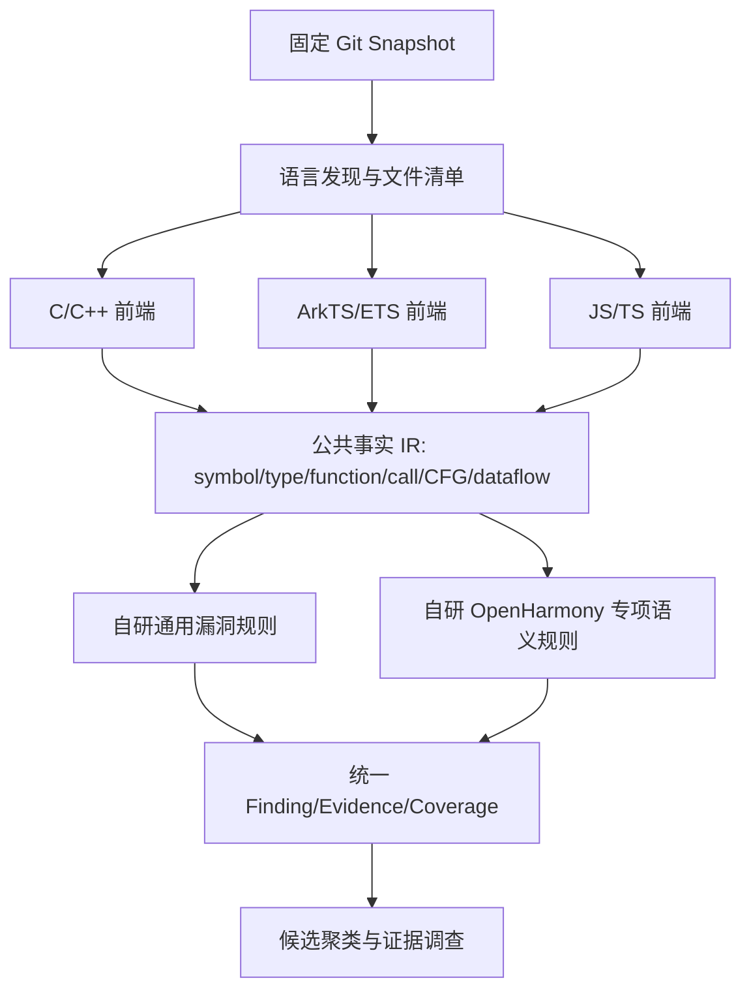

# OHScanner 技术总方案 V1.0

**主题：OpenHarmony 官方社区多仓库全量/增量/跨版本安全审计、自研多语言漏洞扫描、证据驱动 Agent、隔离 PoC、Docker 与 Ubuntu 部署**
**整理日期：2026-10-17；来源：2026-10-16 夜间讨论、2026 官方赛题 6 页版本、截至 2026-10-14 已核验的项目技术记录。**
**定位：技术设计与 Codex 协作基线，不等同于功能全部实现。**

> **一分钟结论：** OHScanner 面向 OpenHarmony **官方代码仓库**，用一套自主实现的检测引擎支持 C/C++、ArkTS/ETS 和 JavaScript/TypeScript，扫描入口只有「仓库安全扫描、时间增量扫描、跨版本安全分析」三种；支持单仓、多仓、全选全部官方活跃仓库，归档仓库按需纳入。服务器维护按需同步的本地 Git 对象缓存，各任务固定每个仓库的完整 SHA 后扫描。静态分析发现候选，Agent+LLM 补证据，隔离 PoC+人工复核支撑确认，最后进行影响版本、修复重验并生成符合赛题的报告。部署先 Windows+WSL2，再 Ubuntu+Docker Compose；PoC 容器独立于平台服务。

---

## 1. 赛题任务与产品不能遗漏的交付闭环

依据用户上传的 **《01-26年网安揭榜赛赛题-OpenHarmony开源代码漏洞挖掘(1).docx》**（6 页；2026-10-16 版本），参赛作品应：自动分析 OpenHarmony 社区源码；输出漏洞描述、CWE 和存在时的已公开 CVE；对识别的漏洞提供可执行且稳定可复现的 PoC；评估严重性和代码/功能模块/不同分支版本影响；给出修复建议或补丁；生成包含源码、触发条件、影响路径、PoC、修复的报告。交付物包括**工具源码、技术说明书、使用说明与演示视频、漏洞报告、大规模扫描性能数据**。

赛题评价包含真实漏洞准确率、范围完整性、CWE/CVE 正确性、PoC 质量、分支影响、修复可操作性、效率资源占用与创新。不能把普通功能 Bug、没有实际安全危害的 DoS 或静态告警充作已确认安全漏洞。

### 1.1 核心证据状态

`unassessed candidate → investigating → evidence_ready → validation_pending → reproduced → confirmed/reportable`。任何阶段可以标注 `ruled_out` 或 `unknown/blocked`，**Agent 观点、候选聚类、一次崩溃、两个版本之间的 diff 都不能自动确认真实安全漏洞**。CVE 只引用可信公开来源；新发现问题未经权威评审不得自行编造 CVE。

---

## 2. 2026-10-17 项目现状：已做 / 待做

代码仓库：`https://github.com/unpredictablexss-lang/CyberSecurity-Innovation-Audit`。当前参考开发分支 `feat/unified-audit-v2`、Draft PR #12（合入目标 `feat/workbench-integration`，**不是 main**）。以下状态来自仓库 `docs/项目现状与下一步.md` 和 `docs/架构与公共协议.md`，最近记录更新时间 **2026-10-14**；并非声称已实测 10-17 的本地工作目录。

| 能力 | 已核验状态 | 下一步 |
|---|---|---|
| C/C++ 统一扫描 runner、Tree-sitter 轻量索引 | 已有核心基础 | 类型、符号/调用图、CFG、数据流逐步增强 |
| 已批准自研研究型检测器 | `ohscanner.cpp.lifetime`（窄范围 unique_ptr）、`ohscanner.cpp.shared_ptr_race`（窄范围 shared_ptr 并发）、`ohscanner.interface.ipc`（IPC/权限边界）；示例检测器不属于漏洞能力 | 做正负样本与独立 holdout；扩展通用、Parcel 和 ArkTS/JS 规则 |
| 单仓固定 SHA 扫描、源码和报告哈希、覆盖 | 已实现核心 | 浏览器真实仓完整端到端验收 |
| React/Ant Design/Monaco、FastAPI、SQLite、Worker | 已有 | 应用产品经理 V4.1 / V6.2 视觉设计、隐藏用户检测器选择 |
| 双 SHA、committer-date 范围、版本矩阵 | API/面板和基础比较已接入 | 全链路验收、跨分支实体关联，影响结论保持 unknown 直到核验 |
| 外部 Git 同步 | 有受限 HTTPS clone/fetch 基础 | 官方仓库目录发现、默认分支核实、多仓 Manifest、缓存策略 |
| 多仓全选、全社区扫描 | **未实现完整任务编排** | 多仓计划冻结、分片、恢复、限流、汇总 |
| ArkTS/ETS、JS/TS 自研规则 | **尚未达到产品可宣称支持的状态** | 建语言前端、公共 IR 与各语言正负样本 |
| Agent | 只读确定性调查轨迹；**尚未接真实 LLM** | 模型适配、工具白名单、预算、证据账本与受控策略 |
| PoC | Docker-only 验证框架已接线；原记录 Docker daemon/固定镜像不可用 | 真实隔离运行、重复对照、修复后重验 |
| Ubuntu + Docker Compose 全套交付 | **未经过部署验收** | 镜像构建、volume、备份、权限、资源限制、无网 PoC 验收 |
| 精度和性能 | 479 passed / 0 failed / 2 skipped 属于代码回归，不是漏洞检测准确率；confirmed=0 | 真实 Precision/Recall、耗时/RSS/IO/覆盖实验 |

五组件对照研究记录：`update_updateservice`、`security_access_token`、`distributeddatamgr_kv_store`、`window_window_manager`、`communication_dsoftbus`。IPC 调整后 23 条候选；shared_ptr 229 条访问点候选，按当前规则分成 48 个**浏览组**，不等于 48 个独立根因。早期扫描还涉及 `commonlibrary_c_utils`。所有真实漏洞确认数仍为 0。

---

## 3. 本次讨论最终冻结的产品与技术边界

- **代码范围：** OpenHarmony 官方组织托管的可信仓库；不开放随意输入任何第三方私有 Git 仓库。用户可浏览并多选官方仓库，支持「全选全部官方仓库」，默认排除归档库，可勾选“包含归档”。网页过去显示的 **807** 是某时刻的仓库/项目数量，不是写死的 API 常数，更不等于组件数。
- **扫描入口：** 「新建审计」只是可展开的左栏分组，二级项为 `仓库安全扫描`、`时间增量扫描`、`跨版本安全分析`；**删除独立的新建审计首页**。
- **默认体验：** 一键扫描，检测器自动选择；不在新建任务界面暴露 3 个检测器复选框。规则 ID、检测器版本在候选详情、实验评估与系统能力页透明展示。
- **任务类型：** (A) 单仓/多仓/全部官方仓库**全量**扫描；(B) 单/多/全社区默认主分支**时间范围增量**，预设最近 7、15、30 天和自定义；(C) 同一官方仓库不同 Branch/Tag/SHA 的跨版本风险比较。
- **语言：** 同步规划 C/C++、ArkTS/ETS、JS/TS，明确不同语言的真正检测支持程度，不能凭后缀识别宣称分析完成。
- **检测自主：** 借鉴公开且许可允许的漏洞机理和规则思想、自己实现程序分析和漏洞规则；不把 Cppcheck、CodeQL、Clang Static Analyzer 当作核心检测工具包装。允许有许可合规记录的非扫描类基础设施（如 Tree-sitter 解析库）。
- **高危研究主线：** OpenHarmony IPC、权限、Parcel、跨进程能力与信任边界、ArkTS/Native 桥接；通用规则同时覆盖常见漏洞，不能只追求规则数量。
- **PoC 与 Agent：** Agent 调查不等于确认。PoC 默认必须经过人工审批并在隔离环境执行，产物保留命令、镜像摘要、版本、日志、次数、对照与审核记录。
- **UI：** 最新选定为 Ant Design 风格、MiSans 字体、蓝白内容区域，左侧非白色的中深浅蓝导航（参考 V6.2）；简洁规整，无繁复装饰。

---

## 4. 源码到底从哪里下载？官方组织、镜像、认证与来源

### 4.1 明确区分三个概念

1. **开发项目本身**放在自己的 GitHub：`unpredictablexss-lang/CyberSecurity-Innovation-Audit`，这里存的是扫描器程序。
2. **扫描目标源码**来自 OpenHarmony 官方社区各仓库：如 `communication_ipc`、`commonlibrary_c_utils` 等。
3. **宿主机/服务器**持有扫描程序及目标源码缓存；浏览器只访问自己的 OHScanner API，不承担数百仓下载。

### 4.2 OpenHarmony 旧入口与当前候选地址

赛题写 `https://www.openharmony.cn/download`，此前访问出现 404；这**不足以独立证明正式来源规范已经整体迁移完成**。已讨论的仓库入口包括：
- `https://gitcode.com/org/openharmony/repos`（OpenHarmony 组织仓库列表页面）
- `https://gitcode.com/openharmony`（组织代码入口）
- `https://gitee.com/openharmony`
- `https://github.com/openharmony`

实际注册仓库必须记录 `canonical_repo_id、display_name、clone_url、provider、organization、official_evidence、visibility、archived、default_branch、observed_at`。不能仅因为仓库名为 `openharmony` 就放行。GitCode 优先 + 经校验的可信镜像回退是一种**建议策略**，不是已经从赛题发文方获得的书面确认；团队应保留截图和向主办方咨询记录。

### 4.3 仓库清单发现

建立 `OfficialRepoCatalog`：从经核查的组织清单接口按页抓取、验证组织归属、排除 fork/非目标和异常地址、去重并保存**不可变目录快照**。组织接口限流或失效时从已签名/哈希的上一次可信清单进行“带过期警告的降级”，不能悄悄宣称最新全量。归档仓库单独标志，数量实时决定。

### 4.4 下载策略：不是每次扫描都重新克隆

推荐 Linux 服务器 **Git 对象缓存 + 固定 Commit + 按需对象读取/只读快照**：

```text
官方 GitCode / 可信镜像
       │ 仅同步服务准许联网
       ▼
/var/lib/ohscanner/git-cache/<canonical-id>.git  (bare/mirror 缓存)
       │ fetch 后解析每个仓库的默认分支完整 SHA
       ▼
ScanManifest (仓库、branch、commit、tree、源地址、同步时间、规则配置)
       │ 每个仓库分片
       ▼
AST/索引缓存 ── 自研扫描 Worker ── 候选/覆盖/证据 ── 报告
       │
       └── 经审批准备只读工作树或构建产物给隔离验证 Worker
```

同步与扫描分离：同步可以联网但必须限制站点、协议、重定向、大小、路径和频率；扫描时**只读固定本地 Git 对象，不隐式 fetch**。避免扫描途中主分支移动造成结果不一致。对象清理由引用计数/manifest 保留策略保护，未过证据保存期的 SHA 不能被 GC 破坏。

### 4.5 需要完整历史吗？

不必一次拉取所有历史。优先获取默认主分支所需提交与对象；比较较早版本或分析多分支时有计划地 deepen/fetch 必要 ref。**注意：** 浅克隆/部分克隆可能无法回答历史遍历、merge-base 或跨分支可达性；对象不足时必须补齐或输出 `history_incomplete`，不能当成“无提交/已修复”。

### 4.6 是否保留完整源码工作目录？

- 普通 AST 静态分析：优先固定 Git Blob / 对象快照，不需要长期可写目录。
- 跨文件或依赖解析：按需生成只读物化快照，保证同一 SHA、宏/编译配置可复核。
- PoC/编译：在**独立隔离环境**复制必要文件、构建产物及依赖，不在 Web/API 或宿主机直接执行不可信代码。

---

## 5. 三种扫描如何运作

### 5.1 仓库安全扫描（单仓/多仓/全部官方仓库）

用户点击“仓库安全扫描”，选择一个、多选或全选；默认使用每仓经验证的默认主分支固定 SHA。选择“全部”时**创建一个父级社区任务**，不能同时启动数百个进程。每仓一个子任务，大仓继续分片；每一片有独立覆盖账本和可恢复检查点。

```text
浏览器选范围 → API 创建父任务 → Catalog 冻结仓库清单
  → SourceSync 排队 → RepositoryVersionManifest
  → 源码清单、语言发现、分片计划 → 扫描 Worker 并发限额
  → 片级检测结果/覆盖 → 仓库级聚合 → 社区级聚合与报告
```

“全量”= 对当次固定快照中**所有受支持且被计划纳入的代码**实施检测；即使某些文件不支持、解析失败、超预算，也必须在结果中记 `not_analyzed/partial/failed/unknown`。不能因任务 completed 宣称 100% 安全覆盖。

容量保护：最大并发仓数、单仓最大正在运行分片、CPU/RAM/IO 配额、磁盘水位阈值、单 blob 大小/解析超时、仓库排队优先级、任务取消/暂停/恢复。第一阶段从 1~2 仓并发、5~10 仓演示开始，之后基于 RSS 和吞吐实测调优。

### 5.2 时间范围增量扫描（默认近 15 天）

三种对象范围：单仓、多仓、整个 OpenHarmony 官方组织**每仓默认主分支**。时间窗必须固定 UTC 起止、展示用户时区和含/不含边界。提交选择语义建议保存两份视图：
- **committer timestamp 命中集**：当前主分支可达提交中提交者时间落在窗口内的提交；
- **主分支净变更集**：固定基线到端点的 Git tree diff，对重命名、删除和合并处理；

二者不同，合入旧 commit、cherry-pick、强推、重写历史都会影响统计。必须保留命中提交/拓扑、起止 SHA、默认分支、窗口及差异证明。

真正检测范围采用“修改文件 + 受影响函数、调用者/被调用者、类型、配置与安全边界上下文”。跨文件规则应利用依赖影响和缓存失效，而不只分析新增行。没有可靠基线时回退为终点快照或更广范围扫描并标识原因。**扫描变化的上下文**不意味着所有提交都被逐个完整扫描；UI 明确实际策略。

### 5.3 跨版本 / 跨分支分析

一个官方仓库多个 Branch/Tag/Commit，各自固定 SHA，分别产生有覆盖标识的检测证据；围绕风险根因建立 `candidate_observation` 与 `case/version` 关系。状态 `affected / fixed / not_present / unknown`：没有修复对照/可达性/等价补丁或 PoC 支撑时只能 `unknown`。不同仓库之间的产品级版本应通过官方 manifest 记录**每组件自己的 SHA**，不能拿同一 SHA 套所有仓库。

---

## 6. 自研统一扫描器架构

### 6.1 一个核心、多语言前端、共享事实层



公共 IR 的接口统一，不意味着每种语言拥有同一类型系统或完全通用 CFG；ArkTS 扩展、装饰器、Ability 生命周期、C++ 宏/模板、JS 动态属性要独立建模。多语言“支持”拆成 `discovered / parsed / indexed / rules_executed / fully_analyzed` 五种状态。

### 6.2 通用规则开发策略

借鉴公开 CWE 描述、已许可公开研究与检测原理，**规则代码由团队独立实现**；记录引用、许可证、借鉴范围、测试样本。优先家族：边界访问与缓冲区溢出、空指针、整数长度约束、资源释放/双释放/UAF、危险拷贝、路径遍历、信息泄露与不安全输入处理；在 ArkTS/JS 中重点覆盖不可信输入到敏感 API、动态执行、WebView 桥接、敏感数据输出等**对应语言适用**的漏洞模式。不能把每次危险 API 调用都判为漏洞。

### 6.3 OpenHarmony 专项研究主线

IPC 接口身份/权限守卫（含上游检查）、Parcel 反序列化的输入长度/对象语义、Native C++ 资源生命周期、跨进程能力/信任边界、ArkTS Ability/Want 与 Native 桥接、跨语言输入流。重点通过真实公开漏洞前后样本、可信安全对照、人工复核与受控 PoC 验证，不为了“候选数量多”牺牲精度。

### 6.4 规则选择对用户透明、自动完成

后端 `RuleCatalog` 明确 `rule_id、version、language、scope、required_facts、risk_family、prerequisites、cost_class、provenance`；按照语言/构建/索引可用度生成 `RuleExecutionPlan`，无需用户勾选三个检测器。结果逐条保留规则及版本。规则未运行、事实不充分、仅词法命中的证据层级必须标记。

### 6.5 缓存设计

AST 可以按 `(blob_sha, parser_version, language, flags)` 缓存；函数索引附带解析配置；跨文件数据流与权限语义缓存必须绑定依赖摘要、调用图与配置，不能只以本文件哈希命中就直接复用所有旧结论。引擎和规则版本变化触发受影响缓存失效。

---

## 7. Agent + LLM：负责补证据，不替代证据

默认扫描完成产生候选、对应源代码哈希、CWE 猜测、EvidenceObligations。Agent 从**证据不足项**出发选择安全受控工具：读取固定 blob、跨文件符号索引、调用链、路径/权限检查、历史提交、版本对比、已有复核与 PoC 结果。LLM 只提供建议、工具选择和解释，所有程序事实以工具输出/源码位置为准。后期允许对安全敏感范围进行受控主动探索，但不得把其自由推断当成确认。

**Agent 工具许可表（初版只读）：** `read_fixed_source`, `lookup_symbol`, `find_callers`, `find_callees`, `inspect_guards`, `inspect_git_history`, `compare_versions`, `read_scan_evidence`。严格过滤仓库路径/提交、配额、token、工具数量；禁止任意 shell、联网探测或自动改漏洞状态。PoC 方案进入**人工审批**后，由独立验证 Worker 执行。

**模型来源：** 通过可配置 API/本地服务适配，但须记录模型版本、提示词版本、输入证据哈希、工具日志、输出与费用；大规模全社区任务有调查配额，超预算保留待调查候选，不当安全结果。Agent 输出 `supported_claims / unsupported_claims / next_evidence_obligations / recommended_validation`。

---

## 8. 隔离 PoC、真实确认、修复与报告

### 8.1 为什么 PoC 独立容器

扫描器容器可以拥有受限的本地源码读取权限；PoC 可能编译、加载或运行由不可信代码构成的程序，**必须使用另一条权限更窄的验证通道**。用户明确批准后生成 `ValidationManifest`: 固定 SHA、镜像 digest、命令参数允许表、输入用例、期望现象、超时、资源上限、网络/文件权限、重复次数。

### 8.2 推荐验证闭环

1. 人工确认实验目标与安全边界；2. 生成安全的最小验证程序/Harness；3. 在冻结漏洞版本运行；4. 在修复版本运行；5. 对 patch/safe/negative 对照进行重复；6. 保存输入、stdout/stderr、退出码、触发证据、时间、digest 和 hash；7. 验证真实产品入口、攻击者可控、实际安全影响；8. 复核决定 `confirmed` 或 `unknown/ruled_out`。

**注意**：单纯组件内触发条件不足以证明真实产品可利用，崩溃不等于有安全价值。PoC 禁止直接在 WSL/Ubuntu 宿主机上任意运行；默认无网络、只读根文件系统、移除 Linux capabilities、no-new-privileges、内存/CPU/PID/时间限制、独立 scratch，并且允许失败时保留 `blocked`。Docker 常规隔离并非强对抗安全边界；若要运行较高风险样本，考虑更强的 VM/微虚机隔离与专用机器。

### 8.3 最终报告字段

目标官方仓库/来源/Commit、检测范围和缺口、代码位置与源码摘录、问题描述、CWE、已有公开 CVE 与证据出处、触发前提与安全影响、PoC 源代码/运行环境/验证日志、影响代码模块/功能模块/各分支、修复建议或补丁、修复后重验、复核状态、扫描性能与可重复运行 manifest。导出 JSON + Markdown；可后续增加 PDF，但不是核心能力的替代。

---

## 9. 部署方案：Windows+WSL2 → Ubuntu + Docker

### 9.1 开发环境（现阶段）

Windows：IDE、Codex、浏览器；WSL2 Ubuntu：Python 运行时、Git 对象库、扫描 Worker、SQLite、API，必要时 Docker Desktop 开启 WSL integration 并验证 daemon 可用。**Windows 路径不是主要扫描工作目录**；源码和大批索引缓存放 Linux 文件系统以避免跨文件系统 IO 损耗。

### 9.2 正式 Ubuntu 服务器的建议拓扑

```text
浏览器 (Windows / 其他终端)
   └─ HTTP(S) → 反向代理 (仅 Web/API 入口暴露)
        ├─ Web UI 静态资源（React 构建产物）
        └─ FastAPI API ─── PostgreSQL 或初期 SQLite（适度负载）
                  │
           扫描任务调度 / 消息队列（初期同机 DB-backed queue）
                  ├── Git Sync Worker  (受限 HTTPS 出网)
                  ├── Scan Worker × N (只读固定 Git/cache + 输出 volume)
                  ├── Agent Worker    (仅允许的 API/只读工具)
                  └── Validation Controller → 独立隔离验证运行时

持久卷：git-cache / database / reports / source-index / artifacts / audit-logs
```

平台运行容器包括 `web-api`, `scan-worker`, `sync-worker`, `agent-worker`（启用时），`validation-controller`（只管理批准的任务）。小规模单机可以共享镜像、分不同命令运行，但角色必须分离；不应该让 Web/API 容器拥有 Docker socket 或直接执行任意宿主命令。

### 9.3 Docker 打包到底打包什么？

**打包的是 OHScanner 应用与依赖，不是把 807 个 OpenHarmony 仓库硬塞进镜像。** 源码 Git cache、SQLite/数据库、候选和报告属于持久化 volume，便于升级程序镜像不丢历史。镜像固定 Python/Node 编译版本，React 前端构建后只分发静态资源；容器进程非 root，使用 `.dockerignore` 排除测试日志和目标 Git 缓存。不要把 LLM API key、SSH 凭据和 PoC 测试文件烘焙进镜像。

### 9.4 Docker Compose 概念性服务与卷（**不是现有仓库的可直接运行配置**）

```yaml
services:
  api:
    image: ohscanner/app:<pinned-version>
    command: ["python", "-m", "src.workbench.api"] # 仅示意，真实入口待核对
    ports: ["127.0.0.1:8765:8765"]
    volumes:
      - oh_reports:/data/reports
      - oh_db:/data/db
    restart: unless-stopped
  sync-worker:
    image: ohscanner/app:<pinned-version>
    command: ["python", "-m", "src.workbench.sync_worker"] # 待实现/核对
    volumes: ["oh_git:/data/git-cache", "oh_db:/data/db"]
    restart: unless-stopped
  scan-worker:
    image: ohscanner/app:<pinned-version>
    command: ["python", "-m", "src.workbench.scan_worker"] # 待核对
    volumes:
      - oh_git:/data/git-cache:ro
      - oh_index:/data/index
      - oh_reports:/data/reports
      - oh_db:/data/db
    restart: unless-stopped
volumes:
  oh_git: {}
  oh_index: {}
  oh_reports: {}
  oh_db: {}
```

**重要**：以上 Compose 仅说明进程边界；实际代码入口、读写卷和队列一致性必须由 Codex 查看项目再落地。SQLite 单机多容器共享文件会有并发/网络文件系统风险；如多个容器长期写 DB，应改用 PostgreSQL 或严格单写者+队列边界，不宜机械套用示意 YAML。反向代理、TLS、鉴权与 RBAC 按部署范围逐步补齐。验证容器另行由批准后的安全控制器调用，不能作为常驻有 Docker socket 的公开服务。

### 9.5 服务器下载全部官方仓库时的运行顺序

1. UI 发起全社区扫描 → API 冻结官方目录快照、归档开关；
2. Sync Worker 将首次需要的仓库按限流顺序 clone/fetch 到 `/data/git-cache`；
3. 对每仓默认主分支解析 full SHA 并生成不可变 RunManifest；
4. 为目标语言和规则构建 FilePlan/ShardPlan，缓存已有对象和解析产物；
5. Scan Worker 在固定数据卷上逐片分析，分离覆盖结果；
6. 汇总仓库级、社区级候选与性能；
7. 支持用户暂停/恢复/重试失败分片，不重复下载未变对象；
8. Agent/PoC 在独立阶段、有预算/审批约束下运行；
9. 导出报告，归档 manifest，按保留策略清理非证据缓存。

**网络方向**：平台对外开放 Web/API；只有同步服务可向受限源站发起下载；扫描容器通常无需外网；LLM Agent 若用 API 要有单独的受控出网能力；PoC 默认禁网。不要把源代码同步与漏洞验证绑成同一网络权限。

### 9.6 本地磁盘与容量估算

容量 = 所有选中 Git 对象（可能含多分支） + 只读快照/构建缓存 + 索引 + 报告/数据库 + PoC 镜像与产物 + 安全余量。不能在未经测试时声称“807 仓只需要 X GB”。先对 5–10 个大小不同的官方仓库记录实际增量网络、Git disk、索引和峰值 RSS；之后用分位数估算扩容并设磁盘水位保护。若多仓跨分支，需要每组件独立 SHA，不能按“一个全系统 Commit”简化。

---

## 10. 多仓任务与数据模型（建议）

建议实体：

- `official_repo_catalog_snapshot`：目录快照哈希、来源、获取时间、失效信息。
- `repository`：规范官方仓库 ID、仓库元信息、源站与镜像验证。
- `git_sync_job`：clone/fetch、对象完整度、错误、ref 更新日志。
- `audit_run`：任务类型（full/delta/version）、创建者、预算、计划快照、状态。
- `audit_run_repository`：每仓 `full_commit_sha`、tree、branch、是否归档、同步状态。
- `audit_shard`：仓库分片范围、依赖边界、执行状态、重试次数、coverage。
- `language_coverage`：发现文件、解析成功、实际规则分析、unknown 原因。
- `finding` / `finding_observation` / `risk_group`：候选身份、规则/源码绑定、版本观测/视图归并。
- `evidence_obligation` / `investigation_trace`：未知条件、Agent 工具调用、可核查证据。
- `validation_job` / `validation_attempt` / `patch_test`：批准人、PoC 运行、重复日志、修复对照。
- `case` / `impact_matrix` / `report_artifact`：人工根因关联、分支证据、最终输出。

任务进度必须分层：**目录发现数、应同步数、已固定版本数、需分析文件数、已分析/partial/not_analyzed/failed 数、已完成仓库数**；不要仅用一个虚假的百分比。幂等键绑定 `(repo, SHA, scope, rule_version, analysis_config)`；失效策略涉及依赖图而不只是单文件哈希。

---

## 11. V4.1 / V6.2 面板与后端 API 对应

产品主导航：

```text
总览
新建审计（只展开折叠，不进入空白中转页）
  ├─ 仓库安全扫描  [单仓 / 多仓 / 全部官方仓库 / 包含归档]
  ├─ 时间增量扫描  [7天 / 15天 / 30天 / 自定义；单/多/社区主分支]
  └─ 跨版本安全分析 [Branch / Tag / SHA / 历史案例]
任务中心           [父子任务、同步、分片、暂停恢复、性能和覆盖]
风险中心           [候选组、源码证据、CWE/公开CVE、规则来源]
智能调查           [Agent 调用轨迹、证据缺口、人工案例]
PoC 验证            [审批、隔离任务、运行与复现、日志]
影响与修复         [分支矩阵、补丁、修复前后重验]
报告中心           [案件、社区审计、工具性能、赛题交付]
系统设置           [同步来源、缓存、规则能力、Worker、模型和验证资源]
```

建议 API（名称建议，**不要误认已存在**）：
- `GET /api/official-repositories?archived=false`：官方目录。
- `POST /api/audits/full`：冻结单/多/全仓 RunManifest。
- `POST /api/audits/delta`：固定时间窗、主分支、仓库范围。
- `POST /api/audits/versions`：分支/版本比较。
- `GET /api/audits/{id}/progress`：聚合分片/仓库状态和覆盖。
- `POST /api/audits/{id}/pause|resume|cancel`：父子任务控制。
- `GET /api/findings/{id}` 与 `GET /api/cases/{id}`：固定源码、候选、人工证据。
- `POST /api/investigations`：在白名单/预算下调查。
- `POST /api/validations`：审批和沙箱运行；不能向公开 API 接受任意 shell。
- `GET /api/reports/{id}`：赛题完整证据包。

**与现有 API 融合**：优先适配已存在 `/operations/source-sync`、`/operations/revision-ranges`、`/operations/date-ranges`、`/operations/version-matrices`、`/operations/validations`、`/operations/investigations` 和既有 `/cases/{id}/report.*`；前端可以使用新 API 聚合层，不应破坏旧协议与历史任务。

---

## 12. 阶段研发路线：从现状到全社区 Ubuntu

| 阶段 | 核心交付 | 必须通过的验收 |
|---|---|---|
| **T0 当前保护** | 核对 PR #8/#9/#12、schema v2、已有真实实验，不改历史证据 | 全部已有测试、CLI/API 结果一致、历史数据只读可核 |
| **T1 UI + 自动规则调度** | 隐藏检测器选择，统一三入口，规则自动选择 | 普通扫描不需配置检测器；记录实际运行和未运行规则 |
| **T2 官方目录 / Git 缓存** | 官方仓库快照、GitCode 主来源、校验回退、主分支/SHA 冻结 | 10 个官方仓库 clone/fetch、断网/过期/重定向/不完整历史测试 |
| **T3 单/多仓全量编排** | 父子任务、分片、覆盖、失败重试、暂停续扫 | 5→10→50 仓渐进测试；中断恢复不重复计数 |
| **T4 时间增量** | 7/15/30 天与自定义、多仓社区主分支、上下文扩展 | 旧提交合入、cherry-pick、重命名、边界、无历史、无变更 |
| **T5 多语言规则** | C/C++ 扩展，ArkTS/ETS、JS/TS 自研规则 | 每种语言正/负/修复样本、parse 失败和 scope 汇总；不虚报覆盖 |
| **T6 Agent 与 PoC** | 模型调用、证据账本、验证审批、隔离重复对照 | 模型不能升级确认；PoC 三组对照与失败闭环、无网、资源限制 |
| **T7 跨版本与报告** | 影响矩阵、补丁/修复重验、完整比赛报告 | `unknown` 保真，来源/版本/PoC/补丁与报告相互可追溯 |
| **T8 Ubuntu + Docker** | 生产镜像、持久卷、部署/恢复/备份文档、DEMO | 全新 Ubuntu 安装，系统重启、容器升级、缓存保留、日志导出 |
| **T9 全社区性能与创新验证** | 按当时真实官方目录批量运行 | wall time、CPU/RSS、磁盘/网络、覆盖/失败、准确率/召回率、增量收益 |

阶段可以并行但要守住共享契约：检测算法、协议迁移、前端重构、数据库升级尽量分独立 PR，避免难以归因。

---

## 13. 实验设计：比赛最需要的数据

### 13.1 检测质量

按漏洞家族和语言分别建立真实公开漏洞/修复前样本、补丁后样本、安全负例、相似但无漏洞的困难负例；冻结 holdout 不参与调参。报告 TP/FP/FN、Precision、Recall、F1、候选聚类前后人工工作量，**未知覆盖从分母剥离且单独统计**。关注真实根因和可复现 PoC，而非候选条数。

### 13.2 增量审计效率与召回

同一固定时间窗对比：全量终点快照审计 vs 仅变更行 vs 变更+上下文。统一硬件与规则版本，统计相对耗时、峰值 RSS、网络数据量、索引复用率、真实漏洞召回损失和未知覆盖范围。

### 13.3 社区规模与稳定性

按 5、10、50、100 直到全部经核查仓库的序列逐级扩容；记录成功、partial、failed、unsupported、资源拒绝、重试、暂停恢复、归档选择、镜像失效。**只有全部目标任务与预定检测条件完成才能标记目标范围完成**。

### 13.4 Agent 消融

同一冻结样本对比 `静态规则-only`、`静态+LLM 单轮解释`、`静态+证据驱动 Agent`，统计可复核证据完整率、人工复核时间、误报排除质量、Token/费用、模型事实错误；不能用 LLM 自评分作为真值。

### 13.5 PoC/补丁验证

固定漏洞/修复/安全对照样本、容器镜像 digest、同样的资源/输入重复运行；记录实际触发概率、失败原因、确定性和安全影响，不把“运行成功”当成“安全漏洞确认”。

---

## 14. 工程安全与操作约束

- Git 下载仅可信 https allowlist，严防 SSRF、重定向越界、恶意超大对象、路径穿越、符号链接逃逸。
- 扫描 Worker 默认不需要出网；按 CPU/内存/文件数/时长/磁盘限制和子进程隔离。
- 验证/PoC 更严格隔离；宿主机不得直接运行未经信任的 PoC。杜绝通过 UI 输入任意 Docker 参数或 shell。
- Agent 只读工具受注册表限制；源码、Issue、README、仓库文本均视为**不可信输入**，防止提示词注入和任意工具调用。
- 静态源代码和日志尽量本地处理；模型 API 出网要最小上下文、记录数据发送边界、密钥放 secret 环境并遮盖日志。
- Docker image/tag、规则版本、模型版本、Git SHA、解析器版本和结果 hash 全记录；备份 DB 以及不可替换的证据文件。
- 若展示 CVE/CWE、严重性、漏洞确认和补丁修复状态，必须显示证据来源、置信边界和人工审批人。

---

## 15. 给 Codex 的执行流程（直接复制）

> 请基于仓库 `unpredictablexss-lang/CyberSecurity-Innovation-Audit` 当前实际分支审阅本《OHScanner 技术总方案 V1.0》，作为技术方向与验收约束。先读取 `docs/项目现状与下一步.md`、`docs/架构与公共协议.md`、`src/ohscanner/detectors/catalog.py`、`src/workbench/operations*.py`、API/Worker/前端目录与已有测试。不要假定文档中的示意模块/API 已存在。输出一份“已有可复用、需要改造、尚未实现、潜在冲突”的对照表。
>
> 第一个 PR **只完成**：现状审计、可自动选择适用自研规则的设计及 UI 隐藏检测器选择的最小接口方案（必要时仅做小范围无破坏性变更），不得启动全部官方仓库扫描，不得推倒现有 Runner/证据协议，不得覆盖队友 A/B 算法，不得自动合并 Draft PR。
>
> 随后建议独立 PR：官方仓库可信清单与 Git 缓存 → 父子多仓全量任务 → 15 天增量 → ArkTS/JS 前端 → Agent + 受控 PoC → Ubuntu Docker Compose → 大规模实验。每 PR 必须有测试、迁移/回滚计划、文档和真实运行日志。未完成的功能保持 `planned/blocked/unknown`，不制造虚假成功截图。

---

## 16. 开发环境迁移到 Ubuntu Docker 的具体验收清单

- [ ] Ubuntu 全新主机能从项目源码构建 pinned 镜像（指定架构、依赖、非 root UID）
- [ ] `docker compose up -d` 后仅 HTTP(S) 入口按预期开放，健康检查正常
- [ ] Git 同步源站地址经校验；10 个真实官方仓库第一次下载/二次 fetch 成功
- [ ] 应用升级/重启后 Git cache、DB、报告、任务状态仍在
- [ ] 单/多仓及 15 天增量任务输出真实固定 SHA、源码范围和 unknown 缺口
- [ ] 文件/仓库失败、队列中断、机器重启、磁盘水位不足有正确退化与恢复
- [ ] Agent（如启用）工具调用可审计、费用有上限、受恶意源码提示词时不越权
- [ ] PoC 未经审批不得运行；验证容器无网/只读/限额/日志 hash；Docker 不可用显示 blocked
- [ ] 漏洞案例最终可展示 PoC 源码、真实运行、分支影响、修复重验、CWE 与已公开 CVE
- [ ] README、技术说明、用户手册、DEMO 视频脚本、性能统计齐全

## 附：真实仓库与技术文档索引

- 工程代码：<https://github.com/unpredictablexss-lang/CyberSecurity-Innovation-Audit>
- 综合分支：<https://github.com/unpredictablexss-lang/CyberSecurity-Innovation-Audit/tree/feat/unified-audit-v2>
- PR #12：<https://github.com/unpredictablexss-lang/CyberSecurity-Innovation-Audit/pull/12>
- 项目现状：`docs/项目现状与下一步.md`
- 现有契约：`docs/架构与公共协议.md`
- 组件实验：`outputs/unified-development/algorithm-integration-summary.json`
- 官方仓库目录候选：<https://gitcode.com/org/openharmony/repos>
- 官方安全信息：<https://www.openharmony.cn/community/security/1>（链接是否可达以访问时为准）

**文档结束。**
